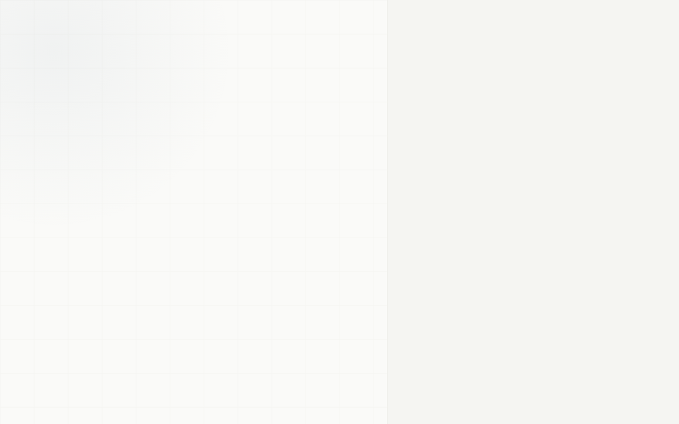

# 装企主题色板与 Web 登录页视觉精修 · 开发验证证据

> 状态：`DEV_VERIFIED_PENDING_USER`  
> 风险级别：L1  
> 变更记录：`CHG-20261029-020-brand-theme-and-login-refinement.md`
> 说明：本报告是开发自测与视觉预检，不替代用户审美验收或小程序真机体验。

## 1. 目标

- 让装企不只选“一个颜色点”，而是能看懂每个推荐主题的浅色、主色、深色和适用业务气质。
- 让 Web 登录页更像家装 ERP 的自有入口：浅中性画布、单一品牌强调色、项目主线、明确登录动作，并加入克制的一次性入场动效。
- 保持 `Company.color` 为唯一主题输入，App/Web 派生规则和业务状态色边界不变。

## 2. 站酷专项学习

本轮在站酷公开页面追加 5 组搜索：`装修ERP`、`家装ERP`、`企业后台登录页`、`SaaS登录页`、`后台系统登录页`。共提取 100 条候选，页面级打开 6 个作品，保留 24 张真实界面图，对 12 张登录页与 5 张 ERP 工作台图做色彩面积分析。

代表参考：

- [PC 登录页 / L小MT](https://www.zcool.com.cn/work/ZNjg4ODE4MjQ=.html)
- [企业后台管理系统登录页合集](https://www.zcool.com.cn/work/ZNTU4NDQ2MDA=.html)
- [B端登录页 / 南昌古天乐](https://www.zcool.com.cn/work/ZNjEyNzUwNTI=.html)
- [PC后台系统登录页 / 熠诚Design](https://www.zcool.com.cn/work/ZNjEyNzgwNzI=.html)
- [ERP项目Web端设计 / 轻智造ERP](https://www.zcool.com.cn/work/ZNjY1NjA0NTI=.html)
- [B端项目 纺织行业ERP](https://www.zcool.com.cn/work/ZNjIwOTA1MDg=.html)

结论：

1. 样本以浅中性/白色内容面为绝对主体，主强调色通常只占 5%–15%。
2. “大气”来自大字号叙事、留白、稳定双栏和单一视觉锚，不来自背景图或 3D。
3. 家装 ERP 更适合用“量房 → 设计 → 报价 → 施工 → 验收”的项目主线建立行业语境；不复制城市照片、户型图和装饰插画。
4. 色板选择必须展示实际使用效果；单色点无法帮助企业判断长期工作台观感。

完整记录见：

- `.agents/skills/zhuangdeqing-ui-craft/references/zcool-research.md` §8
- `.agents/skills/zhuangdeqing-ui-craft/references/visual-learning-loop.md` §17
- `docs/product/domains/enterprise-brand-profile/01f-brand-color-palette-v1.md`

## 3. 推荐企业主题

| 主题 | 基色 | 业务气质 | 白字对比度 |
| --- | --- | --- | ---: |
| 装得清默认 | Web `#2F7D5A` / 小程序 `#16A394` | 平台产品品牌语义 | 各端既有默认 |
| 青瓷 | `#5C7C6E` | 清润克制，适合设计与软装型团队 | 4.60 |
| 松石墨绿 | `#2F6E63` | 稳健耐看，适合综合型装企 | 5.95 |
| 岩蓝 | `#4F708C` | 理性清晰，适合工程与交付管理 | 5.21 |
| 赤陶 | `#A65F46` | 温暖有辨识度，适合住宅整装 | 4.83 |
| 胡桃 | `#7A5540` | 沉静有质感，适合中高端定制 | 6.56 |
| 黛紫 | `#675D7B` | 雅致克制，适合设计主导型团队 | 6.13 |
| 墨灰 | `#3F4B53` | 专业中性，适合工程与财务协同 | 8.96 |

系统只接收基色，浅色背景、边界、悬停、深色强调、焦点环和可读前景均由同一派生算法生成。成功、警告、危险与业务状态色不参与换肤。

## 4. Web 登录页

### 页面意图

- 页面类型：登录入口。
- 目标角色：已入驻装企员工；首次使用员工。
- 第一个问题：这是不是我要进入的系统，账号从哪里进？
- 三秒结论：当前品牌/企业身份清楚，项目主线说明业务范围，右侧只有一个登录主行动。
- 唯一主行动：登录。

### 布局

- 左侧：企业/平台身份、项目从量房开始的叙事、五阶段项目主线。
- 右侧：独立白色登录面，手机号、密码、密码设置提示、登录按钮。
- 1440/1280：左侧大叙事 + 右侧纵向项目轨道。
- 1024：左侧叙事收为上下结构，项目主线改为横向。
- 390：删除重复说明，只保留标题和阶段名，登录按钮完整进入首屏。

## 5. 真实渲染证据

| 场景 | 文件 | 结果 |
| --- | --- | --- |
| 首次使用 1440×900 | `screenshots/login-platform-1440.png` | 官方 Logo、默认品牌色、项目主线、登录表单 |
| 企业品牌 1440×900 | `screenshots/round2-login-enterprise-1440.png` | 岩蓝企业主题；无横向溢出 |
| 企业品牌 1280×800 | `screenshots/round2-login-enterprise-1280.png` | 无横向溢出 |
| 企业品牌 1024×768 | `screenshots/round2-login-enterprise-1024.png` | 横向项目主线，无横向溢出 |
| 企业品牌 390×844 | `screenshots/round2-login-enterprise-390.png` | 登录按钮底部 711px，首屏内完整可见 |
| 主题选择器 1440 | `screenshots/account-brand-edit-1440.png` | 8 个完整主题选项，两列，色阶 + 业务气质 |
| 主题选择器 1024/390 | `screenshots/account-brand-edit-1024.png`、`account-brand-edit-390.png` | 无横向溢出；390 单列 |

DOM/运行时证据：

- `login-round2-evidence.json`：4 档视口尺寸、卡片/主线/按钮坐标和 root 品牌变量。
- `account-brand-editor-evidence.json`：8 个主题选项的文案、尺寸、编辑区位置和溢出。
- `account-brand-responsive-evidence.json`：1024/390 主题选项网格和溢出。
- `login-palette-evidence.json`：默认、青瓷、岩蓝、赤陶、胡桃在 root Token、Element Plus、按钮、企业标识上的同步结果。

## 6. 登录页动效设计

参考 `产品运维/登录页UI升级方案/装企品牌版.html` 后，只吸收有业务含义的动效：

- 企业 Logo/首字轻微落位，表达“系统认出企业”；
- 主标题与说明依次上升，建立阅读顺序；
- 项目主线从起点绘制，五个阶段依次落位；
- 表单卡片随后稳定出现，首屏操作不被长时间遮挡；
- 输入框只保留 hover/focus，按钮保留 active 按压反馈。



明确未采纳：

- 参考稿的 16 秒无限巡游光点：循环装饰会持续抢占登录注意力；
- 鼠标跟随柔光：不是业务状态反馈，触屏不可用且增加分心；
- 深色大面积品牌底、装饰水印和英文 eyebrow：与此前确认的浅中性登录方向冲突。

动效时序：

| 阶段 | 时间 | 内容 |
| --- | ---: | --- |
| 入场 | 0–520ms | 企业标识、标题、表单卡片开始落位 |
| 主线 | 110–630ms | 项目主线绘制 |
| 阶段 | 160–680ms | 五个阶段依次落位 |
| 稳定 | 680ms 后 | 页面完全静止，不再循环 |

减少动态效果：

- `prefers-reduced-motion: reduce` 下登录页动画数量为 0；
- 企业标识与表单直接可见；
- 项目主线显示为完整静态线。

证据：

- `motion/login-motion-sequence.gif`
- `motion/motion-evidence.json`
- `motion/motion-final-1440.png`、`motion-final-1280.png`、`motion-final-1024.png`、`motion-final-390.png`
- `motion/motion-reduced-1440.png`

## 7. 两轮视觉批判

视觉模型：`qwen2.5vl:7b`，仅作预检。

### 第一轮问题 → 修正

| 问题 | 修正 |
| --- | --- |
| 390 同时显示项目主线标签、流程说明、五阶段名称与阶段说明，登录任务不够集中 | 移动端隐藏重复的“项目主线”标签和说明句，保留标题和五阶段名称 |
| 首轮登录卡与项目主线的视觉重心偏高，移动端按钮接近首屏底部 | 第二轮卡片顶部从 346px 上移到 283px，主按钮从 727px 上移到 663px |
| 视觉模型建议增加图标、状态标签、辅助色和圆形按钮 | 拒绝；这些会增加登录页装饰噪音并削弱唯一主行动 |

### 第二轮复核

- 1440：文字层级、留白、无卡片墙、无英文 eyebrow、无 2.5D/3D。
- 390：登录输入区成为主要视觉重心，项目主线作为低干扰业务语境。
- 主题编辑页：品牌色块与完整色阶可识别，无表格或嵌套卡片噪音。
- 未采纳视觉模型关于“增加密码强度提示、忘记密码链接、圆形按钮”的建议：这些会改变登录信息架构或引入未确认的恢复路径。

## 8. 验证命令

Web：

```text
npm run check:client-copy      PASS
npm run check:brand-theme      PASS
npm run type-check             PASS
npm run build                  PASS
```

App：

```text
npm run check:company-brand    PASS
npm run check:client-copy      PASS
npm run check:ui               PASS
npm run type-check             PASS
npm run build:mp-weixin        PASS
```

真实渲染使用本地 Vite 页面；企业信息主题编辑页使用临时 mock Provider 仅返回公开页面所需测试身份，未修改数据库、未调用真实写接口。

## 9. 未闭环

- 待用户确认色板取舍与登录页视觉方向。
- 小程序/App H5 本轮完成代码契约和构建，未做真机视觉截图；不能宣称真机体验通过。
- 未发布生产。
