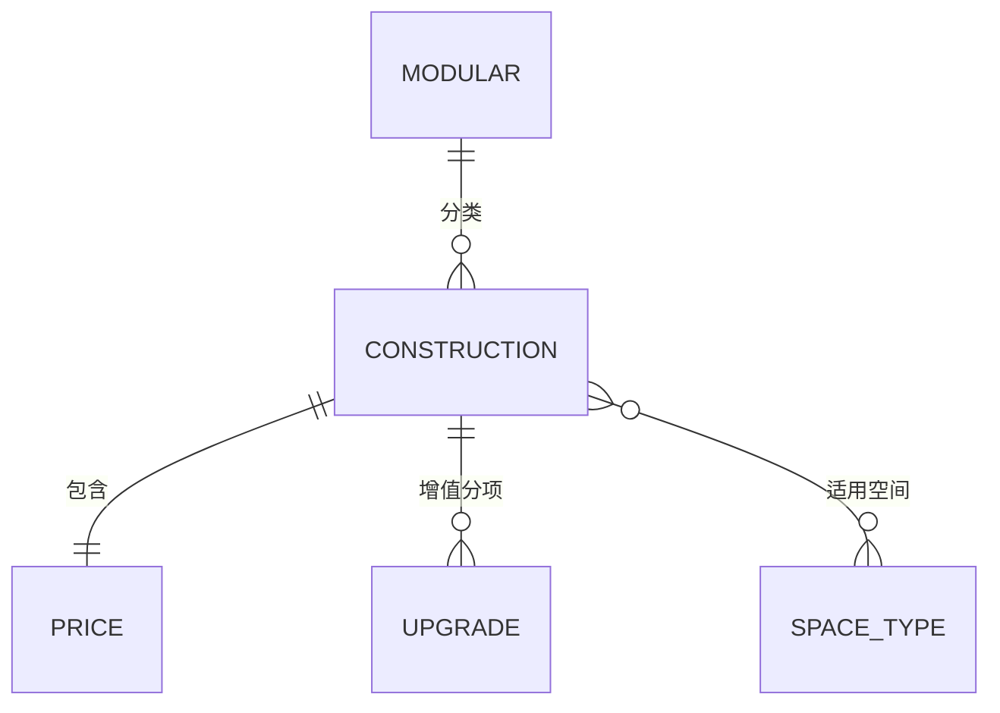

# 工程工艺域设计说明

> 对应代码：`com.th4.edge.decoboon.bim.construct`、`...bim.cost`  
> 对应数据表：`bim_construct_modular`、`bim_construct_construction` 及其 ElementCollection 表  
> 租户约束：`Modular`、`Construction` 均包含 `Company company` 企业归属

## 1. 领域定位

工程工艺域定义“家装施工可以做什么、按什么规则计价、适用哪些空间”。它是报价、施工任务、验收标准和材料计划的共同源头。

该域不是单个项目的施工事实，而是企业/平台级工艺标准。项目中的 `ProjectTask` 才表示某项目实际要执行的施工项。

## 2. 核心模型

### Modular 工程分类

- 表：`bim_construct_modular`
- 主键：`modId`
- 字段：`name`、`title`、`icon`、`priority`
- 集合：`criterions`、`tips`
- 含义：拆除、水电、瓦工、木工、油漆等大类。

### Construction 施工项

- 表：`bim_construct_construction`
- 主键：`constId`
- 关联：`modular → Modular`
- 字段：`code`、`name`、`unit`、`priceType`、`price`
- 子集合：`upgrades`、`spaceTypes`、`criterions`、`tips`、`images`

### Price 工程价格

`Price` 是值对象，包含：

- `material`：材料基价
- `manual`：人工基价
- `total`：总包基价
- `cost`：成本价

### Upgrade 增值分项

增值分项保存名称、价格、成本、单位、计量方法、计价方式和增值类型：

- `Inherit`：延续原施工项计量
- `Anew`：重新计量
- `UnitPrice`：单位计价
- `TotalPrice`：总价计价
- `Addition`：增项
- `Optional`：选项

## 3. 计价逻辑

`PriceContext` 负责统一计算：

```text
Part：数量 × (材料基价 + 人工基价)
Total：数量 × 总包基价
Cost：数量 × 成本价
```

设计约束：

- 计价只接受 `Price`、`PriceType`、`BigDecimal measure`。
- 金额使用 `BigDecimal`。
- 计价上下文不修改实体，只返回计算结果。
- Provider 只负责编排参数、查询主数据和保存业务实体。

## 4. 数据关系



## 5. Provider 规划

| 路由 | 能力 | 说明 |
| --- | --- | --- |
| `bim/modular/page` | 分页 | 工程分类分页 |
| `bim/modular/list` | 列表 | 分类选择列表 |
| `bim/construction/page` | 分页 | 施工项分页 |
| `bim/construction/info` | 详情 | 工艺、价格、增值项详情 |
| `bim/construction/save` | 保存 | 新增施工项 |
| `bim/construction/update` | 更新 | 更新施工项 |

## 6. 序列化与权限

- 面向客户和普通报价页面时，隐藏 `Price.cost`、`Upgrade.cost`。
- 面向 Boss、财务、成本管理角色时才允许返回成本字段。
- 工艺主数据属于纯企业级数据，不虚构 `owner`；查询仍必须强制 `Company`，不能错误套用 `Self` 范围。
- 成本字段的功能可见性由 Provider 使用 `@ServiceProperties` 控制，不能替代企业隔离。
- 不修改实体字段为 `@JsonIgnore`。

## 7. 同步映射

| saas 表 | 本系统表 | 说明 |
| --- | --- | --- |
| `bim_construct_modular` | `bim_construct_modular` | 原表同步 |
| `bim_construct_modular_criterions` | 同名 | 工艺说明 |
| `bim_construct_modular_tips` | 同名 | 报价说明 |
| `bim_construct_construction` | 同名 | 施工项 |
| `bim_construct_construction_criterions` | 同名 | 标准说明 |
| `bim_construct_construction_upgrades` | 同名 | 增值项 |
| `bim_construct_construction_space_types` | 同名 | 适用空间 |
| `bim_construct_construction_tips` | 同名 | 报价提示 |
| `bim_construct_construction_images` | 同名 | 工艺图片 |
