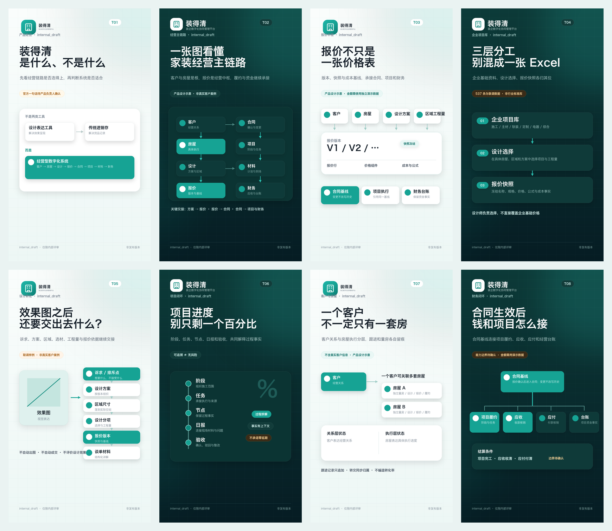
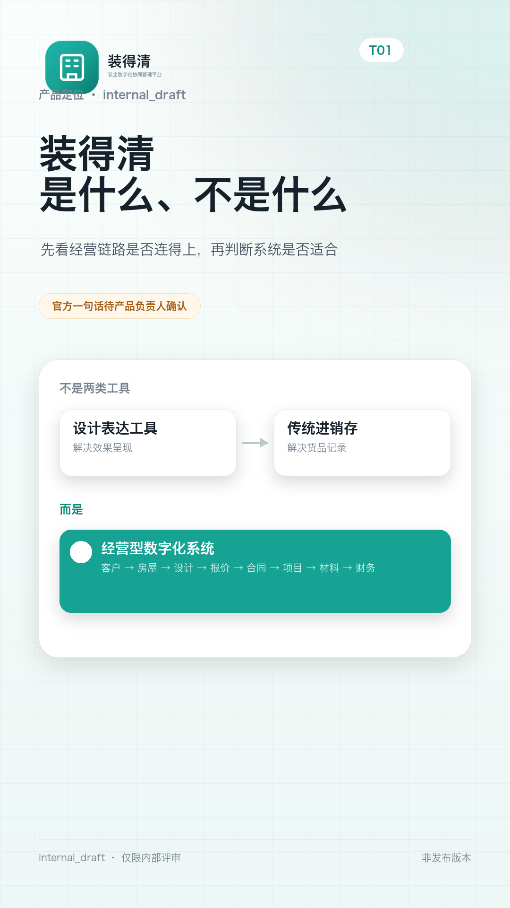
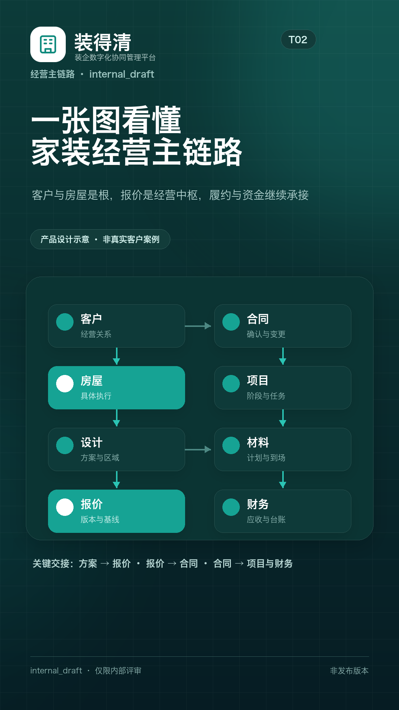
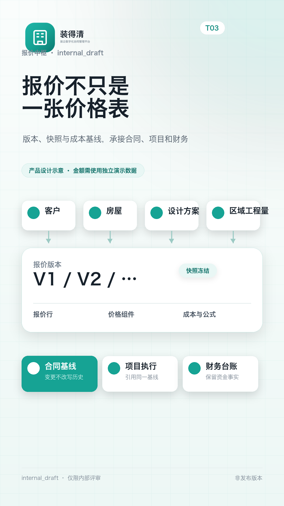
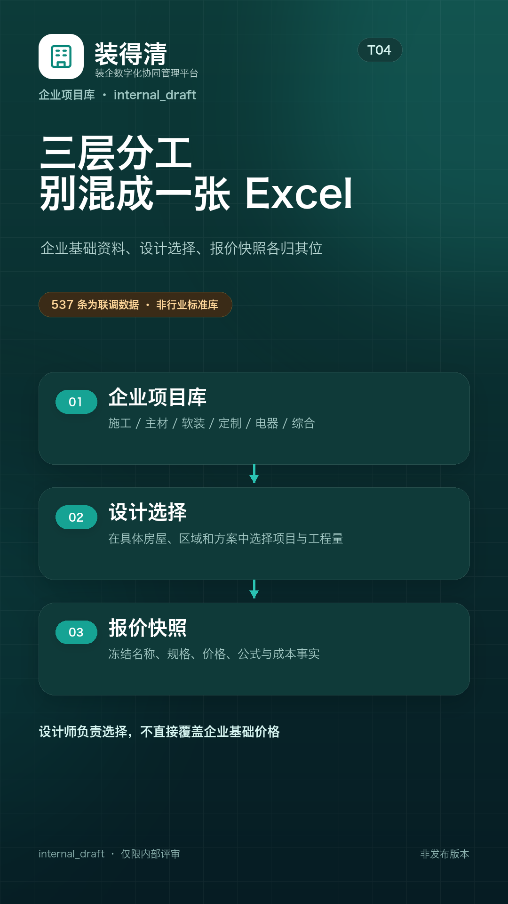
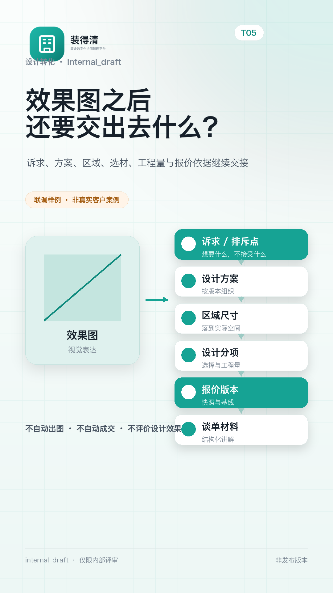
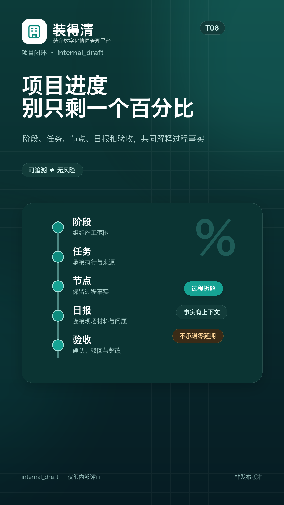
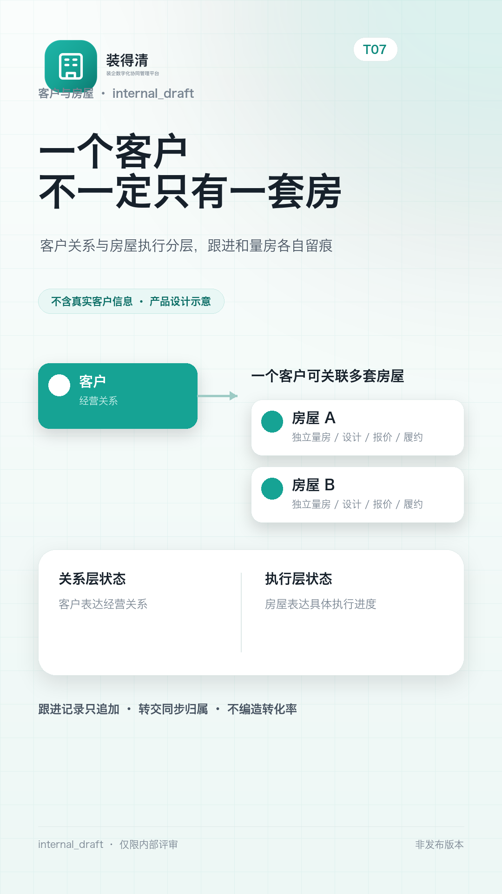
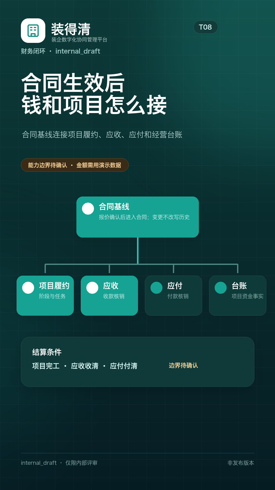

# 装得清上线前首批视觉方案

> 请求编号：`REQ-20260915-DESIGN-BATCH1`  
> 责任 lane：design  
> 输入依据：`docs/marketing/scripts/装得清上线前首批内容脚本.md`、`docs/marketing/material/装得清上线前素材盘点.md`、`docs/marketing/material/素材索引.md`  
> 文档定位：T01-T08 的首批内部封面构图、分镜和视觉执行草案，不是对外发布成稿。  
> 统一状态：`internal_draft`  
> 对外使用门槛：产品负责人确认定位与能力边界；营销负责人确认渠道、标题和 CTA；material lane 完成截图、PPT、照片、字体、音乐和 Logo 的授权/脱敏核验；设计按当前版本素材完成替换与复核。

## 0. 交付结论

- 已完成 8 张 9:16 封面构图稿，编号覆盖 T01-T08，均为 `internal_draft`。
- 已完成 T01-T08 共 60 个镜头的分镜草案，每个选题 7-8 个镜头。
- 已定义品牌色、Logo 使用、字体、网格、封面层级、演示数据角标和移动端安全区。
- 已列出正式制作前必须补齐的素材、授权和产品边界。
- 本方案不使用外部照片、外部插图、未授权字体、音乐或不明版权模板。
- 本方案中的界面示意、关系图和数据角标只用于内部评审，不代表已上线能力或真实客户结果。

## 1. 使用原则与边界

### 1.1 优先复用

1. 品牌标识优先使用 `th4-decoboon-app/logo-export/` 中的 SVG 或 `@2x.png`。
2. 关系图、流程图和封面卡片使用本方案定义的统一图形语言，避免每个选题各画一套。
3. 当前版本界面如已具备独立演示环境和脱敏数据，再替换封面中的结构示意和字幕画面。
4. 正式制作时，界面截图和录屏统一从演示企业重新录制，不使用旧 PPT 或联调长图直接投放。

### 1.2 证据与状态

| 标记 | 本方案用法 |
| --- | --- |
| `F` | 品牌 Logo、颜色 Token、当前工程文件等确定存在的文件事实 |
| `P` | 产品白皮书、业务设计和 T01-T08 脚本中的产品设计说明 |
| `D` | 联调、演示或样例数据；画面必须持续标识“演示数据”或“联调样例” |
| `PENDING` | 正式数据、授权、上线状态或 CTA 未确认，只能使用占位方案 |
| `INTERNAL` | 当前封面、分镜和模板仅限内部评审，不进入发布排期 |

### 1.3 禁止事项

- 不把联调客户、演示企业、PPT 截图或样例金额伪装成真实案例。
- 不新增未经脚本确认的数字、客户反馈、ROI、成交率、回款率或功能承诺。
- 不使用竞品 Logo、排名、收益曲线或行业标准库表述。
- 不把支付、退款、开票、对账、自动续费和完整安全能力写成已完成。
- 不展示真实客户姓名、手机号、地址、小区、合同、成本、流水、供应商价格或现场人像。
- 不在授权确认前使用外部字体、音乐、模板、图片、工地视频或第三方图标库。
- 不用“零延期”“无返工”“绝对安全”“保证增长”等绝对化表达。

## 2. 视觉资产盘点

### 2.1 可直接作为内部制作基础的资产

| 资产 | 路径/规格 | 当前用途 | 状态 |
| --- | --- | --- | --- |
| 彩色横版 Logo | `th4-decoboon-app/logo-export/logo-horizontal-color.svg` | 浅色底品牌署名 | `F`，优先 SVG |
| 彩色横版 Logo 位图 | `th4-decoboon-app/logo-export/logo-horizontal-color@2x.png` | 内部封面、文档 | `F`，位图备用 |
| 黑色横版 Logo | `th4-decoboon-app/logo-export/logo-horizontal-black.svg` | 黑白或低干扰页面 | `F`，优先 SVG |
| 彩色图形标 | `th4-decoboon-app/logo-export/logo-mark-color.svg` | 头像、角标、浅色底 | `F`，优先 SVG |
| 白色图形标 | `th4-decoboon-app/logo-export/logo-mark-white.svg` | 深色底、视频角标 | `F`，使用前复核反白效果 |
| 品牌主色 | `#16A394` | 主操作、关键节点、品牌强调 | `F`，与 App 视觉 Token 一致 |
| 品牌渐变 | `#1FB5A8 → #16A394 → #0B786F` | Logo 基底、封面强调、关键进度 | `F`，正式物料需统一角度 |
| 视觉规范源 | `th4-decoboon-app/docs/03-视觉与设计规范.md` | 颜色、字体、间距、圆角、层级参考 | `F`，用于小程序，不等于宣传物料规范 |

### 2.2 只能作为内部演示参考的资产

| 资产 | 数量/路径 | 可用范围 | 发布前必须处理 |
| --- | --- | --- | --- |
| 设计转化截图 | `data/design/screenshots/` 9 张 | 内部评审、构图占位 | 核验当前版本、授权、客户信息和金额脱敏 |
| 谈单 PPT | 两套联调客户 PPT | 内部理解页面结构 | 不使用客户名、小区、报价和材料品牌 |
| 项目库联调数据 | 537 条 | 说明联调结构和演示规模 | 固定标注“联调数据、非行业标准库” |
| 样本报价 | 118㎡、两套方案、七区域、每套 74 个分项 | 内部流程说明 | 固定标注“联调样例、非真实客户案例” |
| 泛家装短视频 | `data/media` | 素材检索和风格参考 | 不作为装得清产品宣传片；不得直接复用 |

### 2.3 当前确认缺失的视觉输入

- Logo 最小尺寸、安全区、错误用法和授权文件。
- 商业发布字体授权。
- 独立演示企业、演示客户、演示项目及可重置数据。
- 当前版本的无数据、成功态、错误态和关键流程截图。
- 当前版本产品操作录屏。
- 可用的人物、工地、真实项目或客户素材及其肖像/场地授权。
- 音乐、音效、模板和第三方图标的商用授权台账。
- CTA 落地页、客服入口和渠道规格。

## 3. 统一视觉规范

### 3.1 品牌色与语义色

| 角色 | 色值 | 使用规则 |
| --- | --- | --- |
| 品牌主色 | `#16A394` | 关键节点、主行动、高亮状态；同一画面只保留一个主强调 |
| 品牌亮色 | `#2BC4B4` | 连线、渐变亮端、局部光感 |
| 品牌深色 | `#0E8A7D` | 次级强调、链接、浅底文字 |
| 品牌最深色 | `#096C64` | 深色文字、边界标签 |
| 深背景 | `#082B2B` | 信息关系图、财务和主链路封面 |
| 深背景卡片 | `#0E3A39` | 深色画布中的模块和节点 |
| 页面底色 | `#F4FAF9` | 浅色封面、图文页背景 |
| 主文字 | `#17212B` | 浅底标题和关键信息 |
| 次文字 | `#465260` | 副标题和说明 |
| 辅助文字 | `#778390` | 备注、来源和状态说明 |
| 资源提醒 | `#E67E22` | “待确认”“演示数据”“需授权” |
| 设计相关 | `#6958C8` | 设计方案、设计角色；不是品牌主色 |

禁止规则：

- 不使用品牌色之外的高饱和颜色作为大标题背景。
- 不把 `#E67E22` 用作普通装饰，它只表达提醒或待确认。
- 不用颜色单独表达权限、结果或状态，必须同时有文字。
- 同一画面最多出现一个全宽主渐变区域。

### 3.2 Logo 使用

正式规则待品牌负责人补充，本方案内部执行临时约束：

- 浅色底优先使用 `logo-horizontal-color.svg`；深色底使用官方白色图形标加标准字，等待白色横版正式文件。
- 封面 Logo 建议放在左上或页脚，宽度按画布宽度控制在 18%-30%。
- 图形标最小显示高度：9:16 封面不低于 `72px`；正文图标不低于 `32px`。
- 横向 Logo 最小显示宽度：9:16 封面不低于 `260px`；图文正文不低于 `180px`。
- Logo 四周保留不小于图形标高度 `25%` 的净空，不与网格线、边框或字幕接触。
- 不拉伸、不旋转、不描边、不改变渐变方向、不替换标准字颜色。
- 不用 Logo 直接覆盖人物面部、金额、二维码或关键数据。
- Logo 授权、商标状态和最小尺寸确认前，正式投放文件统一标记 `PENDING-LOGO-USE`。

### 3.3 字体

| 层级 | 内部草案字体 | 建议字号（1080×1920） | 正式发布要求 |
| --- | --- | --- | --- |
| 封面主标题 | 苹方 / 冬青黑体类粗体 | 72-88px，最多两行 | 必须确认商用授权 |
| 封面副标题 | 苹方 / 冬青黑体类常规体 | 28-34px，最多两行 | 必须确认商用授权 |
| 模块标题 | 苹方 / 冬青黑体类粗体 | 30-42px | 必须确认商用授权 |
| 正文/字幕 | 苹方 / 冬青黑体类常规体 | 24-30px | 必须确认商用授权 |
| 角标/来源 | 苹方 / 冬青黑体类常规体 | 20-24px | 必须确认商用授权 |
| 数字 | 与正文同族的中黑字重 | 36-64px | 若引入展示字体，单独记录授权 |

字体规则：

- 正式发布前不得把系统字体栈直接视为商用授权依据。
- 建议优先选择可商用的开源中文字体，但必须先下载许可文本、保留版本号和授权记录。
- 一条视频最多使用两种字重；不要混用多种中文字体。
- 标题不用全大写英文，不使用描边字、霓虹字或过度阴影。

### 3.4 画布、网格与移动端安全区

#### 9:16 短视频封面/画面

- 主画布：`1080 × 1920px`。
- 安全边距：左右各 `88px`，顶部 `72px`，底部 `72px`。
- 标题区：Y `240-620px`，最多两行。
- 主视觉区：Y `680-1500px`。
- 底部品牌/状态区：Y `1760-1860px`。
- 右侧 UI 避让区：最右 `160px` 不放关键文字或 Logo。
- 底部操作避让区：最下 `320px` 不放字幕重点和 CTA。
- 12 列网格：内容宽 `904px`，列宽 `56px`，槽宽 `16px`。
- 8px 基准间距：优先使用 `16 / 24 / 32 / 40 / 48 / 64 / 88px`。

#### 4:5 图文封面

- 主画布：`1080 × 1350px`。
- 左右安全边距：`72px`。
- 标题区高度不超过 `330px`。
- 图文平台裁切适配时，核心标题保持在中央 `1080 × 1080px` 范围内。

#### 16:9 视频/演示

- 主画布：`1920 × 1080px`。
- 左侧内容区宽度 `640-760px`，右侧主视觉区宽度 `780-920px`。
- 字幕底部上沿不低于 `884px`，避免和平台控件重叠。
- 品牌页脚固定在左侧 `88px`、底部 `64px` 基线。

### 3.5 封面层级

每张封面只承担一个识别任务，视觉层级固定为：

1. 主题标签：选题编号、产品定位或业务分类。
2. 主标题：一句用户能读懂的矛盾或结论，最多两行。
3. 副标题：解释产品如何组织业务，不写效果承诺。
4. 主视觉：关系图、对象链、版本卡或结构图。
5. 边界角标：`产品设计示意`、`演示数据`、`联调样例`、`边界待确认` 中的适用项。
6. 品牌标识：Logo 或图形标 + 标准字。
7. 状态：`internal_draft · 仅限内部评审`。

主标题禁止：

- 用“最强、第一、绝对、保证、零风险、必涨”等绝对化词。
- 把产品设计写成真实客户已验证。
- 用“全链路闭环已完成”“行业标准库”等超出证据的结论。
- 用数字结果替代机制说明。

### 3.6 演示数据与边界角标

| 角标 | 使用场景 | 固定形式 |
| --- | --- | --- |
| `内部设计草案` | 当前封面、分镜和内部评审文件 | 左上或底部状态区 |
| `产品设计示意` | 使用产品设计关系图，但没有当前版本界面证据 | 主视觉上方或右下角 |
| `演示数据` | 演示企业、演示金额、演示任务和示例状态 | 画面持续可见，不得只在开头出现 |
| `联调样例` | 537 条项目库、118㎡、两套方案等联调数据 | 紧邻数据或画面右上角 |
| `非真实客户案例` | 任何包含演示流程、样例项目的画面 | 与“联调样例”同时出现 |
| `能力边界待确认` | 支付、退款、开票、对账、自动续费和结算 | 画面底部或字段旁 |
| `CTA 入口待确认` | CTA 未上线或未指定承接页 | CTA 卡片内，不得直接显示失效链接 |

角标样式：

- 深色底：`#3A2B17` 底 + `#FFD79A` 字；品牌状态：`#123C3A` 底 + `#D7F5F1` 字。
- 浅色底：`#E9F7F5` 底 + `#096C64` 字；提醒：`#FFF4E8` 底 + `#A35C11` 字。
- 字号不低于画布高度的 `1.1%`，建议 `20-24px`。
- 角标不得只靠颜色区分，必须包含完整词语。

### 3.7 图形语言

- 对象节点：白色卡片或深色卡片，圆角 `24px`。
- 当前重点对象：品牌色实底，只突出一个节点。
- 对象关系：实线箭头表示明确承接；虚线表示“未来可选”“待确认”或“非自动生成”。
- 版本/快照：使用双层卡片和锁扣图形，不使用真实金额。
- 状态：文字 + 小圆点或线框标签，不单独使用红黄绿颜色。
- 演示截图：画面内固定叠加 `演示数据`；旧版截图只可作为内部线框参考，不直接进入封面。
- 数据数字：只使用脚本和素材盘点已登记的数字；联调数字必须带边界角标。

### 3.8 动画与转场

- 对象进入：`180-240ms` 淡入 + 8px 上移，避免连续弹跳。
- 连线出现：从左到右或从上到下绘制，`240-360ms`。
- 版本冻结：旧版本轻微降饱和，新版本从旁侧滑入，`240ms`。
- 分叉关系：主线先完成，再依次出现支线，间隔 `60-100ms`。
- 状态变化：先显示文字，再改变节点色，避免颜色先于语义。
- 转场：优先使用遮罩擦除、卡片推进和对象位移；不使用炫光、爆炸、闪烁和强音效。
- 字幕：每屏不超过两行，每行不超过 14 个中文字符；边界词不得为了时长删除。

## 4. T01-T08 封面草案

### 4.1 封面总览

### 4.2 封面清单

| 编号 | 文件 | 主标题 | 副标题/边界 | 主视觉 | 状态 |
| --- | --- | --- | --- | --- | --- |
| T01 | `covers/T01-cover-draft.png` | 装得清是什么、不是什么 | 先看经营链路是否连得上；官方一句话待确认 | 不是设计表达/进销存，而是经营型数字化系统 | `internal_draft` |
| T02 | `covers/T02-cover-draft.png` | 一张图看懂家装经营主链路 | 客户与房屋是根，报价是经营中枢 | 八对象双列主链路，突出房屋和报价 | `internal_draft` |
| T03 | `covers/T03-cover-draft.png` | 报价不只是一张价格表 | 版本、快照与成本基线 | 来源 → 报价版本 → 合同/项目/财务 | `internal_draft` |
| T04 | `covers/T04-cover-draft.png` | 三层分工，别混成一张 Excel | 企业基础资料、设计选择、报价快照 | 三层抽屉和四层驱动链 | `internal_draft` |
| T05 | `covers/T05-cover-draft.png` | 效果图之后，还要交出去什么？ | 诉求、方案、区域、选材、工程量与报价依据 | 效果图转向六段设计转化链 | `internal_draft` |
| T06 | `covers/T06-cover-draft.png` | 项目进度，别只剩一个百分比 | 阶段、任务、节点、日报和验收 | 阶段时间轴 + 过程拆解 | `internal_draft` |
| T07 | `covers/T07-cover-draft.png` | 一个客户，不一定只有一套房 | 客户关系与房屋执行分层 | 一客户多房屋、双状态轴 | `internal_draft` |
| T08 | `covers/T08-cover-draft.png` | 合同生效后，钱和项目怎么接 | 合同基线连接履约、应收、应付和台账 | 合同向下四路分叉，边界待确认 | `internal_draft` |

### 4.3 单张封面预览

| T01 | T02 |
| --- | --- |
|  |  |

| T03 | T04 |
| --- | --- |
|  |  |

| T05 | T06 |
| --- | --- |
|  |  |

| T07 | T08 |
| --- | --- |
|  |  |

### 4.4 封面替换规则

- 当前封面中的界面元素均为几何构图和对象关系，不包含真实界面截图。
- 正式制作时，先替换主视觉，再调整标题断行；不得为了塞入截图缩小安全边距。
- Logo、字体和演示数据角标是固定层，不能被截图、字幕或动画覆盖。
- 如果 CTA 未确认，封面不显示按钮形态或入口文字，只保留底部品牌区。

## 5. T01-T08 分镜

### 5.1 T01 装得清是什么、不是什么

| 镜头 | 时长 | 画面 | 字幕重点 | 素材来源 | 动画/转场 | 风险/禁区 |
| --- | ---: | --- | --- | --- | --- | --- |
| T01-01 | 0-5s | 报价表、合同、项目群、材料单四张卡片分散出现，背景是空置主链路 | 报价、合同、项目、材料还在各走各的吗？ | `P`：T01 脚本；几何卡片占位 | 四卡错位淡入，最后收拢到中央轴线 | 不使用真实表格、客户名和金额 |
| T01-02 | 5-14s | 官方 Logo 出现，两张工具类型卡从两侧掠过并退场 | 不是设计表达工具；不是只做进销存的传统 ERP | `F`：Logo；`P`：定位边界 | 类型卡擦除退场，Logo 轻微上浮 | 不出现竞品 Logo、排名和比较结论 |
| T01-03 | 14-24s | 客户、房屋、设计、报价、合同、项目、材料、财务八个节点连接成主线 | 同一业务主线上组织经营信息 | `P`：产品设计和业务链 | 连线从左到右绘制，报价节点延迟高亮 | 不能暗示全部环节已在真实客户环境验证 |
| T01-04 | 24-36s | 报价版本卡展开为报价行、成本、变更基线三个标签 | 报价版本、明细、成本与变更基线 | `P/F`：报价领域设计；内部结构图 | 卡片展开，锁扣闭合表示版本冻结 | 不显示成本口径、金额和收益曲线 |
| T01-05 | 36-47s | 设计师、项目经理、财务、老板角色卡围绕客户/房屋/项目节点 | 不同岗位围绕同一对象协作 | `P`：受众与角色设计；`PENDING`：角色画面 | 角色卡环形排列，对象保持中心 | 不使用真实员工、头像和权限承诺 |
| T01-06 | 47-58s | 品牌页 + CTA 占位卡 + 产品边界提示 | 先确认业务链是否匹配，再看产品能力 | `F`：Logo；`PENDING`：CTA 入口 | 页面收束，CTA 用虚线框表示待确认 | 不显示失效链接、价格和版本权益 |
| T01-07 | 58-60s | 尾帧：`内部设计草案 · 官方一句话待确认` | 官方一句话待产品负责人确认 | `INTERNAL`：本方案 | 尾帧静态，不添加额外承诺 | 不把草案标记为 approved 或 ready_for_publish |

### 5.2 T02 一张图看懂家装经营主链路

| 镜头 | 时长 | 画面 | 字幕重点 | 素材来源 | 动画/转场 | 风险/禁区 |
| --- | ---: | --- | --- | --- | --- | --- |
| T02-01 | 0-7s | 八个对象散落，随后汇成一条主线 | 先看业务链能不能接住 | `P`：T02 脚本和主链设计 | 散落节点磁吸到轴线 | 不堆菜单图标和功能数量 |
| T02-02 | 7-16s | 一个客户节点连接两套房屋，房屋各自展开支线 | 客户≠房屋；每套房独立量房、设计、报价和履约 | `P`：客户/房屋双根设计 | 客户不动，小房屋节点从右展开 | 不显示真实姓名、地址、小区、手机号 |
| T02-03 | 16-27s | 量房 → 诉求 → 方案 → 区域/分项 → 报价按顺序点亮 | 方案和工程量形成报价来源 | `P/F`：设计转化和报价设计；结构图 | 卡片依次推进，报价节点合成 | 不出现自动出图或自动报价结论 |
| T02-04 | 27-38s | 报价版本进入合同基线，变更单从旁路接入 | 客户确认后才进入合同基线；调整走变更 | `P`：报价与合同设计 | 主版本锁住，变更线以虚线接入 | 不显示真实合同金额和客户签署信息 |
| T02-05 | 38-50s | 合同向下分叉为项目、材料计划、应收计划 | 合同生效后，履约计划按基线展开 | `P`：合同到项目/材料/应收设计 | 三条支线依次绘制 | 不写成签约后自动完成全部运营动作 |
| T02-06 | 50-63s | 项目、材料、财务三类事实卡回到同一项目节点 | 引用同一项目，不各建一套台账 | `P/F`：项目、材料、财务闭环设计 | 三卡回收到项目中心，显示“产品设计示意” | 不添加经营成果数字和审计结果承诺 |
| T02-07 | 63-73s | 主链总览 + CTA 占位 | 预约产品演示；入口待确认 | `PENDING`：CTA 和演示环境 | 总览缩放，CTA 虚框浮现 | 不发布失效入口，不把链路图称为已验证结果 |

### 5.3 T03 为什么装得清把报价放在经营中枢

| 镜头 | 时长 | 画面 | 字幕重点 | 素材来源 | 动画/转场 | 风险/禁区 |
| --- | ---: | --- | --- | --- | --- | --- |
| T03-01 | 0-6s | 多张不同版本报价卡叠放，历史依据模糊 | 报价最后改乱了，前面的依据也找不到了 | `P`：T03 脚本；无真实表格 | 卡片逐层错位，旧版本降饱和 | 不使用旧版长图、客户报价或真实成本 |
| T03-02 | 6-16s | 客户、房屋、设计方案、区域、工程量依次连向报价卡 | 报价承接每一套房、方案和区域工程量 | `P`：报价来源设计 | 连线从左向右依次出现 | 不暗示所有数据都自动完整 |
| T03-03 | 16-29s | 一个报价版本被锁住，新版本从旧版本一侧生成 | 历史版本不被悄悄改写；调整进入新版本 | `P/F`：版本和快照设计 | 锁扣闭合，V2 从 V1 侧滑出 | 不使用真实版本号、金额和供应商价 |
| T03-04 | 29-36s | 报价按空间切分：主卧、客餐厅、厨房、卫生间 | 区域视图帮助客户理解钱花在哪里 | `P`：区域报价设计 | 卡片切分为四个空间标签 | 不展示实际尺寸、地址和报价金额 |
| T03-05 | 36-43s | 同一报价按施工分类汇总，连接项目经理执行卡 | 施工分类视图服务执行组织 | `P`：双视图设计 | 视图切换，分类标签逐项点亮 | 不把视图切换写成项目结果改善 |
| T03-06 | 43-56s | 总价展开为报价行、价格组件、成本和公式 | 金额不是孤立总表，要说明由什么构成 | `P`：报价模型；“演示数据”角标 | 总卡展开为中心节点和组件节点 | 不泄露成本口径、利润和供应商价 |
| T03-07 | 56-69s | 报价版本 → 合同基线；变更单连接项目、材料、应收 | 报价快照进入合同基线；变更不改写历史 | `P`：合同基线和变更设计 | 版本卡滑动锁入合同，变更虚线绕行 | 不使用真实合同、客户和金额 |
| T03-08 | 69-78s | 品牌页 + “报价即预算”产品设计说明 + CTA 占位 | 先组织报价依据，再承接后续管理 | `P/F`：产品设计；`PENDING`：CTA | 节点回到报价中枢总览 | 不写毛利提升、绝对不漏项和项目盈亏结论 |

### 5.4 T04 企业项目库如何沉淀报价和施工经验

| 镜头 | 时长 | 画面 | 字幕重点 | 素材来源 | 动画/转场 | 风险/禁区 |
| --- | ---: | --- | --- | --- | --- | --- |
| T04-01 | 0-6s | 两张格式不同的报价卡并列 | 不同设计师口径不一致，问题往往在基础资料入口 | `P`：T04 脚本；结构占位 | 卡片对照，差异字段高亮 | 不展示真实企业报价和材料品牌 |
| T04-02 | 6-17s | 六类目录卡汇入“企业项目库” | 施工、主材、软装、定制、电器、综合由企业维护 | `P/F`：Catalog 设计 | 六卡向中心汇聚，图标保持线性 | 不写行业标准库或六类目录已完整 |
| T04-03 | 17-29s | 设计师在区域中选择项目、工程量，形成设计分项 | 设计师负责选品与设计决策，不覆盖基础价格 | `P`：设计分项和权限设计 | 区域卡展开，项目和工程量依次填入 | 不使用真实设计师姓名、企业价格 |
| T04-04 | 29-42s | 设计分项复制为报价行快照，目录变化箭头被断开 | 名称、规格、价格、公式和成本形成报价行快照 | `P/F`：CatalogItem → QuoteLine 设计 | 快照卡冻结，外部更新线变灰 | 不展示供应商价、成本明细和品牌价格 |
| T04-05 | 42-55s | 企业项目库、设计选择、报价快照三层点亮 | 三层各管一件事 | `P`：三层模型 | 三层从上向下依次点亮 | 不把“沉淀经验”引申为人员流动结果 |
| T04-06 | 55-68s | 联调数据卡显示 537，并固定在画面上方 | 537 条为联调数据，非行业标准库 | `D`：素材盘点；`P`：脚本边界 | 数字卡进入，边界角标同步出现 | 不把 537 写成行业标准、真实客户数据或案例量 |
| T04-07 | 68-78s | 企业项目库结构总览 + CTA 占位 | 预约企业项目库演示；入口待确认 | `PENDING`：演示环境和 CTA | 总览缩放，CTA 虚框浮现 | 不宣称软装、电器等六类数据完整覆盖 |

### 5.5 T05 设计转化不只做到效果图

| 镜头 | 时长 | 画面 | 字幕重点 | 素材来源 | 动画/转场 | 风险/禁区 |
| --- | ---: | --- | --- | --- | --- | --- |
| T05-01 | 0-7s | 效果图卡向右滑出，露出诉求、方案、区域、选材、工程量、报价卡 | 效果图之后，真正需要交出去的是什么？ | `P`：T05 脚本；无外部图片 | 效果图遮罩擦除，对象卡依次露出 | 不使用真实项目效果图、客户评价和设计排名 |
| T05-02 | 7-18s | 诉求卡分为“需求/排斥点”，挂接空间和优先级标签 | 想要什么、不接受什么，对应哪个空间 | `P`：诉求设计 | 标签从卡片上弹出，不做夸张动效 | 不使用真实客户原话和隐私信息 |
| T05-03 | 18-31s | 方案卡生成区域地图，区域展开施工和材料分项 | 方案按版本组织，区域承接实际尺寸和分项 | `P`：方案、区域、设计分项设计 | 方案卡展开为区域网格 | 不评价审美，不把方案数量写成成果 |
| T05-04 | 31-44s | 项目库 → 设计分项 → 服务端计算 | 价格来源和设计选择分开 | `P/F`：Catalog、DesignItem、Quote 设计 | 节点连成三段，服务端节点高亮 | 不出现真实品牌价格、成本或供应商信息 |
| T05-05 | 44-57s | 报价版本分为区域视图和施工分类视图 | 同一批数据服务客户和项目经理 | `P`：报价双视图 | 左右分屏，视图平滑切换 | 不把联调样例金额说成真实成交价 |
| T05-06 | 57-70s | 诉求、量房记录、方案、区域、材料和投入汇聚成谈单 PPT 封面 | 结构化材料承接同一业务事实 | `P/D`：谈单 PPT 设计；当前 PPT 只作内部参考 | 页面卡片叠层合成为 PPT 封面 | 不展示真实 PPT 页、项目名和金额 |
| T05-07 | 70-80s | 设计师与客户节点分别保留，中央为产品辅助节点 | 不替设计师做设计，也不替客户做选择 | `P`：产品边界 | 两侧节点保持静止，中央只连接 | 不写自动出图、自动成交、提升签单率 |
| T05-08 | 80-84s | `联调样例，非真实客户案例` 角标 + 品牌页 | 演示数据只说明流程和结构 | `D`：118㎡、两套方案、七区域等联调信息 | 角标固定，内容淡出 | 不把联调数字作为行业标准或客户结果 |

### 5.6 T06 项目为什么按阶段、任务和节点来管理

| 镜头 | 时长 | 画面 | 字幕重点 | 素材来源 | 动画/转场 | 风险/禁区 |
| --- | ---: | --- | --- | --- | --- | --- |
| T06-01 | 0-7s | 一个大百分比进度条跳动，下方问号节点不断出现 | 总进度只有一个百分比，过程却说不清 | `P`：T06 脚本；几何演示 | 百分比震动，节点散落 | 不使用真实项目进度和状态 |
| T06-02 | 7-17s | 项目节点展开阶段时间轴：拆除、水电、瓦工、木工等 | 阶段有自己的状态和进度 | `P`：项目阶段设计 | 时间轴从项目节点向下展开 | 不把阶段顺序当作所有项目固定模板 |
| T06-03 | 17-28s | 阶段展开任务卡，显示数量、状态、实际时间和来源合同行 | 任务记录执行与来源，不只写开始结束 | `P/F`：任务模型和合同映射 | 字段依次点亮，来源线回到合同 | 不展示真实合同、任务和金额 |
| T06-04 | 28-40s | 任务节点挂接施工照片、说明和附件 | 留证不等于验收，但能说明谁在何时完成了什么 | `P`：节点留证设计；`PENDING`：授权照片 | 节点打勾，附件从卡片边缘展开 | 不展示真实工地、客户财产和工人姓名 |
| T06-05 | 40-52s | 日报卡连接任务、材料和问题，回到同一项目 | 现场事实回到项目，不散落在聊天窗口 | `P`：日报和项目动态设计 | 三条线汇入项目节点 | 不展示真实日报、材料单据和现场人像 |
| T06-06 | 52-64s | 验收状态链：待确认 → 驳回 → 整改 → 再次提交 → 确认 | 验收可以确认，也可以驳回整改 | `P/F`：验收闭环设计 | 状态节点依次推进，驳回走反向支线 | 不写验收一定通过或质量得到保证 |
| T06-07 | 64-76s | 画面中央显示“可追溯 ≠ 无风险” | 记录事实，不承诺延期或返工消失 | `P`：T06 风险边界 | 对比卡左右分开，风险文字保持 | 不使用零延期、无返工和零风险标题 |
| T06-08 | 76-84s | 项目闭环总览 + CTA 占位 | 预约项目管理能力演示；入口待确认 | `PENDING`：演示环境和 CTA | 时间轴缩放为总览 | 不把产品设计写成真实客户验证结果 |

### 5.7 T07 从客户到房屋再到量房，信息如何交接

| 镜头 | 时长 | 画面 | 字幕重点 | 素材来源 | 动画/转场 | 风险/禁区 |
| --- | ---: | --- | --- | --- | --- | --- |
| T07-01 | 0-6s | 客户节点向右生成房屋节点 | 客户建立关系，具体执行要落到房屋和量房 | `P`：T07 脚本 | 房屋节点从客户节点展开 | 不显示客户姓名、手机号和地址 |
| T07-02 | 6-16s | 一个客户连出两套房屋，各自有独立支线 | 一个客户可有多套房，每套房独立承接业务 | `P`：客户/房屋双根设计 | 两条支线错开推进 | 不使用真实小区、户型和项目信息 |
| T07-03 | 16-28s | 客户时间线追加电话、微信、到店、量房卡 | 跟进记录只追加，不覆盖历史 | `P`：客户时间线设计 | 卡片按时间轴逐条追加 | 不展示真实联系方式、聊天内容和跟进结果 |
| T07-04 | 28-41s | 量房卡绑定具体房屋，字段分为尺寸、结构、诉求、照片和结论 | 量房绑定房屋，保存现场与设计结论 | `P`：量房设计；`PENDING`：授权现场素材 | 量房卡与房屋卡锁合，字段分区展开 | 不使用真实量房照片、户型图和客户诉求 |
| T07-05 | 41-54s | 企业、门店、团队、负责人归属卡同步刷新 | 转交要同步归属，不是只改一个名字 | `P/F`：权限归属和转交设计 | 归属卡从灰色转为品牌色 | 不展示真实员工、门店和组织数据 |
| T07-06 | 54-66s | 客户状态轴与房屋状态轴并列推进 | 客户表达经营关系，房屋表达执行进度 | `P`：双状态设计 | 两条状态轴独立前进 | 不把状态变化写成销售转化 |
| T07-07 | 66-77s | `记录过程 ≠ 转化结果`，CTA 占位 | 不编造转化率、流失率和客户结果 | `P`：T07 风险边界；`PENDING`：CTA | 边界卡收束，CTA 虚框浮现 | 不使用漏斗结果、客户流失结论和真实客户数据 |

### 5.8 T08 合同生效后，应收如何进入经营台账

| 镜头 | 时长 | 画面 | 字幕重点 | 素材来源 | 动画/转场 | 风险/禁区 |
| --- | ---: | --- | --- | --- | --- | --- |
| T08-01 | 0-8s | 报价接受 → 合同基线 → 合同生效三张卡依次连接 | 合同金额从确认的报价基线承接 | `P`：T08 脚本；`D`：可用独立演示数据 | 三卡从左向右锁合 | 不显示真实合同、报价和金额 |
| T08-02 | 8-18s | 合同向下分叉到项目、材料计划和应收计划 | 合同生效后，履约计划按合同行展开 | `P/F`：合同到项目/材料/应收设计 | 三条支线依次绘制 | 不写成每家企业签约后自动完成全部动作 |
| T08-03 | 18-31s | 收款卡核销具体应收节点，台账新增流水 | 收款核销具体应收，金额不能超过当前应收余额 | `P`：收款核销设计；画面全程 `演示数据` | 收款卡吸附到应收节点，余额条变化 | 不展示真实账户、流水、余额和客户名 |
| T08-04 | 31-44s | 材料计划 → 采购 → 到场 → 应付 → 付款 → 项目成本 | 支出侧形成应付、核销和项目成本事实 | `P/F`：材料与应付闭环设计 | 物流线转为资金线，节点依次点亮 | 不显示供应商价格、成本明细和真实单据 |
| T08-05 | 44-57s | 变更单连接合同、项目预算、任务、材料、应收 | 变更不改写历史合同和报价快照 | `P`：变更映射设计 | 变更卡从旁路接入，原节点保持锁定 | 不把变更写成无风险自动同步 |
| T08-06 | 57-70s | 项目结算条件：项目完工、应收收清、应付付清 | 结算条件满足服务端校验后成立 | `P/F`：结算校验设计 | 三个条件卡依次打勾 | 不展示真实结算金额和合规结论 |
| T08-07 | 70-83s | 发票、退款、对账、真实支付渠道保持灰态，并出现 `边界待确认` | 这些能力边界仍需当前版本单独确认 | `P`：脚本和素材盘点缺口 | 灰态卡不进入主回路，边界标签固定 | 不把待确认能力写成已上线或可用 |
| T08-08 | 83-92s | 财务闭环总览 + CTA 占位 | 记录和追溯项目资金事实，不代替收款或合规判断 | `P`：产品边界；`PENDING`：CTA | 总览缩合，CTA 虚框浮现 | 不写资金安全、自动回收和收益结论 |

## 6. 素材缺口清单

| 缺口编号 | 优先级 | 缺口 | 影响选题 | 完成标准 | 当前替代方案 |
| --- | --- | --- | --- | --- | --- |
| DG-01 | P0 | 官方产品一句话、Logo 副标题和对外术语 | T01、T02 | 产品负责人书面确认，统一 Logo、白皮书和脚本用语 | 封面保留“官方一句话待确认” |
| DG-02 | P0 | Logo 使用规范、商标状态和授权文件 | 全部 | 提供最小尺寸、安全区、错误用法、授权范围和期限 | 按本方案临时规则，正式投放前阻断 |
| DG-03 | P0 | 独立演示企业、员工、客户、房屋、项目 | T02-T08 | 可重置；无真实姓名、手机号、地址、小区、合同和金额 | 使用关系图和线框占位 |
| DG-04 | P0 | 当前版本无数据、成功态、错误态和关键流程截图 | T02-T08 | 与当前构建一致，已脱敏，统一显示“演示数据” | 不截取旧版长图，改用结构示意 |
| DG-05 | P0 | 当前版本产品操作录屏 | T02-T08 | 带版本号、录制脚本和演示数据角标 | 使用动态连线和卡片转场 |
| DG-06 | P0 | 截图、PPT、Excel、工地照片、视频的权利台账 | T04、T05、T06、T07 | 来源、日期、授权范围、期限、是否含个人信息完整 | 不进入正式设计稿 |
| DG-07 | P0 | 商用字体授权或批准的替代字体 | 全部 | 许可文本、版本号和授权范围可追溯 | 内部草案使用系统字体，发布前阻断 |
| DG-08 | P0 | CTA 页面、客服入口和目标渠道规格 | 全部 | 入口真实可达，文案和版本与脚本一致 | 显示 `CTA 入口待确认` 的虚框 |
| DG-09 | P1 | 项目库 537 条联调数据的脱敏和可展示范围 | T04 | 明确可展示字段、角标、截图范围和授权人 | 只展示数字和“联调数据”角标 |
| DG-10 | P1 | 118㎡、两套方案、七区域、每套 74 分项的可演示范围 | T05 | 明确联调样例边界、金额脱敏和授权 | 使用“联调样例，非真实客户案例” |
| DG-11 | P1 | 工地、人物、访谈和客户案例素材 | T06、T07 | 场地、肖像、内容、用途和期限授权齐全 | 使用匿名线框和几何示意 |
| DG-12 | P1 | 音乐、音效、片头片尾和模板授权 | 全部视频 | 每项可商用，保留来源和许可证据 | 只做无音乐或自有音效的内部草案 |
| DG-13 | P1 | 支付、退款、开票、对账、自动续费和结算边界 | T08 | 产品负责人和技术负责人确认已实现/未实现/待验收 | 灰态显示“能力边界待确认” |
| DG-14 | P1 | 当前版本权限、租户隔离和安全验收证据 | T02、T06、T07、T08 | 专项证据可追溯，不把路由存在当验收通过 | 不使用“安全”“绝对隔离”等结论 |
| DG-15 | P2 | 品牌片头、片尾、字幕样式和统一 CTA 模板 | 全部视频 | 通过营销、品牌和素材授权审核 | 本方案提供内部版式和动效建议 |

## 7. 制作与审核清单

### 7.1 单张封面检查

- [ ] 选题编号、主标题和脚本核心内容一致。
- [ ] 官方一句话和副标题已确认，或明确显示待确认。
- [ ] Logo 来源、格式、净空、颜色和尺寸正确。
- [ ] 标题在移动端安全区内，底部 320px 不承载关键信息。
- [ ] 画面没有真实客户、金额、账号、工地和未授权内容。
- [ ] 演示数据、联调样例和能力边界角标持续可见。
- [ ] 不存在收益、ROI、成交率、安全或合规承诺。
- [ ] 状态为 `internal_draft`，未经审核不标记 approved、ready_for_publish 或 published。

### 7.2 分镜检查

- [ ] 每个选题不少于 6 个镜头，当前方案为 7-8 个。
- [ ] 镜头包含画面、字幕、来源、动效和风险五类字段。
- [ ] 时长与脚本口播顺序一致，没有绕过或改变核心选题。
- [ ] 旧截图、PPT 和联调内容只作为内部参考，不直接进入发布素材。
- [ ] 关系图对象名称、箭头含义和边界词在 T01-T08 中保持一致。
- [ ] 镜头中的数字只来自脚本和素材盘点，并带正确证据标记。

### 7.3 发布前阻断

- 官方产品定位和 Logo 副标题未统一。
- 独立演示环境和当前版本截图/录屏缺失。
- 素材授权、脱敏和字体/音乐许可缺失。
- CTA 落地页未确认。
- 财务、支付、退款、开票、对账和结算边界未确认。
- 没有产品、营销和必要的法务/授权审核记录。

## 8. 交接信息

### output_paths

- `docs/marketing/design/装得清上线前首批视觉方案.md`
- `docs/marketing/design/covers/T01-cover-draft.png`
- `docs/marketing/design/covers/T02-cover-draft.png`
- `docs/marketing/design/covers/T03-cover-draft.png`
- `docs/marketing/design/covers/T04-cover-draft.png`
- `docs/marketing/design/covers/T05-cover-draft.png`
- `docs/marketing/design/covers/T06-cover-draft.png`
- `docs/marketing/design/covers/T07-cover-draft.png`
- `docs/marketing/design/covers/T08-cover-draft.png`
- `docs/marketing/design/covers/T01-T08-cover-contact-sheet.png`
- `docs/marketing/design/covers/generate_covers.py`
- `_系统/协作/lanes/design/worklog.md`

### cover_count

- 8 张独立封面草案，另附 1 张总览联系图。
- 画布：`1080 × 1920px`。
- 全部状态：`internal_draft`。

### storyboard_count

- 视频镜头：60 个。
- 覆盖选题：T01-T08。
- 每选题镜头数：T01 7，T02 7，T03 8，T04 7，T05 8，T06 8，T07 7，T08 8。

### asset_gaps

- 官方定位、Logo 授权和品牌规范。
- 独立演示环境、当前版本截图和录屏。
- 截图、PPT、照片、人物、音乐、模板和字体授权。
- CTA 入口、渠道规格和当前能力边界。
- 支付、退款、开票、对账、自动续费和结算状态。

### verification

- 已逐项读取 T01-T08 的脚本、素材盘点、素材索引和选题规划。
- 已核对官方 Logo 文件、品牌色 `#16A394` 和渐变 `#1FB5A8 → #16A394 → #0B786F`。
- 已生成 8 张独立封面和 1 张总览图，并复核文件尺寸为 `1080 × 1920px`。
- 已核对每张封面的编号、标题、主视觉和内部草案状态。
- 已生成 60 个镜头分镜，覆盖画面、字幕重点、素材来源、动画/转场和风险/禁区。
- 已建立素材缺口和发布前阻断清单。
- 未完成正式素材替换、产品审核、营销审核和素材授权复核。

### risks

- 当前视觉资产只能支撑内部构图，不足以支撑正式发布。
- 旧截图和联调数据存在版本、授权和脱敏风险，不能直接替换封面主视觉。
- 系统字体只能用于内部草案，商用字体授权仍未确定。
- T08 的财务边界未确认，封面和分镜中的支付、退款、开票、对账、结算只能保持灰态。
- Logo 副标题与白皮书定位未统一，T01 的对外文案必须先完成确认。

### next_action

1. 由用户或营销负责人确认首发渠道、封面尺寸优先级和 CTA 形态。
2. 由 material lane 优先补齐 DG-01 至 DG-08，并建立可商用素材台账。
3. 产品负责人确认 T01 官方一句话、T04 联调数据边界和 T08 财务能力边界。
4. 在独立演示环境建立后，替换封面中的关系示意为当前版本截图。
5. 完成替换后重新进行产品、营销、素材授权和视觉一致性审核。

### acceptance_needed

- 产品负责人确认产品定位、能力边界和上线范围。
- 营销负责人确认渠道、标题、CTA 和发布节奏。
- 品牌/负责人确认 Logo、字体和视觉规范授权。
- material lane 完成截图、录屏、照片、音乐、模板和第三方素材的授权及脱敏。
- 技术/产品确认支付、退款、开票、对账、结算和当前版本界面状态。
