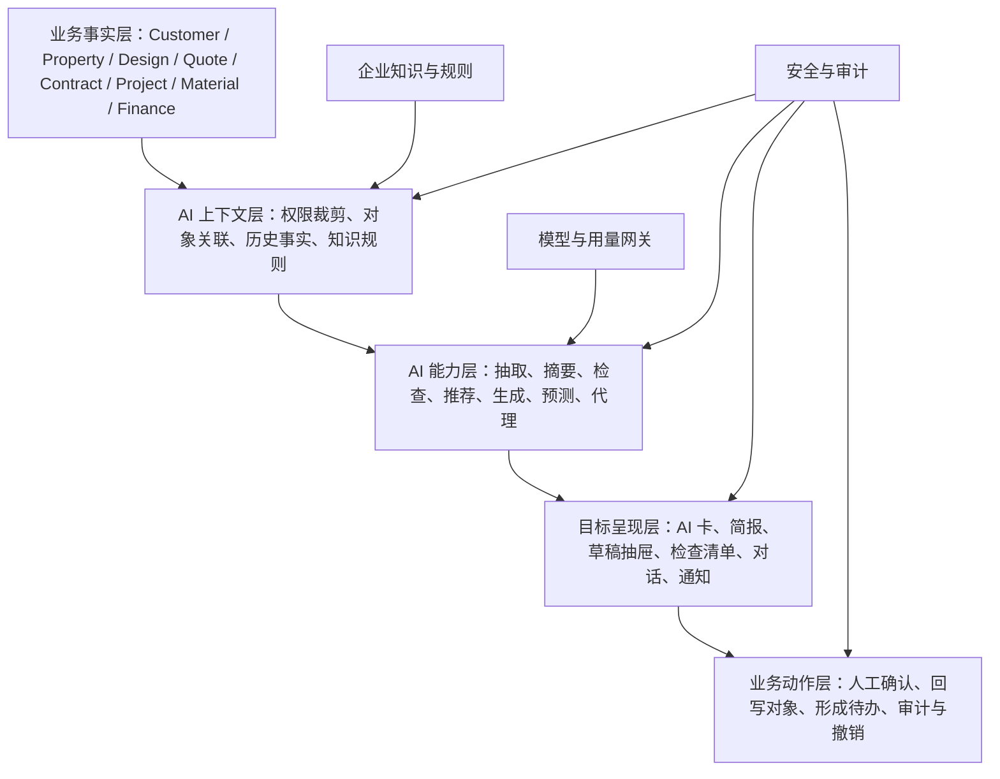

# 装得清 AI 能力接入总体设计方案

> 文档编号：PRODUCT-AI-20260926-001  
> 版本：v1.0  
> 状态：`draft_for_review`  
> 日期：2026-09-26  
> 定位：产品总体设计、页面与交互规格、研发分批和验收基线，不含生产代码  
> 上游业务依据：`CAP-001`、`CAP-002`、`SCN-001~011`、`BR-001~010`、`SOL-004`、`DEC-010`、`MET-001`、`MET-002`、产品白皮书阶段五  
> 硬性边界：AI 不替代正式设计、报价、合同、施工、验收、收付款和利润事实；所有金额、成本和权限口径继续以现有业务责任链为准。
> 总册入口：[装得清 AI 能力接入详细设计方案（总册）](./2026-09-26-装得清AI能力接入详细设计方案-总册.md)  

---

## 0. 一页结论

### 0.1 产品判断

装得清接入 AI 的正确方式不是增加一个孤立的“AI 问答”菜单，而是把 AI 做成覆盖全业务主链的三层能力：

1. **嵌入式 AI 副驾**：在客户、量房、设计、报价、项目、验收、材料和财务页面中直接帮助用户完成当前动作。
2. **角色 AI 简报**：按角色聚合真实业务事实，告诉用户“今天最该处理什么、为什么、下一步给谁”。
3. **受控业务代理**：后台持续监测业务事实，在风险出现时生成建议、待办或草稿；涉及价格、合同、验收、收付款和状态变化的动作必须人工确认。

最终形成三个可销售产品包：

| 产品包 | 面向角色 | 核心价值 | 主要板块 |
| --- | --- | --- | --- |
| AI 谈单官 | 业务员、设计师、店长、老板 | 更快理解客户、更少报价漏项、更容易讲清方案和价格 | 客户、量房、设计、报价、合同、谈单 |
| AI 工地管家 | 项目经理、材料/履约、设计师、业主 | 更早发现延期、材料、整改和沟通风险，形成明确下一步 | 项目、材料、验收、整改、业主协同 |
| AI 经营参谋 | 老板、店长、团队负责人、财务 | 把经营事实变成可下钻的风险和行动，不只看图表 | 财务、回款、成本、风险、经营分析、组织 |

三个产品包共用一套业务事实、权限、审计、模型调用和用量底座，不建设三套独立 AI 知识。

### 0.2 当前事实状态

| 能力 | 当前状态 | 本方案处理 |
| --- | --- | --- |
| AI 设计转化、一户一案 | `SOL-004 / DEC-010` 已确认，`approved/high`，尚未实现和生产验收 | 保留为独立旗舰线，产品规则沿用已有决策，不重新定义 |
| AI 订阅权益 | 套餐中存在 `Ai` 模块位，属于权益规划 | 作为用量和权益接入点，不把模块位当成已实现能力 |
| AI 客户、报价、项目、财务等设计 | 未形成统一产品方案 | 本方案给出总体设计和分级实施建议 |
| AI 建议、用量、审计和自动代理 | 新对象、状态和权限边界未冻结 | 产出 T05 咨询单，取得 T06 前不得进入研发实现 |

### 0.3 推荐起步顺序

- 首个低风险样板：**老板 AI 经营简报 + 风险解释**。
- 首个高频业务样板：**客户跟进总结 + 下一步动作**。
- 首个差异化样板：**报价体检 + 客户讲解稿**。
- 已确认但研发链更长的独立线：**AI 设计转化与一户一案**。
- P1 后再进入工地、材料、验收和财务代理；P2 才研究自动执行类代理。

---

## 1. 设计目标与非目标

### 1.1 目标

1. 让角色打开系统后，更快看到真实事实、风险和下一步，而不是自行在多个列表间拼信息。
2. 让设计、报价、施工、验收、材料和财务中重复、容易遗漏的判断形成系统检查能力。
3. 把企业内部分散在 Excel、微信、图片、语音和个人经验中的信息，转为可确认、可追溯、可复用的业务输入。
4. 让 AI 输出成为正式业务事实之前的“建议、草稿或检查结果”，由责任角色决定是否采纳。
5. 形成可计量的 AI 使用、成本、质量和业务结果观测，不以生成数量代替经营结果。

### 1.2 非目标

- 不做通用聊天机器人，不替代装得清现有角色工作台和业务页面。
- 不让 AI 自动确认设计方案、最终报价、合同生效、施工完成、验收通过、收付款或结算。
- 不通过 AI 绕过数据权限、功能权限、租户隔离和成本可见性。
- 不用 AI 估算缺失成本、伪造利润、补造客户决策或替代真实业务对象。
- 不在效果尚未验证前对外宣称效率提升比例、成交提升比例或百分百准确。
- 第一阶段不把 AI 做成可自由调用任意工具、无限自动执行的全自治代理。

### 1.3 成功标准

产品成功不能用“生成了多少次”判断，建议按四层验证：

| 层级 | 验证内容 | 示例 |
| --- | --- | --- |
| 可用闭环 | 用户能否完成输入、生成、查看、确认、应用和异常恢复 | 客户跟进摘要可修改后保存为正式跟进记录 |
| 决策质量 | AI 是否减少关键遗漏、错误理解和无效重复处理 | 报价体检能指出缺失分项，并由设计师确认 |
| 业务推进 | 是否推动进入下一真实业务动作 | 建议被采纳后形成跟进、报价调整、采购或风险处置事实 |
| 经营结果 | 是否改善报价、毛利、回款、交付和客户体验 | 需在公式、分母、样本和观察期冻结后单独验证 |

任何对外指标都必须先定义公式、统计对象、分母、时间口径、排除项和缺失值处理。

---

## 2. 总体产品架构

### 2.1 五层架构



### 2.2 三类产品形态

| 形态 | 产品定义 | 典型表现 | 允许的最终动作 |
| --- | --- | --- | --- |
| 嵌入式副驾 | 在当前业务页面中辅助当前动作 | 摘要、补全、检查、解释、生成草稿 | 用户确认后写回当前对象 |
| 角色简报 | 跨对象聚合后形成角色今日任务 | 老板经营简报、设计师待跟进、项目经理风险清单 | 指派、创建待办、进入业务页面 |
| 受控业务代理 | 后台监测事实，发现变化后主动生成建议 | 回款提醒、材料到货风险、延期预测 | 先提醒和生成草稿；高风险写入必须审批 |

### 2.3 AI 能力等级

| 等级 | 定义 | 是否可自动写业务事实 | 建议场景 |
| --- | --- | --- | --- |
| L0 生成 | 生成文本、图片、结构和方案草稿 | 否 | 方案书、讲解稿、日报草稿 |
| L1 检查 | 按规则和上下文检查遗漏、冲突、异常 | 否 | 报价体检、证据核验、成本缺口 |
| L2 建议 | 排序、推荐、预测并给出理由 | 否 | 跟进优先、回款优先、延期风险 |
| L3 代理 | 后台监测并在授权范围内执行低风险动作 | 仅限已冻结、可撤销、非资金和非正式事实动作 | 通知、草稿、待办、提醒 |

本方案默认所有 AI 能力从 L0-L2 起步；L3 只允许在后续单独裁决后启用。

### 2.4 AI 逻辑对象

以下是产品级逻辑对象，不代表最终实体和字段；是否落库、保留多久和谁可修改需由 T05/T06 冻结。

| 逻辑对象 | 作用 | 建议关联 |
| --- | --- | --- |
| AI 能力任务 | 记录一次 AI 调用的输入范围、能力类型和状态 | 企业、员工、业务对象 |
| AI 建议 | 展示可采纳的摘要、检查项、推荐或草稿 | 业务对象、来源事实、生成任务 |
| AI 输出资产 | 图片、文本、HTML、PDF、语音等生成结果 | 方案、报价、项目、文档 |
| AI 用量流水 | 记录文本、图像、视频、文档等实际消耗 | 企业、订阅、员工、能力 |
| AI 应用记录 | 记录采纳、修改、拒绝、撤销和应用到的正式对象 | 建议、业务对象、责任人 |

### 2.5 统一状态模型

面向用户建议采用以下交互状态；最终业务状态仍需 T05/T06 裁决。

| 状态 | 用户感知 | 可用动作 |
| --- | --- | --- |
| 待生成 | 已收集输入，尚未生成 | 取消、补充输入 |
| 生成中 | 系统正在处理 | 返回页面，稍后查看 |
| 已生成 | 可查看 AI 结果 | 采纳、修改、忽略 |
| 已修改 | 用户调整过 AI 结果 | 保存草稿、再次检查 |
| 已应用 | 已写入目标业务对象 | 查看对象、撤销或再次生成 |
| 已拒绝 | 用户明确不采纳 | 查看原因、重新生成 |
| 已过期 | 来源事实已经变化 | 重新生成 |
| 生成失败 | 超时、文件读取失败或服务不可用 | 重试、保留输入 |

### 2.6 统一页面组件

| 组件 | 用途 | 出现位置 |
| --- | --- | --- |
| AI 摘要卡 | 一句话总结当前对象和最近变化 | 客户、报价、项目、财务详情 |
| AI 检查卡 | 逐项显示通过、警告、阻断和依据 | 报价、验收、材料、成本 |
| AI 建议卡 | 展示建议、原因、来源和优先级 | 工作台、风险中心、经营页 |
| AI 草稿抽屉 | 生成可编辑的文本、方案或说明 | 谈单、日报、客户沟通 |
| AI 简报 | 展示事实、风险、原因和行动队列 | 首页、Web 经营总览 |
| AI 对话浮层 | 基于当前权限事实的问答 | 全局、页面上下文 |
| AI 来源抽屉 | 展示引用的对象、字段、版本和时间 | 所有 AI 结果 |
| AI 用量提示 | 显示本次消耗、剩余额度和升级路径 | 生成前后、订阅页 |

---

## 3. 角色与入口地图

| 角色 | 主要 AI 目标入口 | 默认看到什么 | 禁止看到什么 |
| --- | --- | --- | --- |
| BOSS | Web 经营总览、风险中心、App 首页 | 经营简报、风险排序、项目盈利缺口、回款优先级 | 不能通过 AI 绕过企业数据范围 |
| 店长 | 门店工作台、客户与项目工作台 | 门店漏斗、员工负荷、报价停滞、交付风险 | 其他门店数据 |
| 团队负责人 | 团队工作台 | 团队客户跟进、量房、报价和项目风险 | 其他团队数据 |
| 业务员/家装顾问 | 客户列表、客户详情、量房工作台 | 客户摘要、流失风险、下一步跟进 | 设计写入、报价成本、施工内部信息 |
| 设计师 | 设计师工作台、设计/报价/签约工作台 | 待设计、待谈单、报价体检、一户一案草稿 | 非本人客户、成本无权限内容 |
| 项目经理 | 工地首页、项目详情、任务、日报、验收 | 今日施工、延期风险、材料缺口、整改事项 | 报价价格修改和财务成本越权 |
| 财务/履约 | 财务首页、收付款、采购、库存 | 回款优先级、应付节奏、成本缺口、材料风险 | 非授权业务范围 |
| 业主 | 小程序项目旅程、方案、报价、验收 | 本人项目进展、AI 概念方案、正式确认事项 | 成本、内部话术、其他客户和项目 |

全局 AI 助手可以存在，但默认必须带当前页面上下文。无业务上下文时，只能回答产品使用帮助或本企业有权限的经营问题，不能凭标题猜测对象。

---

## 4. 真实业务场景推演

每个板块至少覆盖两个真实场景；开发前仍需按具体板块补充更细的前置条件、状态和异常。

| 板块 | 场景一 | 场景二 | 闭环下一步 | 主要异常 |
| --- | --- | --- | --- | --- |
| 客户经营 | 业务员结束电话，希望快速记录沟通和下次跟进 | 老板周一查看哪些客户最可能流失 | 保存跟进、调整下次跟进、指派负责人 | 转写错误、客户身份不唯一、无有效联系方式 |
| 量房与需求 | 设计师量房后整理语音、照片和尺寸，生成需求清单 | 业务员拿到客户微信描述，但尚未量房 | 补齐缺失项、约定量房、生成设计条件 | 尺寸冲突、照片不清、客户只给口头描述 |
| 设计转化 | 设计师基于 CAD 与诉求生成三套概念方向 | 业主未量房先上传户型图获取初步概念方案 | 客户反馈、设计师接手、现场复核、形成正式 Design | CAD 不可读、结构置信度不足、材料不存在 |
| 报价与合同 | 设计师完成报价前，希望检查漏项和异常单价 | 客户提出变更，项目经理需要判断金额、成本和工期影响 | 修改报价草稿、发起合同变更、客户确认 | 成本不完整、权限不足、变更依据不明 |
| 项目履约 | 项目经理早上查看今天的施工、材料和验收风险 | 日报集中收到照片和语音，需要生成客户可读进度 | 完成任务、补证据、指派风险、发布日报 | 照片时间不明、任务状态冲突、网络中断 |
| 验收整改 | 项目经理提交阶段验收前检查证据是否齐全 | 业主驳回后，需要快速归类整改并跟进到期 | 发起整改、指派责任人、复验、追加结论 | 证据不足、问题描述不清、责任人缺失 |
| 材料供应链 | 选材完成后，需要匹配供应商、规格和采购时机 | 采购人员发现价格异常或到货延期风险 | 发起采购、调整供应商、调整计划、通知项目经理 | 供应商无报价、库存数据过期、材料替换未确认 |
| 财务经营 | 财务查看本周应优先催收的客户 | 老板想看项目成本为何不完整、哪些项目不能算利润 | 生成催收记录、补齐成本、下钻项目财务 | 回款凭证缺失、合同变更未确认、成本权限不足 |
| 组织与实施 | 新装企接管在跑项目，需要把已有资料映射进系统 | 新员工需要按角色学习装得清业务流程 | 形成待确认对象、培训任务和交接摘要 | 历史数据缺失、归属不清、跨企业串号 |

---

### 5. 板块详细设计

### 5.1 客户经营 AI 副驾

#### 5.1.1 产品目标

让业务员、设计师和店长不再依赖个人记忆判断“这个客户现在需要什么”，同时不把 AI 评分包装成客户真实购买意愿。

#### 5.1.2 页面入口

- App 客户列表：`AI 今日优先`、风险客户排序说明。
- App 客户详情：`AI 客户卡`。
- App 跟进页：录音/文字输入后的 `AI 摘要草稿`。
- 店长/团队工作台：团队客户漏斗和异常客户摘要。
- Web 业务分析：客户渠道、阶段和流失原因摘要。

#### 5.1.3 可用事实

客户、房屋、来源、负责人、状态、标签、画像、跟进记录、到店记录、量房预约、报价和项目关联；具体可见范围继续执行 `Company/Store/Team/Self`。

#### 5.1.4 AI 能力

| 能力 | 行为 | 必须保留的事实 |
| --- | --- | --- |
| 沟通摘要 | 将语音、文字或微信记录整理为意向、预算、时间、关注点、排斥点和异议 | 原文、记录人、记录时间 |
| 下一步建议 | 根据客户阶段、最近跟进、量房和报价状态生成最多三个下一步 | 建议原因和当前状态 |
| 意向变化提示 | 对新增需求、预算变化、犹豫和拒绝信号做标注 | 不输出确定成交概率 |
| 客户等级建议 | 根据企业已定义维度提出等级建议和解释 | 等级最终由授权角色确认 |
| 重复客户识别 | 对手机号、姓名、房屋地址等提出疑似重复 | 不自动合并，必须人工确认 |
| 跟进内容生成 | 生成电话、微信回访提纲和话术草稿 | 不承诺价格、优惠和交付结果 |

#### 5.1.5 目标呈现

顶部 `AI 客户卡` 固定展示：

1. 一句话客户现状。
2. 三个最重要的事实，例如预算变化、量房未约、报价停留 5 天。
3. 最多三个建议动作，按优先级排序。
4. 每个建议可展开查看来源事实。
5. 主按钮仅允许进入已有业务动作：记录跟进、约定量房、继续报价、转交客户。

跟进结束后进入 `AI 摘要草稿` 抽屉：

- 左侧或上方显示原始记录；
- 中间显示结构化摘要；
- 下方显示“下次跟进时间”和“下一步动作”；
- 用户可编辑后保存为正式 `CustomerFollow`；不保存则仅作为本地草稿或自动丢弃。

#### 5.1.6 权限与限制

- AI 客户建议只能使用当前员工数据范围内的事实。
- 不能将意向评分展示为成交概率或客户承诺。
- 不能通过 AI 绕过负责人变更和客户转交规则。
- 不能生成折扣、礼品或交付承诺。
- 客户反馈和个人信息只用于已授权用途，跨企业训练执行 `DEC-010` 的授权、脱敏、隔离、撤回和审计条件。

#### 5.1.7 异常与降级

| 异常 | 页面表现 | 恢复路径 |
| --- | --- | --- |
| 无足够跟进数据 | `暂不足以生成有效建议` | 记录跟进或补充客户画像 |
| 语音转写失败 | 保留录音，不显示伪摘要 | 手工输入或重试 |
| AI 超时 | 显示原客户页面和重试入口 | 不阻断手工跟进 |
| 建议依据已变化 | 标记 `依据已变化` | 重新生成或忽略 |
| 疑似重复客户 | 显示对比卡 | 人工确认、保留两者或进入合并流程 |

#### 5.1.8 优先级

`P0`。直接增强现有客户与工作台，可先使用结构化事实和文字摘要，不依赖复杂图像模型。

---

### 5.2 量房与需求整理 AI

#### 5.2.1 产品目标

把量房现场的照片、语音、尺寸和客户口语，快速整理为可确认的房屋事实与设计需求，减少设计师后续重复理解。

#### 5.2.2 页面入口

- 量房记录页：`整理量房信息`。
- 量房经营工作台：待补资料和异常量房。
- 客户详情 `客户诉求与设计转化`：`生成需求草稿`。
- 设计要求页：诉求分类、优先级和空间映射建议。

#### 5.2.3 可用事实

`Property`、`Measure`、量房照片、尺寸记录、`Requirement`、`Space`、CAD 或户型图、客户画像、跟进记录。

#### 5.2.4 AI 能力

| 能力 | 行为 | 限制 |
| --- | --- | --- |
| 现场摘要 | 将语音、照片备注和量房笔记整理为现场摘要 | 不确认承重、拆改和结构安全 |
| 尺寸识别 | 从用户输入中提取长宽高和面积候选值 | 冲突或低置信度必须提示人工确认 |
| 需求归类 | 按空间、功能、风格、预算、工期、质量、其他归类 | 保留客户原话 |
| 排斥点识别 | 识别客户明确不能接受的风格、材料和做法 | 不得从单次沉默推断为排斥 |
| 缺失项检查 | 列出设计前仍缺少的信息 | 不允许自动补造数据 |
| 设计条件草稿 | 组合房屋、需求、量房结果和待确认项 | 只能作为草稿，不直接进入正式方案 |

#### 5.2.5 目标呈现

量房记录页采用三段式：

1. `事实`：面积、空间、尺寸、现场照片；
2. `客户原话`：需求、排斥点、预算、时间；
3. `待确认`：AI 发现的缺失项、冲突项和风险项。

生成后在 `Requirement` 列表展示可编辑建议标签，用户确认后逐项落为诉求；未确认的建议不进入正式设计条件。

#### 5.2.6 权限与限制

- 量房、房屋和诉求均按现有数据范围隔离。
- AI 识别尺寸不能替代量房责任人确认。
- 客户隐私照片不得进入对外分享内容。
- 不能将户型图识别结果用于正式施工依据。

#### 5.2.7 优先级

`P0-P1`。文字和语音结构化可先做；图纸、照片和尺寸高精度识别放在后续阶段。

---

### 5.3 AI 设计转化与一户一案

#### 5.3.1 产品定位

沿用 `SOL-004 / DEC-010`，本方案不在产品设计中重新解释该板块，只把它纳入总体 AI 产品架构和交付顺序。

#### 5.3.2 两条入口

- 设计师精准共创：CAD/CAD 图片 + 量房 + 需求 + 家庭信息，生成三套概念方向、效果图和 HTML 方案书。
- 业主自助入口：户型图或户型描述 + 手机号 + 家庭、预算、风格和功能诉求，生成初步诊断和 1-3 个概念方向。

#### 5.3.3 目标呈现

设计师端：

- `一户一案工作台`：左侧房屋和需求，中间概念方向，右侧待确认项和报价衔接。
- 每个方向展示适配理由、回应了哪些需求、预算档位和讲解顺序。
- 概念效果统一标记 `AI 概念效果 · 未经现场复核`。
- 设计师可将客户选择回写 `Design` 和 `Requirement`，再进入正式方案和报价。

业主端：

- 展示本人房屋、户型、区域、原始诉求、AI 回应和概念效果。
- 明确“AI 概念、非正式设计、非最终报价”。
- 预算无依据时提示联系装企，不展示成本或伪造价格。
- 生成后自动进入线索、客户和房屋主链，由设计师接手。

正式 HTML 附件：

- 由结构化方案生成；
- 冻结为不可变 HTML 快照 + PDF；
- 记录唯一编号、版本、审核人、发布时间和归档；
- 不允许绕过业务系统修改。

#### 5.3.4 权限、金额与训练边界

- 企业、员工、业主和生成资产强制隔离。
- 成本价只对 BOSS、店长、财务可见；设计师和业主不得通过 AI 或 HTML 看到成本。
- AI 不计算最终报价，客户可见金额来自正式 Quote 快照。
- 租户 CAD 和客户资料可用于模型训练，但实施前必须完成授权、脱敏、访问隔离、撤回和审计。
- 第一阶段只验证能力闭环，不以成交率、签单额或生成数量得出能力提升结论。

#### 5.3.5 优先级

独立旗舰线。业务边界已经确认，可作为 P0/P1 级别产品方向，但必须单独完成数据授权、模型能力、文件处理、页面和验收，不与普通 AI 助手混同一批上线。

---

### 5.4 报价、合同与谈单 AI

#### 5.4.1 产品目标

把 AI 放到装得清最核心的“报价中枢”上，重点解决漏项、异常价格、成本完整性、客户解释和变更影响，而不是让 AI 自行定价。

#### 5.4.2 页面入口

- 报价编辑页：`AI 报价体检`。
- 报价详情页：`生成客户讲解稿`。
- 谈单页：`生成讲解顺序和异议提示`。
- 合同变更页：`解析变更影响`。
- 老板/店长工作台：报价停滞、低毛利和高风险报价摘要。

#### 5.4.3 可用事实

`CatalogItem`、套餐、设计区域、设计分项、`Quote`、报价版本、合同、合同变更、标准成本、采购成本、历史项目和 `MET-001` 指标口径。

#### 5.4.4 AI 能力

| 能力 | 行为 | 禁止 |
| --- | --- | --- |
| 漏项检查 | 根据空间、面积、工艺和历史套餐提示可能缺失的分项 | 不自动新增报价行 |
| 异常检查 | 提示单价、数量、重复项、折扣和成本异常 | 不自动改价 |
| 成本完整性诊断 | 指出来源缺失、标准成本待维护和不能计算利润的原因 | 不用 0 成本代替缺失 |
| 客户解释稿 | 按区域、需求、投入和价值生成客户可理解的说明 | 不承诺优惠、不暴露成本 |
| 谈单辅助 | 生成讲解顺序、常见异议和回应建议 | 不替客户做接受决定 |
| 合同变更解析 | 将文本变更拆成候选变更项、金额、成本和工期影响 | 不直接确认金额或生效 |
| 历史报价复用 | 查找相似项目并提示可复用结构 | 不覆盖当前报价快照 |

#### 5.4.5 目标呈现

报价体检采用固定检查表：

- 通过：有明确事实支持；
- 警告：可能遗漏或需要解释；
- 阻断：报价阶段不能继续的硬门槛；
- 无法确认：缺成本、缺面积、缺设计条件或权限不足。

每项显示来源、影响和可执行入口。例如：

> 主卧墙面可能存在漏项。依据：当前区域面积 18㎡，类似项目 80% 包含腻子与乳胶漆；本报价未出现对应工艺。  
> 动作：查看候选分项 / 忽略并填写原因 / 继续检查。

客户讲解稿生成后，必须显示“正式金额以报价快照和签字报价单为准”。

#### 5.4.6 金额、成本与权限

- 最终报价只能由现有服务端报价逻辑计算。
- 成本不完整时，利润和毛利率保持为空，并显示 `成本未完整`。
- 成本仅对 BOSS、店长、财务等授权角色可见；业主和普通设计师不得通过 AI 获取成本。
- AI 不得生成折扣、返点、返工承诺和最终毛利结论。
- 报价版本、客户确认、合同签署和生效继续走原有状态机。

#### 5.4.7 异常

- 成本不完整：AI 输出“无法判断利润”，而不是给出估值。
- 设计条件缺失：只能做结构提示，不能判断具体工程量。
- 历史数据不足：明确说明无足够同类样本，不使用行业比例伪装成企业事实。
- 变更依据不清：要求上传或补充原始依据，不能反向伪造合同条款。

#### 5.4.8 优先级

`P0`。该能力最接近装得清的报价尖刀和商业差异化，但必须先确定 AI 建议记录和权限边界。

---

### 5.5 项目履约与工地 AI

#### 5.5.1 产品目标

让项目经理和老板从“翻列表找问题”变为“按风险、节点和下一步组织工作”，同时不把照片或 AI 判断直接当成施工完成事实。

#### 5.5.2 页面入口

- App 工地首页：`今日工地简报`。
- 项目详情：`AI 项目指挥卡`。
- 施工计划：排期建议和冲突提示。
- 任务详情：证据清单和下一步。
- 日报页：语音/照片/文字生成日报草稿。
- Web 项目监管：延期、材料和验收风险聚合。

#### 5.5.3 可用事实

`Project`、`ProjectStage`、`ProjectTask`、`TaskNode`、现场照片、日报、材料计划、采购到货、验收、整改、合同变更、项目成员和风险处置记录。

#### 5.5.4 AI 能力

| 能力 | 行为 | 限制 |
| --- | --- | --- |
| 今日工地简报 | 汇总今日应施工、待补证据、材料、验收和逾期事项 | 只读事实和提醒 |
| 排期建议 | 根据阶段、任务、材料到货和人员提出排期调整建议 | 不自动重排和回写合同快照 |
| 任务拆分 | 将施工项拆成可执行任务和节点草稿 | 必须项目经理确认 |
| 日报摘要 | 将语音和照片整理为客户可读日报 | 不把未发生的进展写成完成 |
| 证据检查 | 检查节点照片、说明、时间和责任人是否齐全 | 不判断施工质量合格 |
| 延期原因 | 归类延期来自客户、设计、材料、施工或协调 | 不用于无依据追责 |
| 风险下一步 | 按影响和时效给出建议责任人 | 指派仍需授权人确认 |

#### 5.5.5 目标呈现

`AI 项目指挥卡` 固定展示：

1. 项目当前阶段和健康度；
2. 三个最高优先级风险；
3. 每个风险的事实、影响、责任人和建议截止时间；
4. 直接进入任务、材料、验收或整改页面。

日报生成时，原文、照片和 AI 草稿分开显示，AI 草稿只有员工确认后才对业主可见。

#### 5.5.6 权限与限制

- 项目经理仅能处理其参与或授权范围内的项目。
- 项目成员可见性继续沿用项目参与关系，不扩大到企业全量。
- AI 不修改报价价格、财务归属和成本。
- AI 不把单张照片或单个打卡判定为任务完成。
- 项目状态、阶段状态和验收结论继续由原状态机管理。

#### 5.5.7 优先级

`P1`。重点是简报、日报和证据检查，排期与自动优化放在后续。

---

### 5.6 验收、整改与业主协同 AI

#### 5.6.1 产品目标

在质量事实、业主反馈和整改闭环之间，减少漏证据、漏责任和沟通误解，但 AI 不替代质量责任人做验收判断。

#### 5.6.2 页面入口

- 验收提交页：`证据核验`。
- 验收详情：`生成业主说明`。
- 整改看板：问题归类和到期风险。
- 业主项目旅程：进度、验收、整改和反馈。
- 反馈/投诉页：问题主题归类和回复草稿。

#### 5.6.3 可用事实

`Acceptance`、`AcceptanceRound`、整改问题、图片、责任人、截止日期、验收结论、业主反馈、投诉、项目阶段和施工任务。

#### 5.6.4 AI 能力

| 能力 | 行为 | 限制 |
| --- | --- | --- |
| 验收证据核验 | 检查照片、说明、节点和责任人是否齐全 | 不判定合格或驳回业主意见 |
| 问题归类 | 将问题归入可配置的整改类型和优先级建议 | 类型最终由责任人确认 |
| 整改建议 | 给出整改责任人、截止时间和核实材料建议 | 不自动指派和关闭 |
| 复验摘要 | 汇总新增证据、整改动作和待确认事项 | 保留每轮历史，不覆盖 |
| 业主说明 | 将内部专业描述转为清晰、克制的沟通文本 | 不掩盖问题、不承诺赔偿 |
| 反馈聚类 | 聚合反馈主题和重复问题 | 不推断单个业主情绪或客户价值 |

#### 5.6.5 目标呈现

提交前 `证据核验`：

- 已具备的证据；
- 建议补充的证据；
- 问题与责任人的对应关系；
- 影响的阶段和客户可见范围。

整改看板增加：

- `问题摘要`；
- `本轮新增`；
- `逾期风险`；
- `下一步动作`；
- `历史轮次对比`。

#### 5.6.6 权限与限制

- 验收结论只能由原有权责角色确认。
- 业主人脸、住址、电话等敏感信息不进入非必要生成内容。
- 投诉和反馈不能被 AI 自动关闭。
- 整改不改变合同、成本、应收应付、结算和利润。
- AI 生成内容必须标明是否为内部说明或客户可见版本。

#### 5.6.7 优先级

`P1`。依赖现有验收整改闭环数据的质量。

---

### 5.7 材料、采购与供应链 AI

#### 5.7.1 产品目标

让选材结果更快进入材料计划、供应商匹配、采购和到场管理，同时保持企业目录、供应商价格和成本权限边界。

#### 5.7.2 页面入口

- 选材工作台：`选材归一化`、`待采购风险`。
- 材料计划：`按施工节点生成采购时序建议`。
- 采购编辑：供应商、规格、价格和交付方式建议。
- 到货/库存：`异常与缺口提示`。
- 项目经理工作台：影响施工的材料清单。

#### 5.7.3 可用事实

`MaterialSelection`、`MaterialPlan`、`CatalogItem`、供应商、供应商价格、采购单、到货、库存、退货、损耗、项目阶段和施工任务。

#### 5.7.4 AI 能力

| 能力 | 行为 | 限制 |
| --- | --- | --- |
| 选材归一化 | 将设计师文本转为候选分类、规格、单位和材料项 | 不自动替换材料 |
| 供应商匹配 | 按企业目录、规格、交付方式和价格来源推荐候选供应商 | 不跨企业推荐 |
| 价格异常 | 对比同企业历史价、供应商价和采购执行价 | 不擅自修改标准成本 |
| 采购时序 | 根据阶段、交期、急迫程度提出采购建议 | 不自动下单 |
| 到货风险 | 根据计划日期、供应商交期和项目节点提示风险 | 不把未到货标记为到场 |
| 库存/退货异常 | 发现异常领用、退换货和库存缺口 | 不改变库存流水 |

#### 5.7.5 目标呈现

选材工作台每项显示：

- 原始选择文本；
- AI 建议匹配结果；
- 匹配依据和置信度；
- `确认匹配`、`重新选择`、`保留原文本`。

材料计划页提供 `采购时序建议`，按“已具备/待采购/存在延期风险”分类，不能替代采购审批和到货确认。

#### 5.7.6 权限与金额

- 标准成本、采购执行价和供应商报价按现有角色和采购规则裁剪。
- 客户和设计师不得通过 AI 看到标准成本。
- 到货形成实际成本和应付继续由现有业务事实触发。
- 供应商推荐不能引入未授权的平台佣金或排序偏向。

#### 5.7.7 优先级

`P1`。先做文本归类和风险提示，后做复杂匹配与采购时序。

---

### 5.8 财务与经营分析 AI

#### 5.8.1 产品目标

让老板和财务更快看到“钱在哪里、风险在哪里、下一步找谁”，并确保 AI 不制造伪利润和伪现金流。

#### 5.8.2 页面入口

- 财务首页：`今日收付行动`。
- 应收/应付详情：催收建议、付款节奏、凭证缺口。
- 项目财务：`成本完整性诊断`。
- Web 经营总览：`AI 经营简报`。
- 风险中心：风险原因、责任人和处置建议。
- 全局 AI 助手：带数据权限的经营问答。

#### 5.8.3 可用事实

应收、收款、应付、付款、台账、账龄、结算、项目成本、合同变更、项目状态、报价快照、目标数据和现有经营报表。

#### 5.8.4 AI 能力

| 能力 | 行为 | 限制 |
| --- | --- | --- |
| 回款优先级 | 根据逾期、金额、合同节点和项目状态排序 | 不自动确认收款 |
| 催收建议 | 生成催收时间、对象、理由和话术草稿 | 不承诺减免、不威胁客户 |
| 付款节奏 | 提示到期、项目和供应商风险 | 不自动付款 |
| 流水匹配建议 | 对收款、付款和业务对象做候选匹配 | 不自动过账 |
| 成本完整性 | 指出缺哪类成本、对应哪个项目或采购 | 不按 0 成本估算 |
| 经营简报 | 汇总收入、回款、毛利、风险和组织异常 | 区分预计、动态、结算口径 |
| 经营问答 | 基于当前企业事实回答问题并附来源 | 不回答越权对象和无依据预测 |

#### 5.8.5 目标呈现

Web 经营总览顶部固定 `AI 经营简报`：

- 一句话经营现状；
- 昨日/本周变化事实；
- 三类风险，分别为业务、交付、资金；
- 每条风险的责任人、金额或影响对象、建议动作；
- 一键下钻到客户、项目、应收、风险处置。

项目财务卡：

- 成本完整度；
- 缺失成本清单；
- 预计成本、实际成本和利润是否可计算；
- 若 `costComplete=false`，统一显示 `成本未完整`，不显示伪造利润。

#### 5.8.6 金额与权限

- 毛利润、毛利率和成本必须使用已冻结口径；不能用 AI 自行定义净利润。
- 回款、付款、台账、结算和余额只读或生成草稿，AI 不直接写过账事实。
- 公司、门店、团队和个人数据继续按角色范围过滤。
- 经营问答必须返回来源和统计时点，无法确认时明确说“暂不可确认”。

#### 5.8.7 优先级

`P0` 的经营简报和风险解释；`P1` 的催收、成本诊断；`P2` 的自动催收和付款建议代理。

---

### 5.9 组织、实施与企业知识 AI

#### 5.9.1 产品目标

让新企业更快完成系统入驻，让新员工更快理解自己的任务，让离职交接和企业经验不再只存在个人大脑和微信里。

#### 5.9.2 页面入口

- 企业注册/首次入驻：`AI 实施助手`。
- 历史项目承接：`资料映射与缺失项提示`。
- 成员管理：`离职交接摘要`。
- 我的/帮助：`企业知识助手`。
- 新员工首页：`角色任务包`。

#### 5.9.3 可用事实

产品知识、业务规则、企业模板、员工和角色、导入文件、承接项目、历史附件、操作记录和已确认的公司 SOP。

#### 5.9.4 AI 能力

| 能力 | 行为 | 限制 |
| --- | --- | --- |
| 导入映射 | 识别 Excel/表格列名并推荐字段映射 | 不直接用猜测覆盖正式数据 |
| 承接助手 | 检查在跑项目缺失的客户、房屋、合同、财务和成本信息 | 不自动猜测负责人和金额 |
| 角色培训 | 根据角色生成任务清单、操作说明和练习场景 | 只使用已确认产品能力 |
| 知识问答 | 基于企业 SOP、业务规则和当前权限回答 | 不把 AI 推演当成正式规则 |
| 交接摘要 | 汇总客户、项目、风险和待确认事项 | 不替代正式交接确认 |
| 实施复盘 | 汇总导入错误、未完成项和数据质量问题 | 不自动判定实施完成 |

#### 5.9.5 目标呈现

`AI 实施助手` 以步骤卡展示：

- 已完成；
- 待完成；
- 缺少依据或责任人；
- 完成后将进入哪个正式对象；
- 暂不可完成的原因。

企业知识助手回答时，必须区分：

- 产品已确认规则；
- 当前企业数据事实；
- 外部资料或建议；
- 待确认问题。

#### 5.9.6 权限与限制

- 不跨企业读取知识、文件、员工和项目。
- 跨租户训练不等于跨租户运行时检索。
- 未确认的产品能力和业务口径不得被 AI 当作正式规则。
- 历史数据导入不得自动创建无来源金额、无负责人项目和无报价合同。

#### 5.9.7 优先级

`P1-P2`。先做入驻和知识问答，后做交接和复杂实施建议。

---

### 5.10 企业能力沉淀与软实力展示 AI

#### 5.10.1 产品定位

企业能力沉淀解决的不只是资料存储，而是把真实项目中的合同、报价、设计、施工、验收、整改、图片、沟通和员工经验，提炼为企业可复用、可交接、可对客户证明的能力资产。

对内形成“企业能力中心”，对外形成“AI 软实力展厅”，两者必须共用同一套事实、授权、脱敏、审核、版本和审计底座。

#### 5.10.2 六个资产域

- 企业档案：品牌、地址、团队、资质、服务范围和服务承诺。
- 能力资产：设计、报价、施工、材料、验收、整改和售后能力。
- 案例资产：户型、面积、风格、预算档位、问题、过程和交付证据。
- 知识资产：SOP、标准动作、话术、模板、常见风险和项目复盘。
- 证据资产：图片、文件、验收记录、证书、客户评价和授权记录。
- 学习资产：岗位课程、真实案例练习、新员工任务和交接包。

#### 5.10.3 目标呈现

对内：

- Web 增加“企业能力中心”：资产总览、资料入库、能力图谱、案例库、SOP 与模板、岗位学习、交接中心、对客展示管理。
- App 增加轻量入口：资料补充、案例待确认、岗位知识问答、交接事项确认。
- 首屏必须回答“企业有什么、缺什么、哪些还没有证据、哪些不能对客户展示”。

对外：

- 客户到店、看方案或签约后，生成客户专属软实力展示包。
- 按“理解你的房子 -> 我们怎么做 -> 相似案例 -> 谁负责 -> 如何验收 -> 真实证据 -> 下一步”组织。
- 初次接待包、设计谈单包、施工安心包分别服务不同业务阶段。
- 只展示已授权、已脱敏、已审核、未过期的内容；成本、折扣、利润和内部话术不得展示。

#### 5.10.4 核心闭环

```text
真实项目事实
-> AI 分类、提取和关联
-> 责任人确认
-> 客户授权与脱敏
-> 企业内部可用
-> 岗位复用、学习和交接
-> 客户专属软实力展示
-> 项目结果和客户反馈反哺企业资产
```

#### 5.10.5 关键边界

- AI 不能编造案例、资质、客户评价、经营数据、交付能力和效果比例。
- 测试、模拟、演示项目不得成为正式客户案例。
- 员工经验只有经企业确认后才成为企业标准。
- 客户授权撤回后，展示立即停用并保留审计记录。
- 企业资料、案例、学习包和展示页继续执行企业、门店、团队、本人和项目参与权限。
- 跨租户训练沿用 `DEC-010` 的授权、脱敏、隔离、撤回和审计条件。

专项设计见 `docs/product/2026-09-26-装得清企业能力沉淀与软实力展示AI产品设计方案.md`，配套 T05 见 `docs/product/consultations/REQ-BIZ-20260926-003-企业能力资产与软实力展示.md`。

## 6. 关键端到端体验

### 6.1 老板周一经营简报

```text
进入 Web 经营总览
-> AI 读取当前企业事实、项目、财务、风险和目标
-> 输出经营简报
-> 老板点击“查看原因”
-> 下钻到具体客户、报价、项目、应收或员工
-> 分派风险处置
-> 系统记录处置，不修改底层金额事实
```

首屏只显示三类内容：已发生事实、需要关注的风险、建议动作。图表放在事实之后，不能先展示无口径数字。

### 6.2 设计师 AI 谈单

```text
客户和房屋
-> 记录诉求和量房
-> CAD/方案草稿
-> AI 生成概念方向和讲解顺序
-> 设计师确认或调整
-> 生成客户讲解稿
-> 报价体检
-> 关联正式报价快照
-> 客户确认或反馈
-> 回写 Design / Requirement / Talk
```

AI 方案不直接进入正式设计、报价、合同和施工依据。

### 6.3 项目经理 AI 工地

```text
进入工地首页
-> 查看今日项目和风险排序
-> 打开项目指挥卡
-> 处理任务、材料、验收或整改
-> 记录日报和证据
-> AI 生成内部摘要和客户可见草稿
-> 项目经理确认后发送
-> 系统记录来源、发布对象和时间
```

### 6.4 财务催收

```text
打开财务首页
-> AI 生成应收优先级
-> 查看每笔款项的合同节点、逾期和项目状态
-> 生成催收草稿
-> 财务确认并记录跟进
-> 收款仍通过正式收款 Provider 登记
-> AI 仅根据新事实重新排序
```

### 6.5 业主自助 AI 方案

```text
业主上传户型图或描述
-> 手机号校验
-> 补充家庭、预算、风格和功能
-> 生成 AI 概念诊断和方向
-> 标注未经现场复核和非正式报价
-> 建立或合并线索、客户和房屋
-> 转交设计师
-> 设计师现场复核后决定是否进入正式设计
```

---

## 7. 数据、权限与安全设计

### 7.1 上下文最小化

每次 AI 调用只携带完成当前能力所需的最小对象和字段：

- 必需：当前企业、当前员工、业务对象、业务版本、动作目标；
- 可选：与当前对象有明确业务关系的历史事实；
- 禁止：无业务必要地携带客户电话、身份证、成本、供应商历史和跨项目数据。

### 7.2 权限裁剪顺序

```text
登录员工身份
-> 企业隔离
-> 角色与功能权限
-> Company/Store/Team/Self 数据范围
-> 项目参与关系
-> 字段级裁剪（成本、敏感信息）
-> 只向 AI 提供允许读取的最小事实
-> AI 返回结果前再次校验目标对象
```

禁止信任前端传入的 `companyId`、`empId`、`ownerId` 或任意对象列表。

### 7.3 来源与可追溯

每个 AI 结论至少记录：

- 使用了哪些业务对象和版本；
- 数据读取时间；
- 生成时间和能力版本；
- 由谁触发；
- 哪些字段被 AI 修改；
- 用户是否确认、拒绝或撤销；
- 最终应用到哪个业务事实。

### 7.4 运行时隔离与训练隔离

- 运行时只能读取当前企业和当前权限范围内的事实。
- 跨租户训练必须执行授权、脱敏、访问隔离、撤回和审计。
- 企业撤回授权后，应停止后续训练使用，并按冻结规则处理历史模型影响。
- 模型输出不得成为跨企业检索答案，也不得在另一个租户中暴露个人信息。

### 7.5 敏感信息

| 信息 | 默认策略 |
| --- | --- |
| 客户电话、地址 | 仅业务必要角色和场景使用 |
| 身份证、工资等工人敏感字段 | 按现有工人档案权限，不进入普通 AI 摘要 |
| 成本、供应商历史价 | 仅 BOSS、店长、财务等授权角色 |
| 业主反馈和投诉 | 按本人项目和处置角色可见 |
| CAD、效果图和方案书 | 按企业、客户、房屋和方案版本隔离 |
| 模型训练数据 | 脱敏、隔离、授权、撤回和审计后使用 |

---

## 8. AI 用量、模型与成本管理

### 8.1 用量计量

AI 能力必须按文本、图像、视频、文档解析或其他类型记录实际消耗；不把不同模型成本笼统记成“一次调用”。

调用次数与计费点数必须分开：

```text
API 调用量 = 请求、有效调用、成功、失败和重试次数
计费点数 = 按能力资源单位和费率版本换算后的资源点数
```

企业是唯一收费主体，门店是统计和分摊维度。每笔调用记录业务门店、执行门店、分摊门店和企业公共归属。

### 8.2 用户可见额度

生成前显示能力类型和预计消耗；生成后显示实际消耗。剩余额度较低时提示购买或升级，但不得阻断已经进入的正式业务流程，除非权益规则明确要求。

### 8.3 失败与重试

- 模型超时不扣正式输出额度，或按裁决规则返还；
- 用户重复点击不能产生重复生成和重复扣费；
- 失败保留用户输入和业务上下文；
- 生成失败的草稿不能伪装成成功。

### 8.4 模型与能力版本

每次输出应关联能力版本和模型版本。模型替换、提示词变化或知识升级后，历史结果保持原版本，不静默重算。

### 8.5 商业呈现

AI 点数、套餐额度和加购必须与产品白皮书的权益边界一致，不承诺无限使用；价格和利润测算在正式对外前另行验证。

### 8.6 企业与门店统计

| 维度 | 用途 | 结算规则 |
| --- | --- | --- |
| 企业 | 唯一收费主体、资源账户和账单 | 企业总消耗 |
| 门店 | 内部统计、分摊和经营分析 | 企业总消耗中的分摊部分 |
| 企业公共 | BOSS 全企业或无法归店操作 | 不默认归总店 |
| 员工 | 审计和团队统计 | 不作为独立收费主体 |
| 业务对象 | 回溯来源和下钻 | 不作为独立收费主体 |

企业汇总必须满足：

```text
企业总消耗 = 各门店分摊消耗 + 企业公共消耗
```

详细设计见 `2026-09-26-AI资源用量与企业门店统计设计.md`。

---

## 9. 统一交互状态与文案

### 9.1 生成前

| 场景 | 文案原则 |
| --- | --- |
| 数据不足 | 说明缺少什么，不让用户猜 |
| 权限不足 | 说明无权使用或无可访问对象，不泄露存在性 |
| 成本不可见 | 不显示模糊的成本提示，不诱导绕过 |
| 额度不足 | 说明消耗、剩余和处理方式 |

### 9.2 生成中

- 允许用户离开当前页面；
- 不阻塞原有手工流程；
- 显示可恢复状态，不显示虚假百分比；
- 长任务进入任务中心或消息提醒。

### 9.3 生成后

所有 AI 结果统一展示：

```text
AI 生成 | 来源 n 项 | 生成时间 | 使用能力
[查看依据] [编辑] [采纳] [忽略]
```

高风险结果增加：

```text
此结果不构成正式报价、合同、验收或付款依据
```

### 9.4 依据变化

对象版本、报价、合同、项目状态、材料价格或用户输入发生变化后，原 AI 建议标记 `依据已变化`，不能继续一键应用。

### 9.5 无法确认

统一使用“暂不可确认”，禁止以空列表、0、默认值或猜测结果伪装完成。

---

## 10. 观测指标

以下为建议指标，公式、分母和时间口径必须在研发前冻结，不能直接对外承诺。

| 指标 | 建议定义 | 说明 |
| --- | --- | --- |
| AI 能力闭环率 | 完成生成并进入采纳/拒绝结果的次数 / 有效生成次数 | 判断能力是否真正完成交互 |
| AI 建议采纳率 | 被采纳并应用到业务事实的建议数 / 已查看建议数 | 不衡量经营结果 |
| AI 修改率 | 采纳前发生人工修改的建议数 / 已采纳建议数 | 判断输出质量 |
| 关键遗漏发现数 | AI 发现且被责任人确认的关键缺失项数 | 需要定义关键项范围 |
| 风险闭环率 | 由 AI 提示并完成处置的风险数 / 有效风险提示数 | 沿用风险处置口径 |
| 客户解释使用率 | 采用 AI 客户讲解稿的报价数 / 已查看讲解稿报价数 | 不直接代表成交 |
| AI 用量成本 | 实际模型和推理成本 / 业务次数 | 用于商业模型 |
| AI 异常率 | 失败、过期、依据不符和被撤回次数 / 总生成次数 | 用于质量治理 |

不得以“生成数量”“图片数量”“AI 点击数”单独证明产品价值。

---

## 11. 研发分批建议

### 11.1 A0：AI 能力底座

范围：

- AI 能力任务、建议、来源、用量和应用审计；
- 权限裁剪、上下文最小化、运行时租户隔离；
- 统一 AI 卡、检查卡、草稿抽屉和异常状态；
- 权益、点数、限流和失败重试；
- 端侧功能开关和灰度。

前置：

- T06 冻结 AI 建议状态、保留、确认、撤销和用量口径；
- 安全、法务确认训练和客户内容边界；
- 现有数据权限回归通过。

### 11.2 A1：AI 经营参谋 P0

范围：

- Web 老板经营简报；
- 风险解释和项目/客户/财务下钻；
- 项目成本完整性诊断。

不自动执行资金和状态变更。

### 11.3 A2：AI 谈单官 P0

范围：

- 客户跟进摘要和下一步；
- 量房/诉求结构化；
- 报价体检；
- 客户讲解稿和谈单提示。

AI 不生成最终价格，不修改报价快照。

### 11.4 A3：AI 工地管家 P1

范围：

- 今日工地简报；
- 项目风险卡；
- 日报草稿；
- 证据检查；
- 验收整改摘要。

### 11.5 A4：AI 设计转化旗舰线

范围：

- 设计师 CAD 共创；
- 三套概念方向；
- 效果图和 HTML 方案书；
- 客户反馈回写；
- 业主自助概念入口。

该线沿用 `SOL-004 / DEC-010`，不与普通助手共用未经授权的数据用途。

### 11.6 A5：AI 供应链与经营代理 P2

范围：

- 选材/供应商匹配；
- 采购时序和到货风险；
- 回款提醒和催收草稿；
- 跨项目经营预测；
- 经单独审批的低风险后台代理。

禁止自动付款、自动确认收款、自动合同生效、自动验收通过和自动报价。

---

## 12. 验收基线

### 12.1 功能正向

- 每个 AI 能力都能从真实业务页面进入、生成、查看、修改、采纳或拒绝。
- 采纳后形成正确业务事实，并保留 AI 来源和人工确认记录。
- 手工流程在 AI 不作为或失败时仍然可用。

### 12.2 反向与越权

- 跨企业、跨门店、跨团队和无关项目不可见。
- 伪造 `companyId`、`empId`、`ownerId` 不改变权限。
- 设计师和业主看不到成本。
- 普通员工不能通过 AI 获取老板经营数据。
- 后台代理不能自动修改资金、合同、验收和报价事实。

### 12.3 金额与成本

- 最终报价仍由服务端计算。
- 成本不完整时利润为空，页面显示 `成本未完整`。
- 没有依据时不输出预算金额或伪造优惠。
- AI 不能将暂估、预计、动态和结算口径混为一个数字。

### 12.4 版本与证据

- AI 建议保留生成版本、来源、时间和责任人。
- 来源事实变化后，旧建议不能继续一键应用。
- 正式 HTML 方案书只能从已确认结构化内容生成，并冻结为 HTML + PDF。
- 历史轮次和正式业务事实不能被 AI 静默覆盖。

### 12.5 异常与恢复

- 超时、额度不足、文件失败、模型拒绝和网络中断均有恢复路径。
- 失败不产生重复收费、重复对象和重复正式记录。
- 无法确认时明确表达，不用空数据伪装完成。

---

## 13. 待业务与产品裁决

完整咨询单见 `docs/product/consultations/REQ-BIZ-20260926-002-AI能力接入总体设计.md`。

必须优先裁决：

1. AI 建议和应用记录是否作为正式业务对象保存，保留多久，谁可删除。
2. 哪些 AI 内容可以不经过员工预审直接面向客户；除已确认的 AI 概念设计外，其余默认预审。
3. 后台代理允许自动触发哪些动作，哪些必须生成待办和人工审批。
4. AI 生成文本、图片、HTML 和 PDF 的责任角色、发布版本和撤回规则。
5. AI 经营结论是否可以对外表达，如何标注预计、动态、结算和成本不完整状态。
6. 跨租户训练的实施授权、撤回、删除和历史模型影响处理。
7. AI 用量、点数、退款和失败重试的商业口径。
8. AI 质量、采纳、应用和业务结果的指标公式与统计口径。
9. 企业知识助手能否引用企业自己的 SOP、历史项目和员工资料，边界如何确定。
10. AI 风险、错误和不准确结论的接管、纠正、通知和责任链。

---

## 14. 对外表达边界

可以说：

> 装得清规划将 AI 嵌入客户、设计、报价、项目、材料、验收和经营分析主链，帮助中小装企整理事实、发现遗漏、解释风险并形成下一步建议；AI 结果需由责任角色确认，正式设计、报价、合同、施工、验收和收付款仍按原业务规则执行。

不可说：

- AI 自动替代设计师、项目经理、财务或老板决策。
- AI 自动生成最终报价并保证准确。
- AI 保证成交、回款、准时交付、省钱或质量结果。
- 所有效果图、方案书和经营预测 100% 准确。
- 当前所有规划能力已经实现并验收。
- 未经授权的客户案例、效果比例或行业数据。

---

## 15. 方案状态与下一步

### 15.1 当前状态

`draft_for_review`。本方案用于产品评审和业务咨询，不构成研发冻结、生产实现或验收结论。

### 15.2 下一步

1. 由用户确认产品包范围：先做 AI 经营参谋，还是先做 AI 谈单官，或两条并行。
2. 提交 T05，取得 T06，冻结 AI 建议、状态、权限、客户可见和用量边界。
3. 产品规划将选定方向拆成单板块 PRD，明确页面、接口范围、数据对象、研发批次和验收用例。
4. 研发开发前补安全、法务、模型、成本和数据治理评估。
5. AI 设计转化继续按 `SOL-004 / DEC-010` 独立推进，不等待通用 AI 助手完成。
