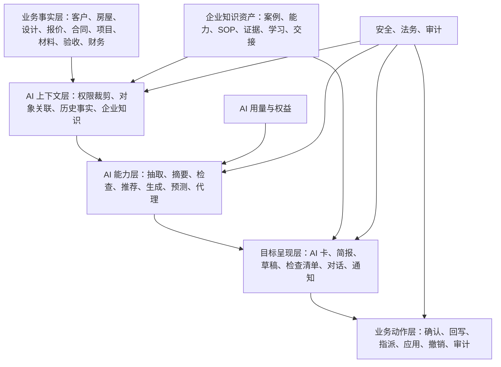

# 装得清 AI 能力接入详细设计方案（总册）

> 文档编号：PRODUCT-AI-20260926-MASTER  
> 版本：v1.0  
> 状态：`draft_for_review`  
> 日期：2026-09-26  
> 定位：AI 产品总体方案、业务板块设计、企业能力沉淀、页面呈现、数据权限、研发分批和验收基线的统一评审入口  
> 不包含：生产代码、接口冻结、数据库迁移冻结和生产发布结论  
> 业务事实源：`CAP-001`、`CAP-002`、`SCN-001~011`、`BR-001~010`、`SOL-004`、`SOL-005`、`DEC-010`、`DEC-011`、`MET-001`、`MET-002`

---

## 0. 文档层级与交付物

本设计采用“总册 + 专项册 + 业务咨询单”的结构，后续产品和研发以总册为评审入口，以专项册为细节真源。

| 文档 | 作用 | 当前状态 |
| --- | --- | --- |
| 本总册 | AI 产品总体设计、研发分批、验收总纲 | 待评审 |
| `2026-09-26-装得清AI能力接入总体设计方案.md` | 九大 AI 产品板块详细设计 | 待评审 |
| `2026-09-26-装得清企业能力沉淀与软实力展示AI产品设计方案.md` | 企业资料、能力、案例、岗位知识和客户展示专项设计 | 待评审 |
| `consultations/REQ-BIZ-20260926-002-AI能力接入总体设计.md` | AI 建议、用量、权限、代理和客户可见咨询 | 待业务答复 |
| `consultations/REQ-BIZ-20260926-003-企业能力资产与软实力展示.md` | 企业资产、案例授权、员工经验和对客展示咨询 | 待业务答复 |
| `2026-09-26-AI经营参谋P0产品需求规格.md` | A1 首个研发批次的页面、数据、状态、权限和验收规格 | 待业务冻结 |
| `2026-09-26-AI资源用量与企业门店统计设计.md` | AI 调用量、点数、企业/门店归属、资源包和账单统计 | 待业务冻结 |
| `consultations/REQ-BIZ-20260926-004-AI调用量与企业门店统计口径.md` | AI 收费主体、门店归属、资源单位、失败返还和资源包咨询 | 待业务答复 |

---

## 1. 设计结论

### 1.1 一句话结论

装得清的 AI 不应是一个独立聊天入口，而应成为贯穿“客户—房屋—设计—报价—合同—项目—材料—验收—财务—经营—企业能力沉淀”的业务副驾：

> 帮企业整理事实、发现遗漏、解释问题、沉淀能力、推动下一步，但不替代正式业务责任。

### 1.2 三个产品包

| 产品包 | 目标用户 | 直接价值 | 覆盖板块 |
| --- | --- | --- | --- |
| AI 谈单官 | 业务员、设计师、店长、BOSS | 更快理解客户、更少漏项、更容易讲清方案和价格 | 客户、量房、设计、报价、合同、谈单 |
| AI 工地管家 | 项目经理、材料/履约、设计师、业主 | 更早发现延期、材料和整改风险，形成明确动作 | 项目、材料、验收、整改、售后 |
| AI 经营参谋 | BOSS、店长、团队负责人、财务 | 把经营事实转成风险、原因和行动 | 财务、回款、成本、风险、经营分析、组织 |
| 企业能力中心 | 全企业、全岗位 | 把项目经验变成资料、案例、标准和对客软实力 | 企业资料、案例、SOP、学习、交接、展示 |

### 1.3 四类产品形态

| 形态 | 定义 | 结果 |
| --- | --- | --- |
| 嵌入式副驾 | 在现有业务页面中帮助完成当前动作 | 摘要、检查、补全、解释、草稿 |
| 角色简报 | 按角色聚合多个业务对象 | 今天该处理什么、为什么、谁负责 |
| 受控业务代理 | 后台监测事实并生成提醒或草稿 | 预警、待办、建议、通知 |
| 企业能力沉淀 | 把业务事实转成企业长期资产 | 案例、能力、SOP、学习、交接、对客展示 |

---

## 2. 目标与非目标

### 2.1 目标

1. 降低业务人员理解、整理、检查和表达信息的成本。
2. 让客户、报价、合同、项目、材料、验收和财务事实更容易被正确使用。
3. 让优秀员工的经验、真实项目和交付证据沉淀为企业能力。
4. 让客户到店、看方案和施工阶段能感受到企业的真实能力，而不是只听口头承诺。
5. 建立 AI 权限、来源、版本、人工确认、用量、审计和撤回机制。
6. 让 AI 结果进入真实业务闭环，而不是停留在生成数量。

### 2.2 非目标

- 不自动确认设计、最终报价、合同、施工完成、验收、收款、付款和结算。
- 不替代设计师、项目经理、财务、店长和老板做责任判断。
- 不编造客户案例、资质、评价、效果比例和经营数据。
- 不跨企业读取业务事实，不用 AI 绕过数据权限。
- 不将模拟、演示和测试项目包装成真实客户案例。
- 不在公式、样本和证据充分前对外承诺效率提升或成交提升。

### 2.3 成功标准

| 层级 | 成功标准 |
| --- | --- |
| 可用 | 用户能完成输入、生成、查看、修改、采纳、拒绝和恢复 |
| 可信 | 结果有来源、版本、权限和责任人，依据变化后可识别 |
| 有用 | 建议能推动真实跟进、补齐、报价、施工、整改或交接 |
| 可经营 | AI 用量可计量，成本可控，价值可以按业务结果验证 |

---

## 3. 现状与事实基线

| 领域 | 当前基础 | AI 可接入点 | 当前边界 |
| --- | --- | --- | --- |
| 客户经营 | 客户、房屋、跟进、量房、标签、画像和角色工作台 | 跟进摘要、意向变化、下一步、重复识别 | 不输出确定成交概率 |
| 设计转化 | 诉求、方案、区域、分项、CAD、谈单和报价 | 一户一案、概念方向、效果图、HTML 方案书 | 正式设计和报价必须责任确认 |
| 报价合同 | 项目库、套餐、报价版本、合同、变更和成本 | 漏项、异常、解释、变更影响 | 最终价服务端计算，成本按权限 |
| 项目履约 | 项目、阶段、任务、节点、日报和证据 | 简报、日报、延期、证据检查 | 不自动完成任务和改状态 |
| 验收整改 | 验收轮次、整改、问题图片和业主反馈 | 证据核验、归类、复验摘要 | 不替代质量责任人和业主确认 |
| 材料供应链 | 选材、材料计划、采购、到货、库存、退货 | 归一化、匹配、价格异常、到货风险 | 不自动下单和改标准成本 |
| 财务经营 | 应收、收款、应付、付款、台账、结算和利润 | 回款优先级、催收、成本缺口、经营简报 | 不自动记账和确认收付 |
| 经营分析 | Boss/Store/Team/Designer/PM 报表和风险中心 | 经营问答、风险解释、下钻 | 口径必须冻结 |
| 企业沉淀 | 企业档案、附件、项目和历史资料 | 资料治理、案例、能力、SOP、学习、交接、展示 | 授权、脱敏、证据和发布审核 |
| AI 设计转化 | `SOL-004`、`DEC-010` 已确认 | 独立旗舰线 | 尚未实现和验收 |

---

## 4. 总体产品架构

### 4.1 五层架构



### 4.2 三类页面入口

1. **页面内嵌入口**
   - 客户详情、报价编辑、项目详情、验收页、财务页。
   - AI 只处理当前页面和当前对象相关事实。

2. **角色工作台入口**
   - App 首页、设计师工作台、项目经理工作台、Web 经营总览。
   - AI 跨对象聚合事实，生成角色简报和行动队列。

3. **企业能力与展示入口**
   - Web 企业能力中心。
   - App 企业资料、知识问答、交接。
   - 客户小程序软实力展示。

### 4.3 统一 AI 建议状态

| 状态 | 含义 | 用户动作 |
| --- | --- | --- |
| 待生成 | 已收集输入 | 补充或取消 |
| 生成中 | 正在处理 | 离开后查看 |
| 已生成 | 结果可查看 | 采纳、修改、忽略 |
| 已修改 | 用户调整过 | 保存草稿或应用 |
| 已应用 | 已写入目标对象 | 查看、撤销、重新生成 |
| 已拒绝 | 明确不采纳 | 查看原因或重新生成 |
| 已过期 | 依据事实发生变化 | 重新生成 |
| 生成失败 | 超时或服务异常 | 重试、保留输入 |

### 4.4 统一来源与展示

每条 AI 结论应展示：

```text
AI 生成 | 来源 n 项 | 生成时间 | 能力版本
[查看依据] [编辑] [采纳] [忽略]
```

高风险内容固定标注：

```text
本结果不构成正式设计、最终报价、合同、验收、付款或结算依据。
```

---

## 5. 角色与主入口

| 角色 | AI 入口 | 默认目标 | 权限边界 |
| --- | --- | --- | --- |
| BOSS | Web 经营总览、风险中心、企业能力中心、App 首页 | 经营简报、项目风险、资金风险、企业能力缺口 | 不取消员工数据责任和正式审核 |
| 店长 | 门店工作台、客户/项目/报价页 | 门店漏斗、员工负荷、报价和交付风险 | 本门店范围 |
| 团队负责人 | 团队工作台 | 团队跟进、量房、报价和项目风险 | 本团队范围 |
| 业务员 | 客户列表、客户详情、量房工作台 | 客户摘要、流失风险、下一步跟进 | 不写入设计、报价成本等无权限内容 |
| 设计师 | 设计/报价/签约工作台和项目页 | 一户一案、报价体检、谈单解释、变更影响 | 本人负责或参与范围 |
| 项目经理 | 工地首页、任务、日报、验收 | 今日施工、延期、材料和整改 | 项目参与和授权范围 |
| 财务/履约 | 财务首页、收付款、采购和库存 | 回款、付款、成本缺口、材料风险 | 按财务和履约权限 |
| 业主 | 小程序项目旅程 | 本人项目、方案、验收、整改和反馈 | 不展示成本和内部信息 |
| 运营管理员 | 平台运营端 | 平台资料、套餐和运营，不读企业业务事实 | 平台范围 |

---

## 6. 真实业务场景推演

每个板块至少覆盖两个真实场景；具体板块的细化场景见专项文档。

| 板块 | 场景一 | 场景二 | 下一步 | 异常 |
| --- | --- | --- | --- | --- |
| 客户经营 | 业务员电话后整理跟进 | 老板识别流失风险客户 | 保存跟进、调整下次跟进、指派 | 转写错误、数据不足 |
| 量房需求 | 设计师整理量房语音和照片 | 顾问记录客户微信描述 | 补缺失项、约量房、生成设计条件 | 尺寸冲突、照片不清 |
| 设计转化 | CAD + 诉求生成概念方向 | 业主自助上传户型图 | 客户反馈、设计师接手、正式设计 | CAD 不可读、结构不足 |
| 报价合同 | 报价发布前检查漏项 | 客户提出变更 | 修改草稿、发起变更、客户确认 | 成本不完整、权限不足 |
| 项目工地 | 项目经理查看今日工地 | 照片和语音生成日报 | 完成任务、补证据、发布日报 | 状态冲突、网络中断 |
| 验收整改 | 提交验收前核验证据 | 业主驳回后生成整改摘要 | 指派整改、复验、追加结论 | 证据不足、责任人缺失 |
| 材料采购 | 选材文本匹配材料 | 采购发现价格或到货异常 | 确认材料、采购、调整计划 | 无供应商、库存过期 |
| 财务经营 | 财务查看回款优先级 | 老板查看成本缺口 | 催收、补成本、下钻项目 | 凭证缺失、成本不完整 |
| 组织实施 | 新企业历史资料映射 | 新员工岗位学习 | 建立对象、完成任务、交接 | 归属不清、历史缺失 |
| 企业沉淀 | 项目完成后提炼案例 | 客户到店展示企业能力 | 授权、发布、复用、反馈 | 未授权、资料不足 |

---

## 7. 产品板块详细设计

### 7.1 客户经营 AI

**目标**：减少跟进遗漏，让每个客户有清晰的下一步。

**入口**：客户列表、客户详情、跟进页、店长和团队工作台。

**AI 能力**：

- 语音、文字、微信记录转结构化摘要；
- 提取预算、时间、需求、关注点和异议；
- 根据阶段生成最多三个下一步；
- 识别客户停留和流失风险；
- 给出客户等级建议和解释；
- 提出疑似重复客户。

**目标呈现**：

- 客户详情顶部显示“AI 客户卡”；
- 显示一句话现状、三个事实和三个建议动作；
- 跟进结束后显示可编辑摘要草稿；
- 用户确认后保存为正式跟进记录。

**边界**：不输出成交概率，不自动转交客户，不承诺价格和优惠。

**优先级**：P0。

### 7.2 量房与需求 AI

**目标**：把现场信息转化为可信的设计条件。

**入口**：量房记录、量房工作台、客户诉求页。

**AI 能力**：

- 语音和照片备注转现场摘要；
- 提取尺寸候选值；
- 归类功能、风格、预算、工期和质量诉求；
- 识别排斥点和缺失项；
- 生成设计条件草稿。

**目标呈现**：

- 量房报告预览；
- 尺寸冲突和待确认标记；
- 可编辑需求标签；
- 缺失信息清单。

**边界**：尺寸、承重和拆改不能由 AI 代替人工确认。

**优先级**：P0-P1。

### 7.3 AI 设计转化与一户一案

**目标**：沿用 `SOL-004 / DEC-010`，让客户看到“这是我家”的设计意向。

**入口**：设计师设计工作台、CAD 上传、Owner 自助入口、HTML 方案书。

**AI 能力**：

- CAD 和需求分析；
- 生成三套概念方向；
- 逐间效果图和设计策略；
- HTML/PDF 方案书；
- 业主自助初步方案；
- 客户反馈和方向选择回写。

**目标呈现**：

- 一户一案工作台；
- AI 概念效果统一标识；
- 户型、需求、效果、设计原因和待确认项同时展示；
- 正式 HTML 冻结、编号、版本和归档。

**边界**：AI 概念不强制设计师预审，但不得冒充正式设计、施工图和最终报价；预算无依据时提示联系装企。

**优先级**：独立旗舰线。

### 7.4 报价、合同与谈单 AI

**目标**：减少漏项和错误解释，让报价更容易被客户理解。

**入口**：报价编辑、报价详情、谈单页、合同变更页。

**AI 能力**：

- 报价漏项检查；
- 异常单价、数量和重复项检查；
- 成本完整性诊断；
- 历史相似报价说明；
- 客户讲解稿；
- 谈单顺序和异议提示；
- 合同变更影响解析。

**目标呈现**：

- 报价体检卡显示通过、警告、阻断和无法确认；
- 每项显示来源、影响和操作入口；
- 生成客户讲解稿和变更影响单；
- 金额显示正式报价版本和依据。

**边界**：AI 不改价、不新增报价行、不承诺优惠、不暴露成本、不使用 0 成本计算利润。

**优先级**：P0。

### 7.5 项目履约与工地 AI

**目标**：让项目经理每天处理真正影响交付的事项。

**入口**：工地首页、项目详情、任务、日报、施工计划和 Web 项目监管。

**AI 能力**：

- 今日工地简报；
- 排期和冲突建议；
- 任务拆分草稿；
- 日报和照片摘要；
- 证据齐全性检查；
- 延期原因归类；
- 风险责任人和下一步建议。

**目标呈现**：

- AI 项目指挥卡；
- 三个最高优先级风险；
- 日报原文、图片和客户可见草稿分开；
- 风险下钻到任务、材料、验收或整改。

**边界**：不自动改任务状态，不把照片判定为施工完成，不改变财务和报价。

**优先级**：P1。

### 7.6 验收、整改与业主协同 AI

**目标**：让质量事实、整改责任和客户沟通更连续。

**入口**：验收提交、验收详情、整改看板、业主项目旅程。

**AI 能力**：

- 验收证据核验；
- 问题归类和优先级建议；
- 整改责任人和截止时间建议；
- 复验摘要；
- 业主沟通稿；
- 反馈主题聚类。

**目标呈现**：

- 提交前证据检查清单；
- 整改看板显示问题、轮次、逾期和下一步；
- 业主时间线显示真实事实和结论；
- 内部说明和客户可见版本分开。

**边界**：AI 不判定验收通过，不关闭投诉，不掩盖问题，不改变账务。

**优先级**：P1。

### 7.7 材料、采购与供应链 AI

**目标**：让选材结果更快进入采购和到场，减少施工等待。

**入口**：选材工作台、材料计划、采购编辑、到货和库存。

**AI 能力**：

- 选材文本归一化；
- 材料、规格和供应商匹配；
- 价格异常提示；
- 采购时序建议；
- 到货延期风险；
- 库存、损耗和退货异常提示。

**目标呈现**：

- 选材结果显示匹配依据和待确认；
- 材料计划分为已具备、待采购和延期风险；
- 采购建议显示来源、供应商权限和价格边界。

**边界**：不自动下单，不改标准成本，不跨企业推荐供应商。

**优先级**：P1。

### 7.8 财务与经营分析 AI

**目标**：让老板和财务更快知道钱、成本和风险在哪里。

**入口**：财务首页、应收应付、项目财务、Web 经营总览、风险中心。

**AI 能力**：

- 回款优先级；
- 催收话术；
- 应付节奏；
- 流水匹配建议；
- 成本完整性诊断；
- 经营简报；
- 带权限和来源的经营问答。

**目标呈现**：

- 今日收付行动清单；
- 项目缺成本清单；
- 老板 AI 经营简报；
- 每条风险可下钻到业务对象；
- 成本不完整时明确显示 `成本未完整`。

**边界**：不自动过账、不确认收付款、不生成缺失成本、不输出伪利润。

**优先级**：P0 简报，P1 行动能力。

### 7.9 组织、实施与企业知识 AI

**目标**：让新企业和新员工更快进入业务闭环。

**入口**：企业注册、历史项目承接、成员管理、我的/帮助、新员工首页。

**AI 能力**：

- 导入字段映射；
- 历史资料缺失检查；
- 角色学习任务；
- 企业 SOP 问答；
- 离职交接摘要；
- 实施复盘。

**目标呈现**：

- AI 实施助手步骤卡；
- 每个步骤显示完成条件、责任人和下一步；
- 企业知识助手区分已确认规则、企业事实和待确认问题；
- 交接必须由接收人确认。

**边界**：不猜测负责人和金额，不把未确认知识当正式规则，不自动宣布实施完成。

**优先级**：P1-P2。

---

## 8. 企业能力沉淀与软实力展示

企业沉淀是本次设计的关键增量，详细方案见专项册，核心设计如下。

### 8.1 两类产品面

| 产品面 | 面向对象 | 核心用途 |
| --- | --- | --- |
| 企业能力中心 | 企业内部员工 | 沉淀资料、能力、案例、SOP、学习和交接 |
| AI 软实力展厅 | 当前客户 | 展示与客户房屋、阶段和需求相关的真实企业能力 |

### 8.2 六个资产域

1. 企业档案：品牌、资质、团队、服务范围和服务承诺。
2. 能力资产：设计、报价、施工、材料、验收、整改和售后能力。
3. 案例资产：户型、面积、风格、预算、问题、过程与结果。
4. 知识资产：SOP、标准动作、话术、模板、风险和复盘。
5. 证据资产：图片、验收、证书、客户评价和授权。
6. 学习资产：岗位课程、真实案例练习、新人任务和交接包。

### 8.3 企业能力沉淀闭环

```text
真实项目事实
-> AI 分类、关联和提炼
-> 责任角色审核
-> 客户授权和脱敏
-> 内部能力资产
-> 员工谈单、施工、学习和交接复用
-> 客户专属软实力展示
-> 项目结果和客户反馈反哺资产
```

### 8.4 对内企业能力中心

Web 页面：

```text
资产总览
资料入库
企业能力图谱
案例库
SOP 与模板
岗位学习
交接中心
对客展示管理
```

首屏回答：

- 企业有什么；
- 缺什么；
- 哪些没有证据；
- 哪些不能对客户展示；
- 哪些岗位现在可以用。

### 8.5 对外 AI 软实力展厅

展示顺序：

1. 我们理解你的房子；
2. 我们怎么做；
3. 我们做过什么；
4. 谁为你负责；
5. 怎么保证透明；
6. 有哪些证据；
7. 你的下一步。

三个展示包：

| 展示包 | 阶段 | 内容 |
| --- | --- | --- |
| 初次接待包 | 未量房 | 企业能力、案例、流程、约量房 |
| 设计谈单包 | 设计/报价/签约 | 房屋理解、设计策略、报价解释、相似案例 |
| 施工安心包 | 施工中 | 团队、计划、材料、日报、验收、整改、售后 |

### 8.6 企业资产治理边界

- 案例必须有真实项目、责任审核、客户授权和脱敏状态；
- 测试和演示项目不能成为正式案例；
- 员工经验必须经企业确认；
- 成本、折扣、利润和内部话术不能对客户展示；
- 客户撤回授权后立即停止展示；
- 跨租户训练继续执行授权、脱敏、隔离、撤回和审计。

---

## 9. 统一 AI 交互协议

### 9.1 生成前

- 展示需要哪些事实；
- 数据不足时说明缺什么；
- 权限不足时不泄露对象是否存在；
- 显示预计或实际 AI 用量；
- 不阻塞原有手工流程。

### 9.2 生成中

- 允许离开页面；
- 长任务进入任务中心或消息通知；
- 不显示虚假百分比；
- 重复点击不产生重复生成和重复扣费。

### 9.3 生成后

- 显示来源、时间、能力和版本；
- 支持编辑、采纳、拒绝和查看依据；
- 正式业务写入前必须人工确认；
- 依据变化后标记 `依据已变化`；
- 生成失败不能伪装成成功。

### 9.4 无法确认

统一使用：

```text
暂不可确认
```

禁止用空数据、0、默认值或猜测结果伪装完成。

---

## 10. 权限、数据和安全

### 10.1 权限裁剪

```text
登录员工
-> 企业隔离
-> 角色和功能权限
-> Company/Store/Team/Self
-> 项目参与关系
-> 字段级权限（成本、敏感信息）
-> AI 可用事实
-> 目标对象再次校验
```

### 10.2 数据最小化

每次 AI 调用只携带必要对象、字段和版本，不无必要携带客户电话、地址、身份证、成本、供应商历史和跨项目资料。

### 10.3 训练隔离

- 运行时只能读取当前企业和当前权限的事实；
- 跨租户训练必须授权、脱敏、隔离、撤回和审计；
- 运行时检索和模型训练严格区分；
- 企业撤回授权后停止后续使用，并按规则处理历史影响。

### 10.4 来源和审计

每项 AI 结果保留：

- 输入对象和版本；
- 读取和生成时间；
- 模型和能力版本；
- 触发员工；
- 修改、采纳、拒绝和撤销记录；
- 应用的正式业务对象。

### 10.5 高敏信息

| 信息 | 默认规则 |
| --- | --- |
| 客户电话、地址 | 业务必要角色和场景使用 |
| 工人身份证、工资 | 按工人档案权限，不进入普通 AI 摘要 |
| 成本、供应商价格 | BOSS、店长、财务等授权角色 |
| 业主反馈 | 本人项目和处置角色 |
| CAD、方案和现场图片 | 企业、客户、房屋、项目隔离 |
| 案例和评价 | 授权、脱敏、审核后对客户展示 |

---

## 11. AI 用量、企业与门店统计

### 11.1 基本口径

1. 企业是唯一收费主体和资源账户主体。
2. 门店是统计、分摊和经营分析维度，不重复形成独立账单。
3. API 调用次数与计费点数分开记录。
4. AI 资源账本独立于订阅剩余天数流水，不修改现有 BalanceLedger 语义。
5. 企业总耗用 = 各门店分摊耗用 + 企业公共未分摊耗用。
6. 业务对象所属门店优先，其次执行员工所属门店，无法确定进入企业公共。
7. 每笔调用保留企业、业务门店、执行门店、分摊门店、员工、能力、业务对象和归属原因。
8. 频率、重复点击、失败和作废按幂等、结算和返还规则处理。
9. 费率版本固化，调价不改写历史调用和历史账单。
10. AI 点数、套餐额度、资源包和加购与订阅权益统一管理。

### 11.2 计费分层

```text
请求次数 = 发起了多少次
有效调用 = 实际进入处理的次数
资源单位 = Token、图片张数、页数、秒数等
计费点数 = 按费率版本换算后的资源点数
资源包余额 = 发放 - 消耗 + 返还 - 过期 + 调整
```

### 11.3 页面呈现

- BOSS/财务：企业 AI 资源总览、门店用量分布、资源包余额和成本。
- 店长：本门店调用量、点数、能力分布和异常率。
- 普通员工：本人调用摘要和本次实际消耗。
- 平台运营：平台成本、企业聚合、套餐和资源包，不读取客户正文。

### 11.4 专项文档

AI 用量专项设计见 `2026-09-26-AI资源用量与企业门店统计设计.md`，业务冻结问题见 `consultations/REQ-BIZ-20260926-004-AI调用量与企业门店统计口径.md`。

---

## 12. 研发分批

### A0：AI 基础底座

- AI 任务、建议、来源、用量和应用审计；
- AI 调用记录、企业/门店归属、点数账本、费率版本和资源账户；
- 套餐额度、AI 资源包、幂等结算、失败返还和对账；
- 权限裁剪和租户隔离；
- 统一 AI 卡、检查卡、草稿抽屉和异常状态；
- 点数、限流、重试和灰度；
- T06 冻结 AI 对象、用量和商业状态。

### A1：AI 经营参谋 P0

- 老板经营简报；
- 风险解释和下钻；
- 成本完整性诊断。

### A2：AI 谈单官 P0

- 客户跟进摘要和下一步；
- 量房/诉求结构化；
- 报价体检；
- 客户讲解稿和谈单提示。

### A3：AI 工地管家 P1

- 今日工地简报；
- 项目风险卡；
- 日报草稿；
- 证据检查；
- 验收整改摘要。

### A4：AI 设计转化旗舰线

- 设计师 CAD 共创；
- 三套概念方向；
- 效果图和 HTML 方案书；
- 客户反馈回写；
- 业主自助概念入口。

### A5：企业能力沉淀

- 企业资料入库；
- 能力图谱和案例候选库；
- 岗位学习和交接；
- 客户专属软实力展示；
- 案例授权、脱敏和发布治理。

### A6：AI 供应链和经营代理 P2

- 选材、供应商和采购时序；
- 到货风险；
- 回款提醒和催收草稿；
- 经营预测；
- 经单独裁决的低风险代理。

---

## 13. 验收基线

### 13.1 正向

- 用户能从真实业务页面进入 AI；
- 能完成生成、查看、修改、采纳和拒绝；
- 采纳后形成正确业务事实；
- 无 AI 时手工流程仍可用；
- 企业资料和案例能完成上传、审核、授权和复用。

### 13.2 反向

- 跨企业、门店、团队和项目不可见；
- 伪造 `companyId`、`empId`、`ownerId` 无效；
- 设计师和业主看不到成本；
- 未授权案例不能展示；
- AI 不能自动改报价、合同、验收、收付款和结算。

### 13.3 金额与成本

- 最终报价由服务端计算；
- 成本不完整时利润和毛利率为空；
- 页面显示 `成本未完整`；
- 无依据时不输出预算和优惠；
- 预计、动态、结算和实际口径不混用。

### 13.4 企业资产

- 企业能力至少有一个证据；
- 可展示案例有授权、脱敏和审核；
- SOP 有角色、阶段、触发条件和责任角色；
- 客户专属展示页有版本、审核人、发布时间和失效条件；
- 客户撤回授权后立即停止展示。

### 13.5 异常恢复

- 超时、额度不足、文件失败、模型拒绝和网络中断均可恢复；
- 失败不产生重复收费、重复对象和重复正式记录；
- 无法确认时不伪装完成。

### 13.6 AI 用量与对账

- 同一幂等调用不重复计费；
- 企业总耗用与门店分摊、企业公共可核对；
- 调用记录、账本、资源包余额和订单可追溯；
- 失败、重试、取消、返还和作废均有独立记录；
- 门店关闭、员工转店和历史费率不破坏历史统计。

---

## 14. 观测指标

以下指标先内部使用，公式、分母、样本和时点冻结后才考虑对外表达。

| 指标 | 定义建议 |
| --- | --- |
| AI 能力闭环率 | 产生采纳或拒绝结果的生成 / 有效生成 |
| AI 建议采纳率 | 采纳并应用的 / 已查看建议 |
| AI 修改率 | 采纳前修改的 / 已采纳建议 |
| 关键遗漏发现数 | 被责任人确认的关键缺失项 |
| 风险闭环率 | AI 提示并完成处置的风险 / 有效风险 |
| 企业资料完整度 | 已治理资料类型 / 已定义资料类型 |
| 能力证据覆盖率 | 有证据的能力 / 企业能力 |
| 案例授权率 | 可展示案例 / 候选案例 |
| 案例复用率 | 被使用的案例 / 可展示案例 |
| 交接完整率 | 一次完成确认的交接 / 总交接 |
| 企业 AI 调用量 | 企业周期内请求和有效调用 |
| 企业 AI 净点数 | 企业用量账本有效变动净额 |
| 门店 AI 点数占比 | 门店净点数 / 企业总净点数 |
| 企业公共占比 | 企业公共点数 / 企业总净点数 |
| 资源包消耗率 | 已消耗点数 / 发放点数 |
| 资源包过期率 | 过期点数 / 发放点数 |
| AI 用量成本 | 实际模型和推理成本 / 业务次数 |
| AI 异常率 | 失败、过期、依据不符和撤回 / 总生成 |

不得用生成数量、图片数量或 AI 点击量单独证明经营价值。

---

## 15. 业务与产品待裁决

1. AI 任务、建议、输出、用量和应用是否成为正式对象。
2. AI 建议状态、保留期限、删除和撤回如何处理。
3. 除 AI 概念设计外，哪些客户可见内容必须员工预审。
4. 后台代理允许自动触发哪些动作。
5. AI 经营结论和对客表达的证据与责任。
6. 跨租户训练的实施授权、撤回和历史影响。
7. AI 用量、点数、退款和失败重试。
8. AI 质量和业务结果指标。
9. 企业资产、案例、知识和学习包是否成为正式对象。
10. 企业资产所有权、案例授权、员工经验归属和交接责任。
11. 客户专属展示页的访问、失效、撤回和审计。
12. 企业能力图谱和岗位能力是否允许用于绩效和管理决策。
13. 企业唯一收费主体、门店分摊和企业公共维度是否确认。
14. AI 资源单位、计费点数、费率版本和资源包扣减顺序。
15. 成功未采纳、失败、重试、取消、超时和主动撤销的扣点返还规则。
16. 门店级 AI 用量和平台成本的可见角色、导出与保留期限。

---

## 16. 对外表达边界

可以说：

> 装得清规划将 AI 嵌入客户、设计、报价、项目、材料、验收、经营分析和企业能力沉淀主链，帮助中小装企整理事实、发现遗漏、解释风险、沉淀项目经验并形成下一步建议；AI 结果需由责任角色确认，正式设计、报价、合同、施工、验收、收付款和结算仍按原业务规则执行。

不可说：

- AI 自动替代设计师、项目经理、财务或老板。
- AI 自动生成最终报价并保证准确。
- AI 保证成交、回款、工期、质量或省钱结果。
- 所有效果图、案例和预测 100% 准确。
- 规划能力已经全部实现和验收。
- 未经授权的客户案例、效果比例或行业数据。

---

## 17. 推荐落地顺序

### 第一阶段：证明可用

- AI 经营简报；
- 客户跟进摘要；
- 报价体检；
- 企业资料入库。

目标是让老板、业务员、设计师和店长在现有业务中立刻感知 AI。

### 第二阶段：证明可复用

- AI 谈单官；
- 工地简报和日报；
- 验收整改摘要；
- 企业案例、SOP、岗位学习和交接。

目标是让企业不再依赖单个人记忆。

### 第三阶段：证明客户可感知

- AI 设计转化；
- 客户专属软实力展示；
- 初次接待包、设计谈单包、施工安心包；
- 相似案例和客户反馈回写。

目标是让客户在到店和项目过程中真正感受到企业能力。

### 第四阶段：证明可经营

- 供应链和资金代理；
- 跨项目经营预测；
- 企业能力图谱和岗位能力差距；
- AI 用量和商业模型优化。

目标是从“AI 功能”进入“企业长期经营能力”。

---

## 18. 下一步

1. 确认本总册作为 AI 产品评审入口。
2. A1 `AI 经营参谋 P0` 已完成产品需求规格，见 `2026-09-26-AI经营参谋P0产品需求规格.md`。
3. 取得 T06，冻结 AI 建议、缓存、来源、用量和客户可见边界后，再将该 PRD 状态升级为 `frozen_for_development`。
4. 后续再选择 AI 谈单官或企业能力中心进入单独 PRD。
5. AI 设计转化继续按 `SOL-004 / DEC-010` 独立推进。
6. 完成数据和模型安全、授权、脱敏、审计和成本评估后再上线。
