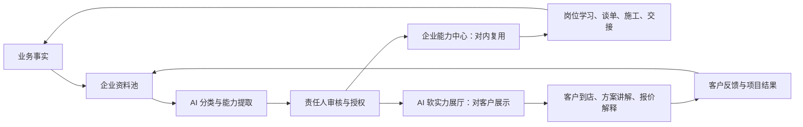

# 装得清企业能力沉淀与软实力展示 AI 产品设计方案

> 文档编号：PRODUCT-AI-20260926-002  
> 版本：v1.0  
> 状态：`draft_for_review`  
> 日期：2026-09-26  
> 定位：企业资料沉淀、岗位能力复用、案例治理、企业知识资产和对客软实力展示的专项产品设计  
> 关联文档：[装得清 AI 能力接入总体设计方案](./2026-09-26-装得清AI能力接入总体设计方案.md)  
> 关联业务依据：`CAP-001`、`CAP-002`、`SCN-007`、`SCN-011`、`SOL-004`、`SOL-005`、`DEC-010`、`DEC-011`、`GAP-001`  
> 硬性边界：AI 不能编造企业案例、资质、客户评价、经营数据和交付能力；跨租户训练和三方数据使用继续执行现有授权、脱敏、隔离、撤回和审计要求。
> 总册入口：[装得清 AI 能力接入详细设计方案（总册）](./2026-09-26-装得清AI能力接入详细设计方案-总册.md)  

---

## 0. 一页结论

中小装企真正缺的不是“再多一个文件夹”，而是把持续发生的客户、合同、报价、设计、施工、验收、整改、图片和沟通记录，转成企业能够反复使用的能力资产。

本方案把企业沉淀设计为两个产品面：

1. **对内：企业能力中心**
   - 管企业资料；
   - 提炼业务能力；
   - 沉淀优秀案例、标准做法、话术和模板；
   - 支持新员工学习、老员工复用和岗位交接。

2. **对外：AI 软实力展厅**
   - 不堆企业自夸，而是按客户所在阶段和房屋情况，展示公司“凭什么能承接、怎么做、做过什么、谁负责、如何验收”；
   - 所有内容都有来源、授权和发布时间；
   - 客户看到的不是 AI 编出来的漂亮话，而是企业真实业务事实的个性化表达。

产品闭环：

```text
企业已在装得清开展真实业务
-> 合同、报价、方案、照片、验收、整改、沟通记录持续进入资料池
-> AI 自动分类、提取案例、提炼能力和发现缺口
-> 责任角色审核、授权、脱敏和定价可见性检查
-> 形成企业能力资产、案例库、SOP、模板和岗位知识
-> 员工在谈单、设计、施工、交接和培训中复用
-> 客户到店时按客户情况生成个性化软实力展示
-> 客户反馈和项目结果再次反哺企业资产
```

---

## 1. 真实业务问题

### 1.1 企业没有沉淀资料能力

- 合同、报价、图片、CAD、验收单、整改照片和沟通记录散落在个人电脑、微信、纸质文件和不同员工手里。
- 企业知道自己做过很多项目，但无法快速找出“相似户型、相似预算、相似风格、相同施工难点”的案例。
- 资料只有“存起来”，没有分类、版本、证据、授权和复用机制。
- 员工离职后，文件能找到一部分，但其中的处理经验、客户异议、设计取舍和施工教训大量丢失。

### 1.2 企业没有沉淀业务能力

- 报价漏项、谈单顺序、异常处理、供应商协调和客户沟通主要依赖个人经验。
- 优秀员工会做，其他人不会复用；管理者知道结果，却说不清标准动作。
- 新员工进入企业后，缺少按岗位、按阶段、按业务场景组织的真实训练材料。
- 项目中的错误整改、客户投诉和返工，结束后没有变成下一次可避免问题的知识。

### 1.3 企业软实力无法被客户感知

- 客户到店后通常看到公司介绍、几张效果图和几本图册，无法判断这家公司真实交付能力。
- 销售和设计师的讲解依赖个人表达能力：有人能讲出企业优势，有人只会讲价格。
- 企业已有的服务质量、施工留证、验收流程、整改能力、材料管理和案例，没有按客户关心的问题展示出来。
- 客户看到的案例往往与本人户型、预算、需求和阶段无关，无法形成“这家公司适合我”的感受。

---

## 2. 产品定位

### 2.1 对内定位

> 装得清企业能力中心，是中小装企的企业资料库、能力图谱、案例库、岗位知识库和交接工具。

它不等于传统网盘，也不是单纯的知识付费课程。它必须与真实项目、报价、合同、设计、材料、验收和财务事实绑定，确保知识和能力有来源、可追溯、可更新。

### 2.2 对外定位

> AI 软实力展厅不是静态企业官网，而是面向当前客户的个性化能力证明页。

对客户展示的逻辑从“我们很专业”改成：

```text
我们了解你的房子
-> 我们用什么方法做
-> 我们做过什么类似项目
-> 谁负责你的项目
-> 中间如何确认、验收和整改
-> 哪些承诺有企业事实支持
-> 下一步我们和你一起做什么
```

### 2.3 核心原则

1. **事实先于表达**：先有项目、合同、方案、照片、验收和授权，再生成企业介绍。
2. **证据先于宣传**：案例、资质、服务承诺、团队能力和客户评价必须有来源。
3. **岗位先于课程**：按业务员、设计师、项目经理、财务等岗位组织知识，不做泛泛文章库。
4. **复用先于堆积**：内容的价值是有多少岗位在多少业务阶段真正使用。
5. **内管先于外发**：企业资料、内部报价、成本和话术不自动对客户可见。
6. **授权先于案例**：客户案例、客户名称、项目地址、图片和评价必须有可追溯授权和脱敏状态。
7. **持续更新**：项目结果、市场价格、材料变化和标准流程更新后，旧知识不能继续冒充最新事实。

---

## 3. 产品结构

### 3.1 双面产品结构



### 3.2 六个企业资产域

| 资产域 | 主要内容 | 主要来源 | 对客户可用性 |
| --- | --- | --- | --- |
| 企业档案 | 企业名称、品牌、地址、服务范围、团队、资质、服务承诺 | 企业资料、员工、证书、合同模板 | 经审核可展示 |
| 能力资产 | 设计、报价、施工、材料、验收、整改、售后等能力项 | 业务规则、操作记录、员工实践 | 可筛选展示 |
| 案例资产 | 项目案例、户型、风格、预算档位、效果、施工和客户反馈 | 项目、设计、合同、验收、图片 | 必须授权和脱敏 |
| 知识资产 | SOP、标准做法、常见问题、风险提示、话术和模板 | 优秀项目、员工总结、规则文档 | 多数仅内部 |
| 证据资产 | 图片、合同附件、验收照片、证书、客户评价 | 业务附件和授权记录 | 按证据范围展示 |
| 学习资产 | 角色课程、场景训练、案例练习和交接清单 | 企业知识、真实案例、岗位任务 | 仅内部 |

### 3.3 资产状态

| 状态 | 含义 | 可否内部使用 | 可否客户展示 |
| --- | --- | --- | --- |
| 原始资料 | 刚上传或自动采集，未分类 | 仅上传者有权限时可见 | 否 |
| AI 已整理 | AI 完成分类、摘要和关联建议 | 经初审后可用 | 否 |
| 待审核 | 等待责任角色确认内容事实 | 可用于内部草稿 | 否 |
| 内部可用 | 内部知识已经确认 | 是 | 否 |
| 待授权 | 拟对客户展示，等待案例或数据授权 | 是 | 否 |
| 可展示 | 完成授权、脱敏和发布审核 | 是 | 是 |
| 已过期 | 依据已变更或有效期结束 | 可查看历史 | 否 |
| 已撤回 | 企业主动撤回或客户撤回授权 | 按审计保留 | 否 |

---

## 4. 对象与主导航设计

以下为产品级逻辑对象，最终实体、字段、状态和权限必须经过 T05/T06 冻结。

### 4.1 逻辑对象

| 对象 | 作用 | 关联 |
| --- | --- | --- |
| 企业档案 | 企业基础身份与服务范围 | Company、Store、Team |
| 企业资料 | 上传或自动采集的原始文件与说明 | 项目、合同、报价、设计、员工 |
| 企业能力 | 可被证明和复用的能力项 | 证据、案例、知识、SOP |
| 企业案例 | 从真实项目提炼的案例展示单元 | 项目、客户授权、设计、验收 |
| 企业知识 | SOP、经验、规则、话术和模板 | 能力、案例、岗位、业务阶段 |
| 展示证据 | 可被对客或内部使用的图片、文件、评价和结果 | 案例、能力、授权 |
| AI 展示页 | 面向当前客户的个性化软实力展示 | 客户、房屋、阶段、模板 |
| 岗位学习包 | 按角色和阶段组织的知识与任务 | 员工、岗位、能力、知识 |
| 交接包 | 离职、转岗或接续项目的能力和资料集合 | 员工、客户、项目、风险 |

### 4.2 内部导航

Web 端建议在现有“组织效能”下增加二级入口，或在后续明确一级导航时按 IA 决策调整：

```text
企业能力中心
├── 资产总览
├── 资料入库
├── 企业能力图谱
├── 案例库
├── SOP 与模板
├── 岗位学习
├── 交接中心
└── 对客展示管理
```

App 端不做完整资料管理，优先提供：

- 企业资料上传；
- 项目照片/资料补充；
- 案例待确认；
- 岗位知识问答；
- 交接事项查看。

### 4.3 对外导航

AI 软实力展厅建议独立于内部业务页面，可通过以下入口访问：

- 客户小程序“我的装企能力”；
- 设计师谈单时生成的客户专属链接；
- 报价/方案 HTML 中的“为什么选择我们”章节；
- 企业微信或销售发送的客户专属展示页。

链接必须带企业、客户、房屋、展示版本和访问权限，不能通过猜链接看到其他企业内容。

---

## 5. AI 处理链路

### 5.1 资料入库

支持来源：

- 本地文件、微信文件、拍照和扫描件；
- 合同、报价、设计文件、CAD、施工照片、验收照片、整改照片；
- 员工手册、标准流程、培训材料、证书和服务承诺；
- 已授权客户评价、回访和案例说明；
- 项目过程中自动产生的事实和附件。

AI 首轮处理：

1. 识别文件类型和业务归属；
2. 提取企业、项目、客户、房屋、金额、日期、角色和事项；
3. 自动打标签；
4. 关联现有项目和业务对象；
5. 给出是否可作为案例、知识或证据的建议；
6. 标记缺失证据、授权和责任人。

### 5.2 能力提炼

AI 从真实项目中抽取可复用能力，例如：

- 对某种户型、采光、动线或收纳问题的设计处理能力；
- 对某种施工工艺、材料组合和质量控制的做法；
- 对客户异议、变更、延期和整改的处理方法；
- 对某一预算档位和风格范围的方案能力；
- 对某一供应商、材料或交付方式的协同能力。

每个能力项必须至少有一个证据来源，并能明确：

```text
能力是什么
-> 在哪个项目验证过
-> 由谁完成
-> 用什么资料证明
-> 适用于什么客户和房屋
-> 有什么限制
-> 是否已客户授权
```

### 5.3 案例提炼

案例不是把项目图片拼在一起，而是按客户关心的问题组织：

| 案例模块 | 内容 |
| --- | --- |
| 客户与房屋 | 户型、面积、家庭结构、关键问题 |
| 初始诉求 | 客户关注点、排斥点、预算范围 |
| 设计策略 | 为什么这么设计，回应了哪些需求 |
| 施工过程 | 关键节点、材料、工艺、风险处理 |
| 验收结果 | 验收结论、证据、整改闭环 |
| 客户价值 | 解决了什么问题，但不得编造效果比例 |
| 证据与授权 | 图片、合同范围、客户授权和脱敏状态 |

### 5.4 业务能力沉淀

AI 从优秀员工的项目中提炼：

- 谈单顺序；
- 需求确认清单；
- 报价解释方式；
- 设计取舍原则；
- 施工风险清单；
- 客户沟通节点；
- 整改和异常处理；
- 供应商协调方法。

系统提示用户确认：

> AI 从项目 X 和员工 Y 的记录中提炼了一个“主材选材跟进方法”。是否作为企业标准？

只有企业确认后，个人经验才成为企业知识。

### 5.5 岗位学习与交接

AI 按角色生成：

| 角色 | 学习与交接内容 |
| --- | --- |
| 业务员 | 客户来源、跟进、量房预约、常见异议和案例匹配 |
| 设计师 | 需求、量房、CAD、方案、报价、谈单和变更 |
| 项目经理 | 排期、任务、材料、日报、验收、整改和安全边界 |
| 财务/履约 | 应收、应付、成本完整性和台账 |
| 店长 | 团队漏斗、项目风险、客户异议和门店经营 |
| BOSS | 企业能力缺口、经营风险和知识资产状态 |

新员工不只阅读文章，还要完成“看真实案例 -> 回答问题 -> 模拟操作 -> 找到原始证据 -> 通过责任角色确认”的任务链。

---

## 6. 对内产品设计：企业能力中心

### 6.1 资产总览

首屏不先展示文件夹，而是展示企业还缺什么能力、哪些资料还没有完成治理。

建议卡片：

1. **企业资料完整度**：基础档案、资质、团队、服务承诺、流程文档。
2. **案例覆盖度**：按户型、面积、风格、预算和业务类型统计可展示案例。
3. **能力证据覆盖度**：有多少能力项有真实项目和证据支持。
4. **待治理资料**：未分类、未关联、未授权、待审核和已过期。
5. **岗位使用情况**：知识被哪些角色在哪些阶段使用。
6. **能力缺口**：企业没有形成标准动作或缺少案例的环节。

每个数字都可以下钻到具体资料、项目和责任人。

### 6.2 资料入库页

资料上传后分三段展示：

```text
原始资料
-> AI 理解与归类
-> 责任人确认
```

AI 结果采用可编辑表单，不直接写正式资产：

- 文件类型；
- 所属企业、项目、客户和房屋；
- 候选能力标签；
- 候选案例；
- 是否包含个人信息；
- 是否包含成本或内部价格；
- 是否具备客户展示授权；
- 建议责任人和审核期限。

### 6.3 企业能力图谱

图谱以业务主链分层，不使用抽象词堆砌：

```text
获客与客户经营
设计转化
报价与合同
项目履约
材料与供应链
验收与整改
财务与经营
售后服务
```

每个能力卡展示：

- 能力名称；
- 适用角色和阶段；
- 关联 SOP；
- 关联案例数；
- 关联证据数；
- 最新更新时间；
- 负责审核人；
- 当前状态。

点击能力后，显示“标准动作、真实案例、常见风险、相关模板、适用限制”。

### 6.4 案例库

案例库支持按客户和房屋维度检索：

- 户型；
- 面积；
- 风格；
- 预算档位；
- 空间问题；
- 施工难点；
- 材料类型；
- 企业、门店和项目类型。

案例卡分为三层：

1. **客户可看摘要**：经过脱敏和授权；
2. **员工可看详情**：包含设计策略、过程证据和内部说明；
3. **审计信息**：来源项目、授权、版本、审核人和发布时间。

### 6.5 SOP 与模板

AI 可基于真实项目生成：

- 报价检查清单；
- 量房提问清单；
- 客户异议回应；
- 设计讲解顺序；
- 施工节点证据清单；
- 验收前检查清单；
- 整改跟进模板；
- 回款跟进模板；
- 项目交接清单。

每份 SOP 必须关联适用角色、阶段、业务对象、触发条件和责任角色，不能只是文章。

### 6.6 岗位学习

学习页按“今天要做什么”组织，而不是按课程章节：

- 第一次接待客户；
- 第一次做量房；
- 第一次做设计报价；
- 第一次处理变更；
- 第一次提交验收；
- 第一次处理业主反馈；
- 第一次接手离职员工客户。

每个任务包含真实业务页面入口、案例、检查清单和完成证据。

### 6.7 交接中心

交接包自动汇总：

- 当前负责的客户和房屋；
- 报价、合同和项目状态；
- 未完成事项；
- 施工、材料、验收和整改风险；
- 关键沟通背景；
- 历史负责人经验；
- 需要接收人确认的事项。

接收人必须逐项确认，不能由 AI 自动宣告交接完成。

---

## 7. 对外产品设计：AI 软实力展厅

### 7.1 目标呈现顺序

客户到店、看方案或收到链接时，看到的不是通用公司介绍，而是按以下顺序生成的“客户专属能力证明”：

1. **我们理解你的房子**：户型、面积、家庭结构、核心问题和关键诉求。
2. **我们怎么做**：设计、报价、施工、材料、验收和变更的标准流程。
3. **我们做过什么**：匹配客户房屋和需求的真实案例。
4. **谁为你负责**：设计师、项目经理、店长和售后角色。
5. **我们如何保证透明**：报价版本、合同变更、施工留证、验收轮次和整改闭环。
6. **我们有哪些真实证据**：图片、验收、证书、授权客户评价和服务承诺。
7. **你的下一步**：约量房、确认设计方向、查看报价或到店沟通。

### 7.2 四类信任证据

| 信任类型 | 客户问题 | 展示内容 | 必须满足 |
| --- | --- | --- | --- |
| 专业证据 | 你们懂我的房子吗 | 相似户型案例、设计分析、量房能力和工艺说明 | 有真实项目依据 |
| 过程证据 | 你们怎么保证不失控 | 报价、变更、施工、验收和整改流程 | 有系统事实或正式规则 |
| 结果证据 | 你们做过什么 | 已完成项目、验收记录、授权图片和客户评价 | 有授权、脱敏和版本 |
| 责任证据 | 出了问题谁负责 | 项目角色、售后入口、责任边界和服务承诺 | 不得超出企业真实承诺 |

### 7.3 客户专属展示页结构

#### 首屏：企业身份与客户关联

- 企业名称、品牌、所在地和服务范围；
- 当前客户姓名和房屋的脱敏称呼；
- 本次展示对应哪个客户、房屋和阶段；
- 生成时间、版本和分享人。

#### 第二屏：我们对房屋的理解

- 户型、面积、家庭结构和关键诉求；
- 量房或图纸来源；
- 待现场复核事项；
- 不假装已完成的信息明确标记。

#### 第三屏：我们怎么做

按客户当前阶段显示，不一次性塞满所有内容：

- 尚未量房：量房流程、设计前期准备和案例；
- 设计阶段：设计流程、材料选择、报价形成；
- 报价阶段：报价构成、变更规则和金额边界；
- 施工阶段：任务、材料、日报、验收和整改；
- 项目收尾：验收、结算和售后。

#### 第四屏：相似案例

客户可看到：

- 相似户型或空间问题；
- 案例设计策略；
- 实际交付证据；
- 材料与风格范围；
- 适用说明和限制。

不得展示未授权客户姓名、地址、电话、合同金额和内部成本。

#### 第五屏：项目团队与责任

- 角色名称和真实职责；
- 不展示不必要的个人敏感信息；
- 项目发生人员调整时，明确交接状态。

#### 第六屏：企业服务承诺

只展示已确认且企业可执行的内容：

- 报价版本；
- 变更确认；
- 施工留证；
- 阶段验收；
- 整改闭环；
- 售后入口。

不能由 AI 自动生成“终身保修”“零增项”“绝不延期”等承诺。

#### 第七屏：下一步

提供与当前客户阶段一致的行动：

- 预约量房；
- 查看设计方案；
- 确认需求；
- 查看报价；
- 到店沟通；
- 提交反馈。

### 7.4 三类个性化展示包

| 展示包 | 适用阶段 | 核心内容 | 主要使用者 |
| --- | --- | --- | --- |
| 初次接待包 | 客户刚到店、尚未量房 | 企业能力、相似案例、服务流程、预约量房 | 业务员、店长 |
| 设计谈单包 | 已量房、设计或报价阶段 | 房屋理解、设计策略、三案方向、报价解释、案例 | 设计师、店长 |
| 施工安心包 | 已签约、施工阶段 | 团队、施工计划、材料、日报、验收、整改和售后 | 项目经理、客服、店长 |

### 7.5 客户到店的推荐体验

```text
客户到店或留下房屋信息
-> 业务员/设计师建立客户和房屋
-> AI 匹配相似案例和可展示能力
-> 生成客户专属软实力展示包
-> 员工确认客户可见内容
-> 客户扫码或点击链接查看
-> 客户点选关注点、收藏案例或留言
-> 系统回写客户画像、诉求和下次沟通建议
```

这不是自动群发营销，而是销售和设计沟通的辅助材料。

---

## 8. 权限与数据范围

### 8.1 内部角色

| 角色 | 资料上传 | 查看内部知识 | 审核资产 | 对外发布 | 删除 |
| --- | --- | --- | --- | --- | --- |
| BOSS | 是 | 全企业 | 最终审核 | 是 | 按规则 |
| 店长 | 本门店 | 本门店/授权范围 | 门店内容 | 经授权 | 否 |
| 团队负责人 | 本团队 | 本团队/授权范围 | 团队内容 | 经授权 | 否 |
| 普通员工 | 本人业务资料 | 按角色和阶段 | 提交审核 | 否 | 否 |
| 财务/履约 | 相关业务资料 | 相关范围 | 成本敏感内容 | 否 | 否 |
| 运营管理员 | 平台资料 | 仅平台范围 | 平台内容 | 否 | 否 |

### 8.2 对客可见

- 只有状态为“可展示”的资产才能进入客户专属展示页。
- 客户只能查看与企业绑定的展示版本，不能看到内部草稿、其他客户或其他企业的案例。
- 展示页面按客户、房屋、项目和分享链接校验，不能依赖可枚举的公开参数。
- 客户查看行为可以记录，但不得将浏览行为扩展为未经授权的营销画像。
- 展示页必须支持撤回、失效和重新发布。

### 8.3 敏感信息

| 信息 | 处理要求 |
| --- | --- |
| 客户姓名、电话、地址 | 对客案例默认脱敏，不必要不展示 |
| 合同金额、折扣、成本 | 不进入客户案例和软实力展示 |
| 供应商价格和内部利润 | 仅授权内部角色可见 |
| 设计 CAD 和施工现场照片 | 按客户、项目和版本隔离 |
| 客户评价和授权截图 | 必须保留授权来源、范围和撤回状态 |
| 员工个人资料 | 只展示岗位职责，不展示与业务无关的信息 |

---

## 9. 案例授权与事实治理

### 9.1 案例来源

案例只能来源于：

- 已真实执行业务的项目；
- 已有真实客户和房屋关系的项目；
- 有过程、结果或附件证据的项目；
- 经企业确认可用作内部学习的项目；
- 经客户授权和脱敏后可作为对外展示的项目。

模拟数据、测试项目、演示数据和未授权聊天截图不得成为正式案例。

### 9.2 案例状态

```text
候选案例
-> AI 提炼
-> 业务责任人确认
-> 客户授权/脱敏
-> 内部可用
-> 对外可展示
-> 定期复审
-> 过期或撤回
```

### 9.3 事实等级

| 等级 | 用途 | 示例 |
| --- | --- | --- |
| 原始事实 | 内部追溯 | 合同、报价、验收和现场图片 |
| 已确认事实 | 内部业务分析 | 已确认的设计方案和项目结果 |
| 可授权案例 | 客户展示 | 脱敏后的真实项目和客户反馈 |
| AI 建议 | 辅助表达 | 可能适用的案例匹配、讲解顺序 |
| 未验证假设 | 不得对外 | AI 推断的企业优势或客户价值 |

### 9.4 关联业务缺口

业务智能体已识别“客户授权案例与效果证据”是市场宣传缺口。本方案不自行宣布授权流程已经具备，T05 必须确认：

- 客户授权的采集时点和有效期；
- 授权撤回后的处理；
- 公开范围和渠道；
- 证照、资质和评价的核验责任；
- 测试、演示和真实案例的隔离。

---

## 10. 用户旅程

### 10.1 场景一：BOSS 第一次整理企业资料

**使用人**：企业负责人。  
**触发事件**：企业已经使用装得清一段时间，但企业资料仍散落在微信和电脑中。  
**当前动作**：让行政、设计师和项目经理分别找文件，整理速度慢，仍然无法证明企业能力。  
**系统下一步**：BOSS 批量上传资料，AI 分类并关联项目，列出缺失资料和可提炼能力，责任角色逐项确认。  
**客户感知**：后续员工和客户看到的是统一企业能力，不再是各岗位各讲一套。  
**异常处理**：资料无来源、无授权、成本敏感或跨企业时，不进入可展示资产库。

### 10.2 场景二：新业务员接待客户

**使用人**：新入职业务员。  
**触发事件**：客户到店，询问公司做过哪些类似户型，是否了解自己的问题。  
**当前动作**：业务员不熟悉公司案例，只能发送通用图册或请设计师救场。  
**系统下一步**：根据客户和房屋匹配相似案例、服务流程和可展示证据，生成初次接待包和讲解顺序。  
**客户感知**：客户感到企业真正理解自己的房屋，并能看到真实过程证据。  
**异常处理**：没有足够相似案例时，明确展示企业处理该问题的流程和待确认项，不编造案例。

### 10.3 场景三：设计师谈单

**使用人**：设计师。  
**触发事件**：方案和报价已经形成，需要向客户解释为什么这样设计、为什么这样报价。  
**当前动作**：设计师依赖个人记忆，不同客户解释不一致，案例和报价脱节。  
**系统下一步**：从企业案例、需求回应、报价快照和项目证据生成设计谈单包，设计师确认后给客户查看。  
**客户感知**：客户看到设计方案、相似案例、报价解释和验收流程之间的对应关系。  
**异常处理**：成本不可见、报价未确认、案例未授权时，不生成对应内容。

### 10.4 场景四：项目经理接手离职员工项目

**使用人**：项目经理、店长、BOSS。  
**触发事件**：原项目经理离职，多个项目需要重新接手。  
**当前动作**：靠微信群翻记录、打电话询问，关键风险容易遗漏。  
**系统下一步**：AI 汇总项目状态、未完成任务、材料、验收、整改、客户沟通和风险，生成交接包。  
**客户感知**：项目仍然连续推进，不会因为人员变化重新问一遍。  
**异常处理**：历史记录缺失的信息进入待确认，不猜测责任和进度。

### 10.5 场景五：项目完成后形成企业案例

**使用人**：设计师、项目经理、店长、BOSS。  
**触发事件**：项目验收完成，资料完整。  
**当前动作**：照片和资料归档后无人整理，下一次谈单仍找不到。  
**系统下一步**：AI 提炼案例草稿，责任人补充设计策略和施工亮点，取得客户授权后进入案例库。  
**客户感知**：后续客户可以看到经过真实交付验证的案例。  
**异常处理**：项目未完、验收未闭环、客户未授权或资料缺失时，保持候选状态，不对外展示。

### 10.6 场景六：新员工入职学习

**使用人**：新设计师、新业务员、新项目经理。  
**触发事件**：员工入职，需要尽快独立处理业务。  
**当前动作**：由老员工口头带教，内容不稳定，遗漏多。  
**系统下一步**：按岗位生成学习路径、真实案例、检查清单和操作任务。  
**客户感知**：客户面对的新员工仍然能按企业标准提供稳定服务。  
**异常处理**：没有真实案例的知识只显示为规则或待验证内容，不作为企业案例。

---

## 11. 目标呈现清单

### 11.1 Web 企业能力中心

| 页面 | 首屏必须回答 | 主要动作 |
| --- | --- | --- |
| 资产总览 | 企业有什么、缺什么、哪些不能用 | 补资料、审核、查看缺口 |
| 资料入库 | 这批资料是什么、属于谁、能否使用 | 分类、关联、审核、授权 |
| 能力图谱 | 企业有哪些真实能力、支撑证据是什么 | 维护能力、关联 SOP、查看案例 |
| 案例库 | 有哪些可按客户匹配的真实案例 | 检索、编辑、授权、发布 |
| SOP 与模板 | 每个岗位和阶段怎么做 | 查看、引用、更新版本 |
| 岗位学习 | 新员工今天要学什么、做什么 | 学习、练习、完成任务 |
| 交接中心 | 接手人还缺哪些事实和风险 | 确认、补充、移交 |
| 对客展示管理 | 哪些内容已经可以给客户看 | 预览、发布、撤回、复审 |

### 11.2 App 员工端

- 企业资料快速上传；
- 项目照片和资料补录；
- 案例待确认提醒；
- 岗位知识问答；
- 今日学习任务；
- 交接事项确认；
- 客户专属展示包预览和分享。

### 11.3 客户小程序端

- 企业身份和服务范围；
- 当前房屋和需求理解；
- 相似案例；
- 企业服务流程；
- 项目团队；
- 验收与整改留证；
- 服务和售后入口；
- 下一步业务动作。

---

## 12. 观测指标

指标先内部使用，样本、公式和时间口径冻结后才考虑对外表达。

| 指标 | 建议定义 | 用途 |
| --- | --- | --- |
| 企业资料完整度 | 已治理资料类型数 / 已定义资料类型数 | 判断基础沉淀程度 |
| 资料关联率 | 已关联真实项目的资料数 / 已上传资料数 | 判断资料是否可用 |
| 能力证据覆盖率 | 有真实证据的能力项数 / 企业能力项数 | 判断能力是否可信 |
| 案例授权率 | 已授权可展示案例数 / 候选案例数 | 判断对外展示能力 |
| 案例复用率 | 被员工在谈单、学习或交接中使用的案例数 / 可展示案例数 | 判断实际价值 |
| 岗位知识触达率 | 完成角色学习任务员工数 / 应学习员工数 | 判断学习闭环 |
| 交接完整率 | 一次性完成全部交接确认的岗位数 / 总交接岗位数 | 判断岗位连续性 |
| 客户展示使用率 | 生成客户专属展示包并打开的客户数 / 生成数 | 判断客户是否真正使用 |
| 展示反馈率 | 客户完成案例收藏、需求点选或留言数 / 打开展示页数 | 判断内容是否被理解 |
| 资产过期率 | 已过期资产数 / 已发布资产数 | 判断治理质量 |

不得用“上传文件数”“AI 生成资料数”“知识库文章数”单独证明企业能力提升。

---

## 13. 分期实施

### P0：企业资料治理与内部知识助手

范围：

- 企业档案和资料入库；
- 文件分类、OCR、摘要、项目关联和敏感信息标记；
- 企业能力项和证据基础；
- 案例候选库；
- 角色知识问答；
- 审核、版本、过期和撤回。

目标：让企业先能做到“找得到、看得懂、有来源、能审核”。

### P1：案例库、岗位学习与交接

范围：

- 从真实项目中提炼案例；
- 客户授权和脱敏流程；
- 岗位学习包；
- 离职/转岗交接包；
- SOP 和模板从真实项目提炼；
- 按角色推送知识和练习任务。

目标：让企业经验和资料开始被岗位重复使用。

### P2：AI 软实力展厅

范围：

- 客户专属展示页；
- 初次接待包、设计谈单包、施工安心包；
- 相似案例匹配；
- 服务流程和责任角色展示；
- 客户反馈回写。

目标：让客户在到店、方案和施工阶段感知企业的真实能力。

### P3：企业能力图谱与持续优化

范围：

- 能力证据覆盖度；
- 岗位能力差距；
- 优质项目自动发现；
- 报价、设计、施工和整改最佳实践提炼；
- 案例效果和客户反馈复盘；
- 企业知识版本升级。

---

## 14. 验收基线

### 14.1 正常路径

- 真实项目资料可以上传、分类、关联、审核并进入企业资产。
- 员工可以在授权范围内检索和复用案例、模板和 SOP。
- 客户可以看到按本人房屋和阶段匹配的软实力展示。
- 项目完成后可以生成案例候选并进入授权治理流程。

### 14.2 反向路径

- 未授权案例不能对客户展示。
- 未脱敏的客户姓名、电话、地址不能进入公开案例。
- 成本、折扣、利润和内部供应商价格不能进入客户展示。
- 测试项目、模拟数据和演示案例不能冒充真实案例。
- 非企业成员不能通过链接查看客户专属展示页。
- 资产过期、撤回或依据变化后不能继续使用旧版本。

### 14.3 异常路径

- 文件损坏、扫描不清、OCR 失败：保留原始资料，不生成伪结果。
- 资料无法归属项目：进入待确认，不自动猜测。
- 跨企业或跨门店对象：阻断关联和展示。
- 授权撤回：立即停止展示，保留撤回记录。
- AI 超时或模型不可用：保留资料和人工整理路径。

### 14.4 质量路径

- 每项企业能力至少有一项证据。
- 每个可展示案例至少有客户授权、脱敏状态和审核记录。
- 每份 SOP 至少有适用角色、阶段、触发条件和责任角色。
- 每个客户展示页有生成版本、审核人、发布时间和失效条件。

---

## 15. 与现有产品的关系

| 现有能力 | 如何复用 | 本方案新增的重点 |
| --- | --- | --- |
| Company | 企业基本资料和品牌 | 企业档案、展示版本和对外范围 |
| 客户与房屋 | 客户、房屋、需求和服务上下文 | 客户专属软实力展示 |
| 设计转化 | 方案、区域、CAD 和谈单资料 | 设计能力、案例和讲解包 |
| 报价与合同 | 报价、合同、变更和项目事实 | 报价方法、服务承诺和案例证据 |
| 项目与验收 | 施工、任务、照片、验收和整改 | 过程证据、交付能力和案例来源 |
| 材料与供应链 | 材料、供应商和采购记录 | 材料能力和供应协同知识 |
| 财务经营 | 项目成本、回款和结算 | 经营经验和风险复盘，不对客户泄露 |
| 组织权限 | 企业、门店、团队和员工 | 岗位知识、学习、交接和能力图谱 |
| 文件与单据 | 文件、模板、HTML、PDF | 资料治理、版本、授权和展示资产 |
| AI 用量与订阅 | AI 能力权益和用量 | 企业知识检索、生成和展示消耗 |

---

## 16. 必须守住的边界

1. AI 不能把企业尚未验证的能力写成已具备能力。
2. AI 不能把模拟、测试或演示项目写成真实客户案例。
3. AI 不能在没有授权和脱敏的情况下对外展示客户资料。
4. AI 不能将内部成本、折扣、利润和供应商价格混入客户展示。
5. AI 不能自动发布客户可见页面，必须经过责任角色和案例授权检查。
6. AI 提炼的员工经验，只有在企业确认后才成为企业标准。
7. 客户撤回授权后，相关展示必须撤回并保留审计记录。
8. 企业能力展示必须回到真实业务事实，不得制造企业软实力幻觉。

---

## 17. 待裁决事项

完整 T05 见：[REQ-BIZ-20260926-003 企业能力资产与软实力展示](./consultations/REQ-BIZ-20260926-003-企业能力资产与软实力展示.md)。

优先裁决：

1. 企业能力、案例、知识和展示证据是否作为正式业务对象。
2. 企业资料的所有权、审核权、门店/团队可见范围和 BOSS 最终控制权。
3. 客户案例授权的采集时点、期限、范围、撤回和删除。
4. 员工项目经验归属于个人、企业还是双方，离职后如何保留和使用。
5. 哪些企业资料可以对外展示，哪些永远只能内部使用。
6. 案例图片、CAD、施工照片和客户评价的脱敏规则。
7. 企业能力图谱、案例、SOP 和学习包的审核责任。
8. 客户专属展示页的分享、访问、失效和审计规则。
9. 企业知识助手能否读取企业历史业务资料，以及读取后的保留期限。
10. 企业能力、岗位能力、案例复用和学习效果是否可以形成对外表达指标。
