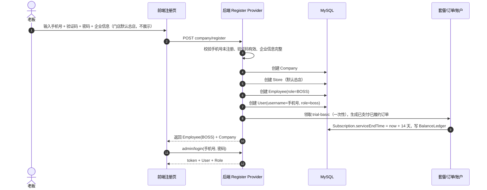
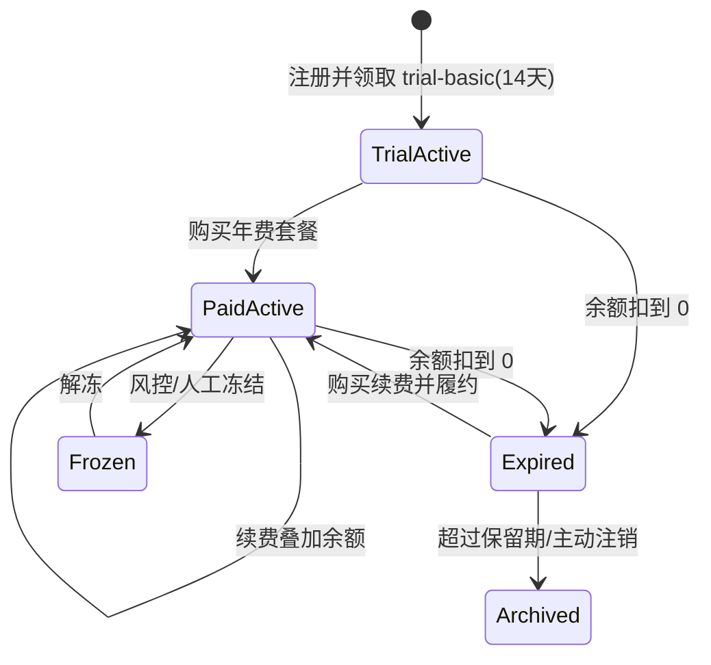
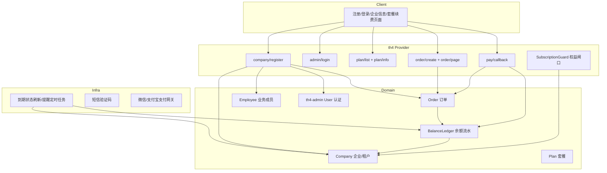

# 装得清 用户体系与续费体系设计

> 项目：th4-decoboon 后端
> 文档定位：业务产品 + 技术架构设计稿，落地实现前用于对齐方案；实际编码仍以工程根目录 `rules.md` 为唯一代码规范。
> 版本：v1.0 · 2026-09-06

---

## 1. 一页结论

1. **登录账号与业务成员分离**：复用 th4-admin 的 `User`（`th4_sys_user`）做认证，业务侧继续用 `Employee` 承载“老板/业务员”的企业成员身份。`User.username = 手机号`，`Employee.phone = 手机号`，一条注册/入职链路同时创建两个对象。计费主体则独立为 `Subscription`。
2. **租户 = 企业 = Company**：一家装修公司一套隔离数据。BOSS 手机号注册时，在同一事务里创建 `Company + Employee(BOSS) + User(boss)`，并发放“免费 14 天基础包”。
3. **免费 14 天做成“套餐 + 订单 + 余额”**：不是写死 `14`，而是定义 `Plan(code=trial-basic, days=14, price=0, oneTimeOnly=true)`，注册时创建一笔 `Order`，由订单履约给企业账户加 14 天余额。每个企业只允许购买/领取一次。
4. **续费采用“服务到期时间”方案**：`Subscription.serviceEndTime` 作为事实来源，剩余可用天数由 `serviceEndTime - 当前时间` 动态计算，不落库；购买年费套餐时向后顺延 365 天。
5. **可审计与幂等**：`Order` 是支付/履约凭证，`BalanceLedger` 是余额流水，二者配合能解决支付回调重复、并发续费、退款和对账。
6. **到期策略**：过期企业进入“只读/软冻结”，保留数据，限制新增线索、视频生成、新增员工等消耗性能力；续费后自动恢复。

---

## 2. 业务产品设计

### 2.1 角色与职责

| 角色 | 平台认证角色 | 业务对象 | 核心职责 | 是否登录账号 |
| --- | --- | --- | --- | --- |
| 老板 BOSS | `Role.idKey=boss` | `Employee(role=BOSS)` | 注册企业、管理员工/门店、看经营数据、购买续费 | 是 |
| 业务员 Marketer | `Role.idKey=marketer` | `Employee(role=MARKETER)` | 发布视频、登记线索、跟进客户、使用素材/模板 | 是 |
| 门店/其他角色（预留） | 可扩展 `Role` | `Employee(role=...)` | 后续按门店看数 | 是 |

现有 `@Role` 已注册 `boss` 与 `marketer`，**业务侧不需要新增两个“角色”，而是新增“角色与员工身份的绑定关系”**。

### 2.2 BOSS 注册闭环



关键业务规则：

- 手机号是平台全局唯一登录名，一个手机号只能对应一个平台 `User`。
- BOSS 注册必须填写企业名称，城市可选；后端在同一事务创建企业并自动创建一家默认总店（`defaultStore=true`）。默认阶段前端不展示门店概念，后续购买/开通多门店权益后才展示门店维度。
- 验证码发送走业务域 `user/sms/send`；注册接口只收 `smsCode`，并在 `user/register` Provider 内注入 `Validator` 完成校验，不落库明文密码。
- 免费 14 天仅在“企业首次注册”时发放，防重复注册/换手机号薅试用。

### 2.3 门店维度的产品设计

- **默认只有总店**：注册时后端自动创建一家默认总店，`Store.defaultStore=true`，`Store.name="总店"`；前端默认不展示门店选择、门店管理、门店维度筛选。
- **多门店是权益**：只有套餐/权益中 `Plan.maxStores > 1` 时，企业才具备多门店能力。
- **启用开关**：`Company.setting.enableStore` 控制前端是否展示门店维度；默认 `false`，企业开通多门店权益后由后端置为 `true`。
- **数据归属不变**：即使不展示门店，员工、团队、线索、视频仍通过默认总店完成企业内归属，后续启用多门店时无需迁移主数据。

### 2.4 企业生命周期



状态建议收敛为企业账户状态枚举：

- `TRIAL`：试用中，权益完整但续费引导强。
- `ACTIVE`：正式付费/续费中。
- `EXPIRED`：余额耗尽，进入只读保护。
- `FROZEN`：人工/风控冻结。
- `CLOSED`：注销/长期未续费归档。

### 2.5 续费产品策略

建议首版 2 个套餐：

| planCode | 名称 | 价格 | 天数 | 是否仅一次 | 说明 |
| --- | --- | --- | --- | --- | --- |
| `trial-basic` | 基础试用包 | 0 元 | 14 天 | 是 | 注册即送，只可领取一次 |
| `annual-pro` | 专业版年费 | 299 元/年（示例价） | 365 天 | 否 | 可多次购买，余额叠加 |

后续可扩展：季费、多年包、多门店权益、AI 视频额度包等；结构上通过 `Plan.maxStores` 控制门店数量，`maxStores=1` 为默认总店，`maxStores>1` 才启用多门店。

---

## 3. 核心技术架构

### 3.1 总体分层



### 3.2 包结构规划（对齐 rules.md）

```text
com.th4.edge.decoboon
├── company                          # 企业/成员/门店（已有，扩展）
│   ├── model
│   │   ├── Company.java             # 增加余额/生命周期/套餐关联
│   │   ├── Employee.java            # 增加 role + user 关联
│   │   └── Store.java
│   ├── configure
│   │   ├── EmployeeRole.java        # BOSS / MARKETER / ...
│   │   └── CompanyStatus.java       # TRIAL / ACTIVE / EXPIRED / FROZEN / CLOSED
│   ├── repository
│   └── service
│       ├── companies/register       # 企业注册 + 建老板 + 发试用
│       ├── companies/info           # 企业详情（含余额、到期时间）
│       ├── companies/renew          # 续费下单/履约（自定义能力）
│       ├── employees/invite         # 邀请业务员（建 User + Employee）
│       └── employees/update
├── billing                          # 计费域（新增）
│   ├── model
│   │   ├── Subscription.java      # 企业账户（计费主体/余额读模型）
│   │   ├── Plan.java                # 套餐
│   │   ├── Order.java               # 订单
│   │   └── BalanceLedger.java       # 余额流水
│   ├── configure
│   │   ├── OrderStatus.java
│   │   ├── PayChannel.java
│   │   └── LedgerBizType.java
│   ├── repository
│   ├── service
│   │   ├── plans/list               # 套餐列表
│   │   ├── orders/create            # 创建续费订单
│   │   ├── orders/page              # 我的订单
│   │   └── orders/callback          # 支付回调（外部网关）
│   ├── context
│   │   └── SubscriptionContext.java # 发权益/扣天数/到期判断
│   ├── listener
│   │   └── OrderPaidListener.java   # 订单支付完成 → 履约
│   └── scheduler
│       └── SubscriptionDailyScheduler.java
├── configure                        # @Role/@View 增加“企业信息/套餐续费/订单记录”
```

---

## 4. 数据模型设计

### 4.1 认证与业务成员关系

平台侧 `User`（th4-admin 自带，不修改源码）：

| 字段 | 用途 |
| --- | --- |
| `username` | 手机号，全局唯一 |
| `password` | `md5(username + 明文密码)`，与现有登录算法保持一致 |
| `role` | `boss` / `marketer` |
| `status` | 正常 / 禁用 |
| `type` | `App` |

业务侧 `Employee` 在现有字段上扩展：

| 字段 | 类型/关联 | 说明 |
| --- | --- | --- |
| `company` | `@ManyToOne(Company)` | 已有 |
| `name/phone/wechat/active` | 已有 | 手机号作为登录名 |
| `role` | `EmployeeRole` | 新增，`BOSS` / `MARKETER` |
| `user` | `@ManyToOne(User)` | 新增，可选；指向平台登录账号，`@JoinColumn(name="user_id")` |
| `displayCompanyName` | 已有 | 前端下拉默认项 |

> 若后续为避免跨 jar 实体映射，可退化为“以 `phone` 作为逻辑关联，不落 `user_id` 物理外键”，但推荐先按 `@ManyToOne` 对象关联实现，符合五条铁律。

### 4.2 企业账户 Subscription（独立计费对象）

计费信息**不要放在 Store（门店）**，也不建议长期直接堆在 `Company` 上。行业标准做法是独立出“企业账户/订阅账户”：

```java
@Note("企业账户")
@Description("企业订阅与可用天数余额，计费域唯一读写主体")
@Model @Entity @Table(name = "db_clue_company_account")
public class Subscription extends AbstractModel {

    @Note("企业账户索引")
    @Id @GeneratedValue(strategy = GenerationType.IDENTITY)
    private Long accountId;

    @Note("所属企业")
    @ManyToOne(fetch = FetchType.LAZY)
    @JoinColumn(name = "company_id", nullable = false, unique = true)
    private Company company;

    @Note("企业生命周期")
    @Column(nullable = false, length = 16)
    private CompanyStatus status = CompanyStatus.TRIAL;

    @Note("当前套餐")
    @ManyToOne(fetch = FetchType.LAZY)
    @JoinColumn(name = "plan_id")
    private Plan plan;

    @Note("服务到期时间")
    @Embedded
    @AttributeOverrides({ /* DateTime 列映射 */ })
    private DateTime serviceEndTime;

    @Note("服务到期时间")
    @Embedded
    @AttributeOverrides({ /* DateTime 列映射 */ })
    private DateTime serviceEndTime;

    @Note("是否已领取试用")
    @Column(nullable = false)
    private Boolean trialActivated = Boolean.FALSE;

    @Note("最近续费时间")
    @Embedded
    @AttributeOverrides({ /* DateTime 列映射 */ })
    private DateTime lastRenewTime;
}
```

设计边界：

- `Company` 只保留企业基础档案（名称、城市、启停、门店等），**不直接承载计费余额**。
- `Store` 是组织单元，只存门店自身档案，**绝不放余额/套餐**。
- `Subscription` 是计费读模型快照；**事实来源是 `Order + BalanceLedger`**。
- 剩余可用天数不落库，统一由 `SubscriptionContext.remainingDays()` 计算：`serviceEndTime - now`，向上取整。

### 4.3 套餐 Plan

```java
@Note("套餐")
@Description("企业可购买/领取的服务套餐")
@Model @Entity @Table(name = "db_clue_plan")
public class Plan extends AbstractModel {

    @Note("套餐索引")
    @Id @GeneratedValue(strategy = GenerationType.IDENTITY)
    private Long planId;

    @Note("套餐编码")
    @Keyword
    @Column(nullable = false, length = 32)
    private String code;                 // trial-basic / annual-pro

    @Note("套餐名称")
    @Keyword
    @Column(nullable = false, length = 64)
    private String name;

    @Note("有效天数")
    @Unit("天")
    @Column(nullable = false)
    private Integer days;                // 30 / 365

    @Note("销售价")
    @Unit("元")
    @Column(nullable = false)
    private Long price;                  // 生产建议以“分”为单位，避免小数；本示例以“元”为单位

    @Note("原价")
    @Unit("元")
    private Long originalPrice;

    @Note("是否仅可购买/领取一次")
    @Column(nullable = false)
    private Boolean oneTimeOnly = Boolean.FALSE;

    @Note("是否上架")
    @Column(nullable = false)
    private Boolean enabled = Boolean.TRUE;

    @Note("排序")
    @Column(nullable = false)
    private Integer priority = 0;

    @Note("套餐说明")
    @Keyword
    @Column(length = 512)
    private String description;

    @Note("创建时间")
    @CreateTime @Embedded @AttributeOverrides({ /* ... */ })
    private DateTime createTime;
}
```

### 4.4 订单 Order

```java
@Note("续费订单")
@Description("套餐购买/试用领取的支付凭证")
@Model @Entity @Table(name = "db_clue_order")
public class Order extends AbstractModel {

    @Note("订单索引")
    @Id @GeneratedValue(strategy = GenerationType.IDENTITY)
    private Long orderId;

    @Note("订单号")
    @Keyword
    @Column(nullable = false, length = 40, unique = true)
    private String orderNo;               // 业务幂等键

    @Note("所属企业")
    @ManyToOne(fetch = FetchType.LAZY)
    @JoinColumn(name = "company_id", nullable = false)
    private Company company;

    @Note("购买套餐")
    @ManyToOne(fetch = FetchType.LAZY)
    @JoinColumn(name = "plan_id", nullable = false)
    private Plan plan;

    @Note("订单金额")
    @Unit("元")
    @Column(nullable = false)
    private Long amount;

    @Note("本次到账天数")
    @Unit("天")
    @Column(nullable = false)
    private Integer days;

    @Note("订单状态")
    @Column(nullable = false, length = 16)
    private OrderStatus status = OrderStatus.PENDING;

    @Note("支付渠道")
    @Column(length = 16)
    private PayChannel payChannel;

    @Note("外部交易号")
    @Column(length = 64)
    private String outTradeNo;

    @Note("支付时间")
    @Embedded @AttributeOverrides({ /* ... */ })
    private DateTime paidTime;

    @Note("创建时间")
    @CreateTime @Embedded @AttributeOverrides({ /* ... */ })
    private DateTime createTime;
}
```

### 4.5 余额流水 BalanceLedger

```java
@Note("企业余额流水")
@Description("套餐发放、续费到账、人工调整的审计记录")
@Model @Entity @Table(name = "db_clue_balance_ledger")
public class BalanceLedger extends AbstractModel {

    @Note("流水索引")
    @Id @GeneratedValue(strategy = GenerationType.IDENTITY)
    private Long ledgerId;

    @Note("所属企业")
    @ManyToOne(fetch = FetchType.LAZY)
    @JoinColumn(name = "company_id", nullable = false)
    private Company company;

    @Note("关联订单")
    @ManyToOne(fetch = FetchType.LAZY)
    @JoinColumn(name = "order_id")
    private Order order;

    @Note("业务类型")
    @Column(nullable = false, length = 16)
    private LedgerBizType bizType;        // TRIAL_GRANT / RECHARGE_GRANT / DAILY_CONSUME / MANUAL_ADJUST

    @Note("变动天数")
    @Unit("天")
    @Column(nullable = false)
    private Integer changeDays;           // +30 / +365 / -1

    @Note("变动后余额")
    @Unit("天")
    @Column(nullable = false)
    private Integer balanceAfter;

    @Note("备注")
    @Keyword
    @Column(length = 256)
    private String remark;

    @Note("创建时间")
    @CreateTime @Embedded @AttributeOverrides({ /* ... */ })
    private DateTime createTime;
}
```

---

## 5. 关键流程设计

### 5.1 注册建企业 + 建老板 + 发试用

Provider 建议：

- 接口：`company/service/companies/register/Register.java`，`Provider<Company, Employee>`
- 实现：`company/service/companies/register/support/RegisterImpl.java`
- 路由：`@Service("company/register")`

入参通过 `@AutoInject` 成员变量：

```java
@AutoInject @NotEmpty @LengthEq(11) private String phone;       // 手机号
@AutoInject @NotEmpty private String smsCode;                  // 短信验证码
@AutoInject @NotEmpty @Length(max = 64) private String password; // 明文密码，仅入参不落库
@AutoInject @Length(max = 16) private String storeName;        // 门店名称（可选，缺省“总店”）
@AutoInject @Length(max = 256) private String storeAddress; // 门店地址（可选）
```

`call(Company company)` 内部事务：

1. 校验手机号未被 `UserRepository.existsByUsername(phone)` 占用。
2. 注册 Provider 注入 `Validator`，校验 `smsCode` 有效且未过期、未使用。
3. 保存 `Company`，并创建默认总店 `Store`（`defaultStore=true`，名称为“总店”）。随后创建 `Subscription`（`status=TRIAL`, `trialActivated=false`）。
4. 创建 `Employee`：`company`、`name=老板/手机号`、`phone`、`role=BOSS`、`active=true`。
5. 创建平台 `User`：`username=phone`、`password=md5(phone + password)`、`role=boss`、`status=Normal`，并回填 `employee.user`。
6. 调用 `SubscriptionContext.grantTrial(companyAccount)`：幂等领取 `trial-basic`，创建已履约 `Order`，设置 `serviceEndTime = now + 14 天`，写 `BalanceLedger`。
7. 返回 `Employee`（用 `@ServiceProperties` 隐藏 User 密码、手机号等敏感字段）。

### 5.2 续费下单

Provider：

- `orders/create/Create.java`，`Provider<Order, Order>`
- 路由：`@Service("order/create")`
- `@AutoInject Long planId; @AutoInject PayChannel payChannel;`

流程：

1. 从当前登录 `@User` 取 `username`，再查 `Employee.phone` 得到当前 `Company`。
2. 校验企业状态可用；若 `planId` 是 `trial-basic` 且 `company.trialActivated == true`，拒绝重复领取。
3. 创建 `Order(status=PENDING, orderNo=业务单号, amount=plan.price, days=plan.days)`。
4. 生成支付参数并返回 `Order`；前端拉起微信/支付宝。

### 5.3 支付回调与履约

Provider：

- `orders/callback/Callback.java`，`Provider<Order, Order>`
- 路由：`@Service("order/callback")`

流程：

1. 验签支付网关签名，校验金额/订单号一致性。
2. 按 `orderNo` 查询订单，**状态机保证幂等**：只有 `PENDING -> PAID` 成功才算数，重复回调直接返回原订单。
3. 更新 `Order.status=PAID`、`outTradeNo`、`paidTime`。
4. 调 `SubscriptionContext.grantRenew(companyAccount, plan, order)`：向后顺延 `serviceEndTime`、写 `BalanceLedger`。
5. 若加款失败，订单回滚到待处理并告警，避免“钱收了权益没到账”。

### 5.4 到期状态刷新与提醒

定时任务 `SubscriptionScheduler`（建议 00:05，避免与支付高峰冲突）：

1. 分页扫描 `status in (TRIAL, ACTIVE)` 的 `Subscription`。
2. 对每个企业：
   - 通过 `remainingDays = serviceEndTime - now` 计算剩余天数。
   - 若 `remainingDays <= 0`：`status = EXPIRED`，记录到期时间，触发通知/软冻结。
   - 若 `remainingDays <= 7/3/1`：触发续费提醒。
3. 使用数据库行锁/乐观锁防止与续费并发。

### 5.5 到期后的能力限制

推荐“软冻结”而非删数据：

| 能力 | 试用/付费中 | 已到期 |
| --- | --- | --- |
| 登录/查看历史数据 | 是 | 是 |
| 导出/下载已有素材 | 是 | 是（限期内） |
| 新增线索 | 是 | 否 |
| 发布/生成视频 | 是 | 否 |
| 新增员工 | 是 | 否 |
| 续费 | 是 | 是 |

实现方式：`SubscriptionContext.requireUsable(company)` 在付费 Provider 开头调用；也可封装成框架 `RequestFilter` + 自定义 `@RequireActive` 注解统一拦截，后续逐步替换手写判断。

---

## 6. 安全与数据隔离

1. **绝不信任前端传的 `companyId/empId`**：现有代码里有 `@AutoInject Long companyId` 的做法，多租户上线后要改为从当前登录 `@User` 派生，避免越权访问其他企业数据。
2. 当前登录用户注入：

```java
@User
private com.th4.edge.admin.system.model.User currentUser;
```

3. 租户上下文解析：

```java
Employee me = employeeRepository.findByPhone(currentUser.getUsername());
Company company = me.getCompany();
```

4. 所有企业数据查询增加公司维度过滤；统计看板、员工/门店/线索/视频查询都限定当前 `company`。
5. 四级数据范围和通用 CRUD 权限实现以 `docs/design/07-数据权限设计规范.md` 为准；本文件形成于改造早期，涉及 `companyId` 直传的示例不得再作为新代码模板。
6. `@ServiceProperties` 对 `User`、`Employee` 做敏感字段裁剪，禁止 `@JsonIgnore`；它不承担数据权限。
7. 支付回调走独立验签与白名单 IP/回调 token，避免伪造“支付成功”。

---

## 7. 路由与前端页面规划

后端新增 `@View`（BOSS 侧）：

| 菜单 | path | 说明 |
| --- | --- | --- |
| 企业信息 | `company/info` | 企业资料、当前套餐、余额天数、到期时间 |
| 套餐续费 | `billing/plan` | 展示套餐，下单购买 |
| 订单记录 | `billing/order` | 我的订单/支付状态 |
| 成员管理（扩展） | `company/employee` | 现有，增加角色/账号状态 |

关键接口：

| 路由 | 能力 | 说明 |
| --- | --- | --- |
| `company/register` | 自定义注册 | 建企业 + BOSS + 发试用 |
| `company/info` | 自定义详情 | 企业信息 + 订阅信息 |
| `plan/list` | 通用列表 | 前端展示可购套餐 |
| `order/create` | 自定义下单 | 创建续费订单 |
| `order/page` | 通用分页 | 当前企业订单 |
| `order/callback` | 支付回调 | 外部网关调用 |
| `admin/login` | 平台登录 | 已有 |

> 注：路由具体路径在实现时统一为 `{域}/{对象}/{能力}`，与 `rules.md` 对齐；上表为语义规划。

### 7.1 微信支付生产配置

微信小程序支付闭环使用微信支付 API v3 JSAPI：

1. 小程序调用 `order/create` 创建本企业待支付订单，金额、套餐版本和加购项均由服务端计算。
2. 企业负责人调用 `order/prepay`，服务端使用当前登录微信 `openId` 获取 `prepay_id`，返回 `wx.requestPayment` 参数。
3. 小程序支付成功后调用 `order/info` 主动查询微信支付订单；异步 `order/callback` 同时接收微信通知。
4. 回调先使用微信支付平台公钥验签，再使用 API v3 密钥解密，最后二次查询微信支付订单核对交易号和金额后幂等履约。
5. 续费时新周期从当前服务到期时间顺延；已到期订单从支付到账时间重新起算。

生产环境必须配置以下变量，禁止将商户私钥、API v3 密钥或公钥文件提交到代码仓库：

```text
WECHAT_PAY_APP_ID                 小程序 AppID
WECHAT_PAY_MCH_ID                 微信支付商户号
WECHAT_PAY_MCH_SERIAL_NO          商户 API 证书序列号
WECHAT_PAY_PRIVATE_KEY_PATH       商户 API 私钥文件路径
WECHAT_PAY_API_V3_KEY             微信支付 API v3 密钥（32 字节）
WECHAT_PAY_NOTIFY_URL             https://业务域名/api/order/callback
WECHAT_PAY_PLATFORM_PUBLIC_KEY_ID 微信支付平台公钥 ID / 平台证书序列号
WECHAT_PAY_PLATFORM_PUBLIC_KEY_PATH 微信支付平台公钥或平台证书文件路径
```

微信支付商户平台中的回调地址必须与 `WECHAT_PAY_NOTIFY_URL` 完全一致，并确保该地址可被公网访问。

---

## 8. 实施建议（分阶段）

### 阶段一：MVP 闭环（先跑通）

- 新增 `Subscription`：`company/status/plan/serviceEndTime/trialActivated/lastRenewTime`，剩余天数动态计算。
- 新增 `Plan/Order/BalanceLedger/Subscription`。
- 新增 `Register`、`SubscriptionContext`、到期状态刷新定时任务。
- 前端做“企业信息 + 续费 + 订单”页面。
- 支付先用“线下转账/模拟支付”模式，`Order` 状态机与流水全链路保留。

### 阶段二：生产化

- 接入微信/支付宝真实支付与回调验签。
- `@User` 替换所有前端传入的 `companyId/empId`，完成数据隔离改造。
- 增加余额行锁/乐观锁、回调幂等、对账任务。
- 增加 7/3/1 天到期短信/站内提醒，到期软冻结。

### 阶段三：扩展

- 套餐增加配额：员工席位数、视频生成次数、AI 分钟数、门店数（`Plan.maxStores`）。
- 支持多门店独立看数、多角色（店长/运营）。
- 退款、发票、优惠券、渠道分销。

---

## 9. 与现有代码的冲突点（需回改）

1. `BossViewConfigure` 与 `MarketerViewConfigure` 的 `@Role(user = true)` 会在启动时自动创建全局 `boss` / `marketer` 演示账号；多租户上线时应改为 `user = false`，账号改为注册/邀请时动态创建。
2. 现有 `Company` 只有 `planCode` 字符串，且余额不应直接放 `Company`/`Store`；需新增 `Subscription` 承载 `Plan + status/serviceEndTime/trialActivated`，剩余天数不落库。
3. 现有线索登记等 Provider 直接信任前端 `companyId/empId`，需改为服务端从登录态派生。
4. 现有 `Employee` 无角色字段，需新增 `role` 与 `user` 关联，区分 BOSS 与普通业务员。
5. `rules.md` 第 9.1 节“`user = true` 自动创建账号”的表述，在多租户体系下需要补充“动态注册账号”的新章节，明确平台账号与企业成员的创建时机。

---

## 10. 待确认的产品决策

- 年费套餐价格、是否允许余额无限叠加、是否要自动续费。
- 到期后数据保留多久、是否允许只读导出。
- 试用包 14 天是否强制绑定营业执照；多门店权益的首期套餐门槛与定价。
- 支付渠道首期接微信还是支付宝，是否保留“对公转账人工开通”。
