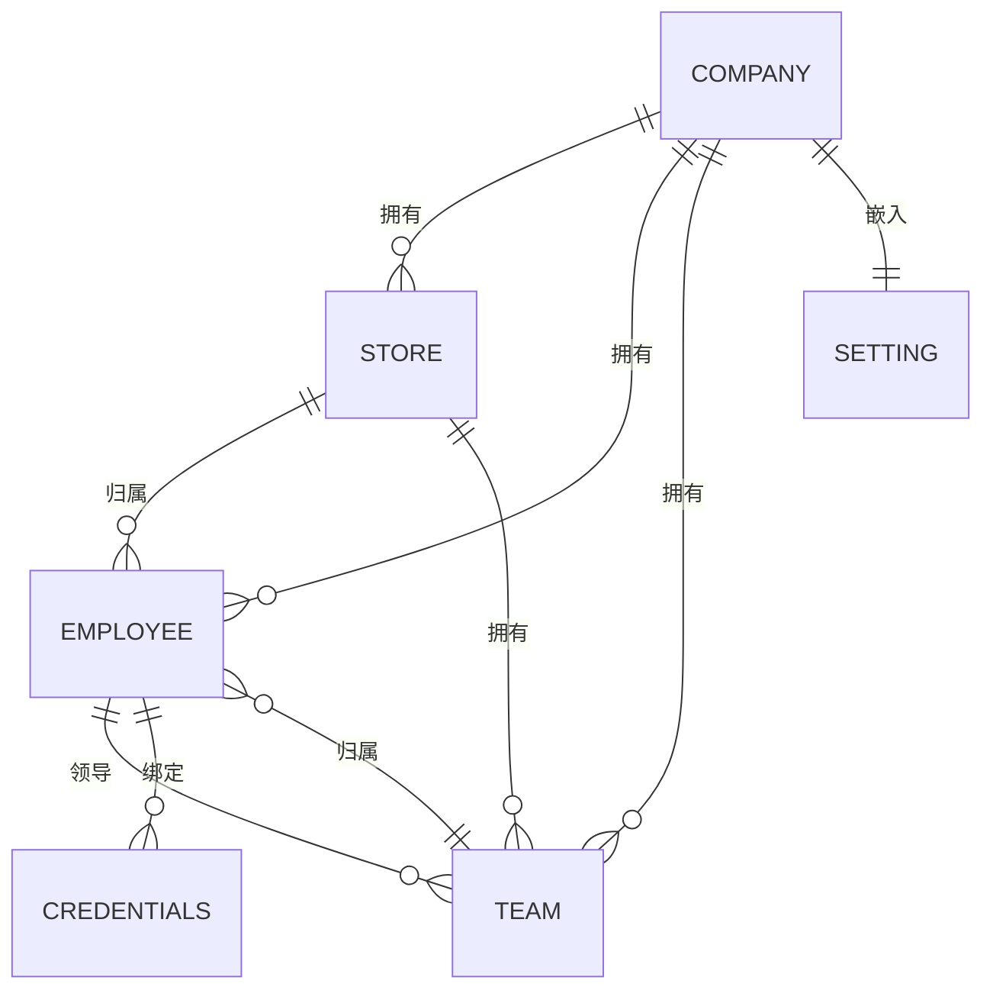
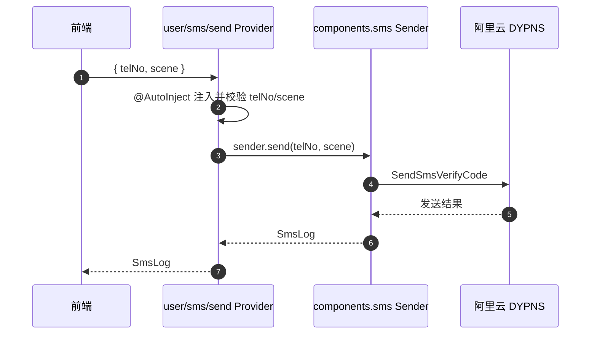
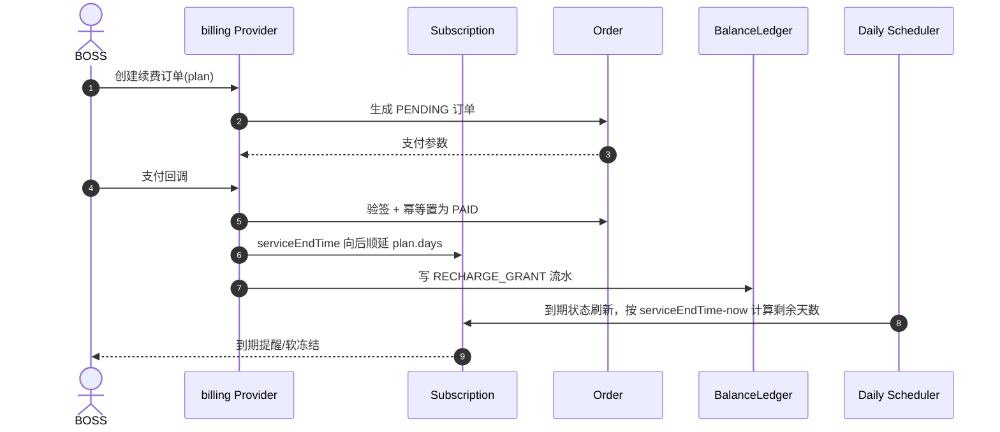

# th4-decoboon 租户域（tenant）设计方案

> 模块：`com.th4.edge.tenant`
> 当前代码根：`src/main/java/com/th4/edge/tenant`
> 文档目的：系统记录当前企业/用户/门店/团队/登录凭证的设计思路、命名规范、已落地代码，并给出后续“企业续费”扩展方案与规范回改清单。
> 版本：v1.0 · 2026-09-11

---

## 1. 设计目标

`tenant` 是装得清的**企业租户与用户域**，与 `com.th4.edge.decoboon` 家装业务域并列，承担：

1. 企业（租户）基础档案：名称、简称、Logo、品牌色、规模、地址、系统配置。
2. 组织单元：默认总店 + 多门店权益 + 团队。
3. 企业成员：员工，作为平台安全体系的登录主体。
4. 多方式登录凭证：账户密码、手机号、微信，统一挂在员工下。
5. 用户域验证码场景：注册、登录、找回密码。
6. 后续企业计费/续费：套餐、订单、余额、流水（建议独立为 `tenant.billing`）。

核心原则：

- **企业是租户主体**：一家企业一套隔离数据。
- **员工是登录主体**：`Employee` 直接实现框架安全 `User<Long>`。
- **凭证与员工分离**：一个员工可绑定多个登录方式。
- **业务与组件分离**：短信等通用能力在 `components`，业务编排在 `tenant`。

---

## 2. 领域定位与包结构

### 2.1 顶层定位

```text
com.th4.edge
├── components                      # 通用技术组件（短信、锁等）
└── tenant                          # 企业租户与用户域
    └── user                        # 用户子域（当前已落地部分）
```

### 2.2 当前 tenant 包结构

```text
com.th4.edge.tenant.user
├── configure
│   ├── CredType.java               # 凭证类型枚举
│   ├── Size.java                   # 企业规模枚举
│   └── UserVCodeScene.java         # 用户域验证码场景枚举
├── model
│   ├── Company.java                # 企业
│   ├── Store.java                  # 门店
│   ├── Team.java                   # 团队
│   ├── Employee.java               # 员工（登录主体）
│   ├── Credentials.java            # 登录凭证
│   └── Setting.java                # 企业系统设置（@Embeddable）
└── service
    └── user
        ├── login
        │   ├── Login.java
        │   └── support
        │       ├── UserLogin.java
        │       └── WxLogin.java
        ├── register
        │   ├── Register.java
        │   └── support/Register.java
        └── sms
            └── send
                ├── Send.java
                └── support/Send.java
```

### 2.3 后续建议扩展包结构

```text
com.th4.edge.tenant
├── user                            # 企业/门店/团队/员工/凭证/登录（现状）
│   ├── configure
│   ├── model
│   ├── repository                  # 待补：CompanyRepository / StoreRepository / ...
│   ├── service
│   └── context                     # 当前租户上下文、当前员工上下文
└── billing                         # 企业计费/续费（建议新增，独立于 user）
    ├── configure
    ├── model                       # Subscription / Plan / Order / BalanceLedger
    ├── repository
    ├── service
    ├── context
    └── scheduler
```

---

## 3. 设计思路解析

### 3.1 为什么 `Employee` 直接实现 `User<Long>`

现有 `Employee`：

```java
public class Employee extends AbstractModel implements User<Long> {

    @Id
    @SnowflakeId
    private Long empId;

    @Override
    public Long getUserId() {
        return getEmpId();
    }

    @Override
    public void setUserId(Long userId) {
        setEmpId(userId);
    }
}
```

设计含义：

- 框架安全体系不需要额外 `User` 表，直接复用员工表作为登录主体。
- `empId` 即 `userId`，员工就是平台账号。
- 员工与企业、门店关联天然完成“账号 → 租户 → 门店”的上下文推导。
- 这种设计适合**企业内成员即登录账号**的 SaaS 场景，避免再造一套与员工表平行的用户表。

### 3.2 为什么凭证独立为 `Credentials`

一个员工可以有多种登录方式：

| CredType | 含义 | 典型 idKey/idSecret |
| --- | --- | --- |
| `User` | 账户密码 | idKey=账号，idSecret=密码摘要 |
| `Phone` | 手机号登录 | idKey=手机号，idSecret=预留 |
| `Wx` | 微信登录 | idKey=unionId/openId，idSecret=会话相关 |

好处：

- 员工主数据与认证凭证解耦。
- 后续增加“验证码登录”“企业微信”“小程序”不用改员工表。
- 一个员工绑定多个手机号/微信时仍可表达。
- `idKey` 全局唯一，适合作为登录索引。

### 3.3 为什么门店/团队/员工都保留 `Company` 关联

当前 `Store`、`Team`、`Employee` 都同时持有 `store/company` 或 `company`：

- `Store.company`：门店归属企业。
- `Employee.store + Employee.team + Employee.company`：员工属于某企业下的某门店和可选团队，企业字段是冗余租户维度。
- `Team.store + Team.company`：团队属于某门店，同时冗余企业维度。

设计取舍：

- 优点：查询员工/团队时少一次多表 join，租户隔离简单直观。
- 代价：存在冗余，需要在写入时保证一致。
- 建议：**以“所属 Store”为准，`company` 作为租户冗余字段**，通过保存 Provider 统一维护。

### 3.4 为什么默认总店也必须落库

即使前端不展示门店维度，`Employee`、`Team`、线索、视频等仍需要稳定的企业内归属节点。默认总店作为隐藏归属单元，避免后续启用多门店时发生主数据迁移。

### 3.5 为什么门店默认不展示

- 多数企业没有多门店管理诉求，因此注册时后端只创建一家默认总店 `Store`，`name="总店"`，`defaultStore=true`。
- 前端默认不展示门店选择、门店管理、门店维度筛选；业务数据仍归属默认总店。
- 多门店能力通过 `Plan.maxStores` 表达：`maxStores=1` 仅总店，`maxStores>1` 才允许启用多门店。
- `Company.setting.enableStore` 是企业前端展示开关；默认 `false`，开通多门店权益后置为 `true`。
- 团队/员工仍冗余持有 `company`，保证无论是否启用多门店都能按企业隔离。

### 3.6 为什么 `Setting` 设计成 `@Embeddable`

`Company.setting` 内嵌 `enableStore`，属于企业级系统开关。

- 低频、强属于企业主表的少量配置，用 `@Embeddable` 合理。
- 若后续设置项变多（计费开关、审核开关、功能开关），建议独立 `CompanySetting` 实体或继续扩展 `Setting`。
- **计费余额不要放进 `Setting`**，因为计费需要独立流水、锁和状态机。

### 3.7 租户组织与四级数据权限

`Company / Store / Team / Employee` 不只是主数据层级，也是业务数据权限的四级范围：

| 角色 | 数据范围 |
| --- | --- |
| BOSS | 当前企业 |
| 门店店长 | 当前企业 + 当前门店 |
| 团队负责人 | 当前企业 + 当前团队 |
| 普通员工 | 当前企业 + 本人 |

业务实体使用 `company/store/team/owner` 对象关联保存归属快照，并标注 `@DataPermission`。框架通用 CRUD 由 `DataScopeRequestFilter` 与 `DataPermissionCrudAspect` 自动处理；自定义 Provider 使用 `DataScopeSpecification`。详细规范见 `docs/design/07-数据权限设计规范.md`。

---

## 4. 命名规范（当前 tenant 域约定）

### 4.1 包与类命名

| 层级 | 约定 | 示例 |
| --- | --- | --- |
| 领域根 | `com.th4.edge.tenant` | `tenant` |
| 子域 | `{子域}`，当前 `user` | `tenant.user` |
| 枚举 | `configure` 包，枚举名用业务名词 | `CredType / Size / UserVCodeScene` |
| 实体 | `model` 包，单数业务名词 | `Company / Store / Team / Employee / Credentials` |
| 服务接口 | `service.{对象}.{能力}.{接口}` | `service.user.register.Register` |
| 服务实现 | 同能力包 `.support` 下，名称与能力一致或加前缀 | `support.Register / support.Send / support.UserLogin` |
| 路由 | `@Service("user/register")` 等 | `user/sms/send` |

### 4.2 实体字段命名

| 概念 | 字段名 | 主键 | 表名 |
| --- | --- | --- | --- |
| 企业 | `comId` | `Long` + `@SnowflakeId` | `db_tenant_company` |
| 门店 | `storeId` | `Long` + `@SnowflakeId` | `db_tenant_store` |
| 团队 | `teamId` | `Long` + `@SnowflakeId` | `db_tenant_team` |
| 员工 | `empId` | `Long` + `@SnowflakeId` | `db_tenant_employee` |
| 凭证 | `creId` | `Long`（待补主键策略） | `db_tenant_credentials` |

字段倾向缩写/简洁名：

- 手机号：`telNo`，不是 `phone`。
- 地址：`addr`，不是 `address`。
- 名称：企业用 `title/name`，门店/团队/员工用 `name`。
- 品牌色：`color`。
- 领导：`leader`（对象关联，不是 `leaderId`）。
- 登录凭证标识/密钥：`idKey / idSecret`。
- 企业规模：`size`，枚举 `Size`。

### 4.3 枚举命名

| 枚举 | 实现接口 | value 风格 | 说明 |
| --- | --- | --- | --- |
| `CredType` | `Attribute<String>` | `User / Phone / Wx` | 凭证类型 |
| `Size` | `Attribute<String>` | `A / B / C / D` | 企业规模 |
| `UserVCodeScene` | `VCodeScene` | `register / reset-password / login` | 验证码业务场景 |

`UserVCodeScene` 是**业务场景枚举**，放在业务域 `tenant.user.configure`；组件层只有抽象 `VCodeScene`，不感知具体业务。

---

## 5. 数据模型

### 5.1 ER 关系



### 5.2 实体职责

| 实体 | 职责 | 关键字段 |
| --- | --- | --- |
| `Company` | 企业/租户主档案 | `comId / title / name / logo / color / size / addr / setting` |
| `Store` | 门店组织单元；注册时创建默认总店 | `storeId / company / name / color / addr / defaultStore` |
| `Team` | 门店下的团队 | `teamId / name / leader / color / store / company` |
| `Employee` | 企业成员，登录主体 | `empId / name / telNo / role / store / team / company` |
| `Credentials` | 员工登录凭证 | `creId / type / employee / idKey / idSecret` |
| `Setting` | 企业系统开关 | `enableStore` |

### 5.3 当前实体代码说明

#### Company

```java
@Note("企业")
@Model
@Entity
@Table(name = "db_tenant_company")
public class Company extends AbstractModel {

    @Id
    @SnowflakeId
    private Long comId;

    private String title;   // 企业全称
    private String name;    // 企业简称
    private String logo;    // Logo
    private String color;   // 品牌色
    private Size size;      // 规模
    private String addr;    // 地址

    @Embedded
    private Setting setting;

    @CreateTime
    private DateTime createTime;
}
```

#### Store / Team / Employee

- `Store`：`@ManyToOne Company company`，`@Name String name`，`color/addr`，`defaultStore` 标识默认总店。
- `Team`：`@ManyToOne Employee leader`，`@ManyToOne Store store`，`@ManyToOne Company company`。
- `Employee`：实现 `User<Long>`，`telNo` 全局唯一，`@ManyToOne Store store`，`@ManyToOne Company company`。

#### Credentials

- 不继承 `AbstractModel`（当前实现），含 `type / employee / idKey / idSecret / lastTime / createTime`。
- `idKey` 唯一，作为登录查找索引。

---

## 6. Provider 体系

### 6.1 已落地 Provider

| 路由 | 接口 | 请求/响应 | 职责 | 状态 |
| --- | --- | --- | --- | --- |
| `user/sms/send` | `Send extends Provider<Employee, SmsLog>` | `Employee` → `SmsLog` | 注入 `Sender` 发送验证码 | 已实现 |
| `user/register` | `Register extends Provider<Employee, Employee>` | `Employee` → `Employee` | 注入 `Validator` 校验注册验证码 | 半成品 |
| `user/login` | `Login extends framework Login<Employee>` | `Employee` → `Token` | 员工登录 | 占位 |
| 微信登录 | `WxLogin` | — | 微信登录入口 | 空类 |

### 6.2 短信发送



当前实现要点：

- `@AutoInject @NotEmpty @LengthEq(11) private String telNo;`
- `@AutoInject @NotNull private UserVCodeScene scene;`
- 业务 Provider 不接触 Redis Key、AccessKey、DYPNS 协议。
- 组件异常 `VCodeSendException` 被包装为 `DefinedException` 返回业务错误。

### 6.3 注册

当前 `Register` 只完成“验证码校验 + 把手机号回填到入参员工”：

```java
@Service("user/register")
@Scope(ScopeTypes.PROTOTYPE)
public class Register implements ...Register {

    @AutoInject @NotEmpty @LengthEq(11) private String telNo;
    @AutoInject @NotEmpty @Length(max = 8) private String smsCode;

    public Employee call(Employee employee) {
        validator.validate(telNo, UserVCodeScene.Register, smsCode);
        employee.setTelNo(telNo);
        return employee;
    }
}
```

目标注册闭环（待扩展）：

```text
user/register
  → 校验短信验证码
  → 创建 Company
  → 创建默认总店 Store（defaultStore=true）
  → 创建 Employee(BOSS)
  → 创建 Credentials(User)（账户密码）
  → 创建企业账户/发放试用（billing）
  → 返回 Employee
```

### 6.4 登录

当前 `UserLogin` 返回 `null`，尚未实现。目标建议：

- `UserLogin`：按 `Credentials(type=User)` 校验账号密码。
- `WxLogin`：按 `Credentials(type=Wx)` 走微信授权/手机号授权。
- 登录成功后返回框架 `Token`，`Employee` 作为安全 `User<Long>` 写入 token。

---

## 7. 与 components 的边界

`tenant` 业务域必须遵循“components 提供怎么发，业务决定何时发、发给谁”的原则：

| 层 | 允许 | 禁止 |
| --- | --- | --- |
| `tenant.user.configure` | `UserVCodeScene` 等业务场景枚举 | 不实现短信协议 |
| `tenant.user.service.user.*` | Provider、`@AutoInject`、业务事务 | 不拼 AccessKey、不操作 Redis Key |
| `components.sms.service` | `Sender/Validator/VCodeScene` 契约 | 不出现 Provider、不感知注册/登录 |
| `components.sms.sdk.aliyun` | 阿里云 DYPNS 实现 | 不落业务表、不注册前端路由 |

当前 `Send/Register` 已正确注入 `Sender/Validator`，边界保持良好。

---

## 8. 当前实现与 rules.md 的差距（回改清单）

以下为“现状代码可运行，但与规范不一致，应回改”的清单：

| 项 | 现状 | 规范要求 | 建议 |
| --- | --- | --- | --- |
| 时间类型 | 已回改：`createTime` 使用 `DateTime + @CreateTime`；`Credentials.lastTime` 作为纯登录时间标记保留 `LocalDateTime` | 按用途选择：统计维度用 `DateTime`；纯标记用 `LocalDateTime`/`LocalDate`；审计时间用 `@CreateTime/@UpdateTime + DateTime` | 已回改 |
| 主键 | `Company/Store/Team/Employee` 已用 `@SnowflakeId`；`Credentials.creId` 未指定 | 主键统一策略 | `Credentials` 补 `@SnowflakeId` 或 `@GeneratedValue` |
| 实体基类 | `Credentials/Team` 未继承 `AbstractModel` | 实体继承 `AbstractModel` | 统一继承 |
| 时间自动维护 | `createTime` 已改为 `@CreateTime` 自动维护 | `@CreateTime` 自动维护 | 已回改 |
| Provider 路由 | `user/register`、`user/login`、`user/sms/send` | 规范为 `{域}/{对象}/{能力}`，tenant 域需明确统一前缀 | 与团队确认 tenant 路由前缀 |
| `@ServiceName` | 自定义业务 Provider 已移除 `@ServiceName` | 仅通用模型服务（`ModelService`）使用 `@ServiceName` | 已回改 |
| 仓储 | tenant 尚未建 repository | `repository` 包 + Spring Data JPA | 补 `Company/Store/Team/Employee/CredentialsRepository` |
| 序列化 | 无 `@ServiceProperties` | 敏感字段需声明式过滤 | 登录/员工/凭证响应补齐 |
| 关联列名 | 多数 `@JoinColumn(nullable=false)` 未显式 `name` | 建议显式列名，避免默认名歧义 | 显式 `name` |
| 注册入参 | `Provider<Employee, Employee>` | 注册是创建租户场景，业务对象需重新审视 | 建议 `Provider<Company, Employee>` + `@AutoInject` 手机/验证码/密码；门店默认总店，不要求必填 |
| 事务 | 无 | 注册/续费跨多实体必须 `@Transactional` | 补齐 |

---

## 9. 企业续费扩展设计（tenant.billing）

### 9.1 计费主体放在哪里

结论：**余额不放 `Store`，也不建议直接放 `Company` 主表**。标准做法是独立企业账户：

```text
Company            企业基础档案
Store              门店组织档案
Subscription     企业订阅（套餐/服务到期时间）
Plan               套餐定义
Order              订单
BalanceLedger      余额流水
```

### 9.2 建议包结构

```text
com.th4.edge.tenant.billing
├── configure
│   ├── SubStatus.java      # TRIAL / ACTIVE / EXPIRED / FROZEN / CLOSED
│   ├── OrderStatus.java               # PENDING / PAID / GRANTED / CANCELLED / REFUNDED
│   ├── PayChannel.java                # WX / ALIPAY / OFFLINE
│   └── LedgerBizType.java             # TRIAL_GRANT / RECHARGE_GRANT / DAILY_CONSUME / MANUAL_ADJUST
├── model
│   ├── Subscription.java
│   ├── Plan.java
│   ├── Order.java
│   └── BalanceLedger.java
├── repository
├── service
│   ├── plans/list
│   ├── orders/create
│   ├── orders/page
│   ├── orders/callback
│   └── accounts/info
├── context
│   └── SubscriptionContext.java
└── scheduler
    └── SubscriptionScheduler.java
```

### 9.3 核心字段建议

#### Subscription

```java
@Note("企业账户")
@Model
@Entity
@Table(name = "db_tenant_company_account")
public class Subscription extends AbstractModel {

    @Id @SnowflakeId private Long accountId;

    @ManyToOne(fetch = FetchType.LAZY)
    @JoinColumn(name = "com_id", nullable = false, unique = true)
    private Company company;

    @Column(nullable = false, length = 16)
    private SubStatus status = SubStatus.TRIAL;

    @ManyToOne(fetch = FetchType.LAZY)
    @JoinColumn(name = "plan_id")
    private Plan plan;

    @Unit("天")
    @Column(nullable = false)
    private DateTime serviceEndTime;

    // serviceEndTime 用框架 DateTime
    // trialActivated 用于“免费 30 天仅一次”
    // lastRenewTime
}
```

#### Plan

```java
code       // trial-basic / annual-pro
name       // 套餐名称
days       // 30 / 365
price      // 建议以“分”为单位
oneTimeOnly // trial-basic = true
enabled    // 是否上架
```

#### Order

```java
orderNo    // 业务幂等键
company    // 所属企业
plan       // 购买套餐
amount     // 实付金额
days       // 到账天数
status     // PENDING / PAID / GRANTED ...
payChannel // 支付渠道
outTradeNo // 三方交易号
paidTime   // 支付时间
```

#### BalanceLedger

```java
company / order
bizType    // TRIAL_GRANT / RECHARGE_GRANT / DAILY_CONSUME / MANUAL_ADJUST
changeDays // +30 / +365 / -1
balanceAfter
remark
```

### 9.4 续费闭环



关键规则：

- 剩余可用天数不落库，由 `SubscriptionContext.remainingDays()` 按 `serviceEndTime - now` 动态计算；`Order + BalanceLedger` 是续费事实来源。
- 支付回调幂等：按 `orderNo` 状态机防止重复加款。
- 免费试用包 `trial-basic` 只能领取一次，用 `Subscription.trialActivated` 防薅。
- 到期进入只读/软冻结，续费后恢复。
- 并发扣减与续费使用行锁/乐观锁/Redisson 锁。

---

## 10. 实施路线建议

| 阶段 | 内容 |
| --- | --- |
| 阶段一：补底座 | 时间字段已回改；继续补 repository、主键策略、事务 |
| 阶段二：注册登录闭环 | 完成 `user/register` 建企业/门店/员工/凭证；完成 `UserLogin/WxLogin` |
| 阶段三：计费闭环 | 新增 `tenant.billing`：`Subscription/Plan/Order/BalanceLedger` |
| 阶段四：支付与调度 | 接支付回调、到期状态刷新任务、到期通知、软冻结 |
| 阶段五：运营能力 | 发票、退款、优惠券、多套餐配额 |

---

## 11. 文档维护

- 本文件与 `tenant` 包同步演进。
- 代码结构变更后同步更新第 2、5、6 节。
- 与 `rules.md` 冲突时以 `rules.md` 为准，并同步回改 `tenant` 存量代码。
