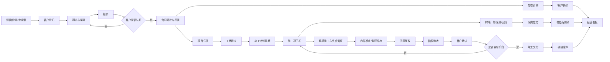
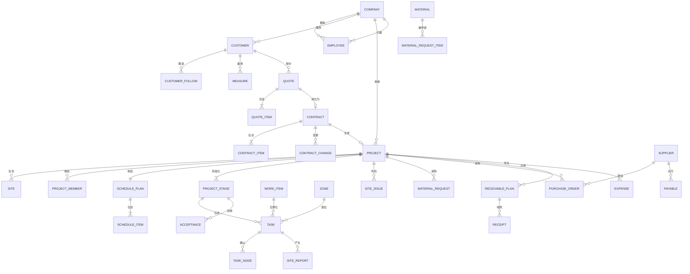
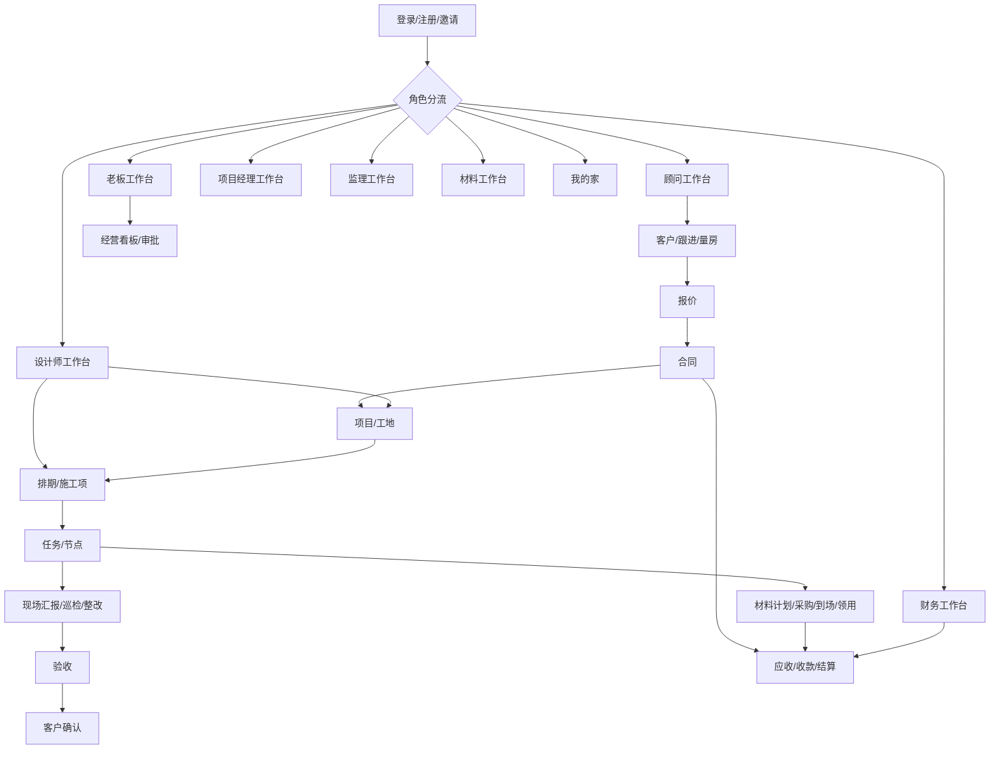

# 装得清整体业务体系设计说明书

> 项目：th4-decoboon（装得清后端）  
> 客户端范围：当前仅建设微信小程序，多角色在同一端内按权限进入不同业务工作台  
> 版本：v1.0  
> 日期：2026-09-11  
> 设计基线：`AGENTS.md`、`rules.md`、`th4-decoboon-app/docs/01-业务设计说明书.md`、`th4-decoboon-app/docs/02-闭环页面逻辑与高保真视图.md`、现有 `tenant/user`、归档获客域

---

## 0. 结论摘要

装得清不是一个“客户表 + 项目表”的简单管理系统，而是一条由装修企业经营活动驱动的完整业务链：

```text
获客 → 线索/客户 → 量房/报价 → 签约 → 项目立项 → 工地开工
→ 排期与施工项 → 现场执行/材料 → 阶段验收/客户确认
→ 回款/支出/结算 → 经营统计与风险闭环
```

建议将整体业务划分为 **13 个业务体系板块**：

| 序号 | 业务体系板块 | 核心业务问题 | 系统主对象 |
| --- | --- | --- | --- |
| A | 平台与租户基础 | 企业如何成为独立租户、如何订阅、如何隔离 | `Company`、`Subscription`、`Order` |
| B | 身份、组织与权限 | 不同角色如何登录、加入企业、获得项目级权限 | `Employee`、`Credentials`、`CustomerIdentity`、`ProjectMember` |
| C | 主数据与工艺标准 | 工艺、阶段、区域、单位、价格如何标准化 | `StageTemplate`、`WorkItem`、`Zone`、`PriceBook` |
| D | 线索与客户 CRM | 客户从哪里来、谁负责、跟进到哪一步 | `Lead`、`Customer`、`CustomerFollow` |
| E | 量房、报价与合同 | 如何报价、审批、签约、变更并形成履约依据 | `Measure`、`Quote`、`Contract`、`ContractChange` |
| F | 项目与工地区 | 一个经营项目对应哪些物理工地、由谁负责 | `Project`、`Site`、`ProjectMember` |
| G | 排期、阶段与施工项 | 先做什么、在哪做、做多少、做到什么时候 | `SchedulePlan`、`ScheduleItem`、`ProjectStage`、`Task` |
| H | 现场执行与质量验收 | 如何施工、留证、巡检、整改、验收 | `TaskNode`、`TaskMedia`、`SiteIssue`、`Acceptance` |
| I | 材料与供应链 | 材料怎么计划、采购、到场、领用、退料、盘点 | `Material`、`PurchaseOrder`、`Arrival`、`MaterialUse`、`Inventory` |
| J | 账务与资金 | 合同应收、收款、支出、应付和结算如何闭环 | `ReceivablePlan`、`Receipt`、`Expense`、`Payable`、`Settlement` |
| K | 协同、消息与文档 | 多角色如何同频沟通、通知、沉淀证据 | `ProjectMember`、`SiteReport`、`Notice`、`Attachment` |
| L | 经营看板与风险 | 老板如何不打电话也知道进度、成本和风险 | `DashboardQuery`、工作台/报表读模型 |
| M | 获客内容与 AI 辅助 | 视频、素材、话术如何反哺获客 | 获客内容域 |

> 多租户总原则：装得清所有业务实体都必须包含 `Company company` 企业归属，Provider 以 `{域}/{对象}/{能力}` 路由，不再使用 `decoboon/` 或 `clue/` 前缀。

## 0.1 最重要的五项架构决策

1. **合同是履约依据，项目是履约主体。** 合同金额、合同项和变更项以合同域为准；项目不得自己维护另一套不可追溯的合同数据。
2. **项目和工地分开建模。** `Project` 表示经营与履约单元，`Site` 表示物理施工地点；MVP 可约束一个项目只有一个工地，但不能把两者永远写死为一个概念。
3. **报价项、合同项、施工项分层。** 报价/合同保存商务快照，施工项是项目内的执行实例，来源于工艺主数据、合同项或经批准的变更。
4. **排期与任务是两层。** `SchedulePlan/ScheduleItem` 管基线、版本和计划时间；`Task` 管实际施工、节点、证据和状态。
5. **金额、进度、已收款等是派生结果。** 可以在项目表保留汇总字段用于查询，但必须由合同、账务、任务/验收服务回写，不能由前端直接改。

---

## 1. 现状基线与差距

### 1.1 已有基础

| 现有资产 | 当前覆盖 | 可复用价值 |
| --- | --- | --- |
| `tenant/user` | `Company / Store / Team / Employee / Credentials / Invite / Setting` | 租户、组织、员工登录和邀请基础 |
| `tenant/billing` | `Plan / Subscription / Order / BalanceLedger` | 平台套餐与续费，不与项目账务混用 |
|  归档域 | 线索、线索跟进、素材、视频、内容、统计 | 获客上游与内容生产，可转化为客户 |
| 小程序领域类型 | 客户、项目、阶段、施工项、节点、日报、验收 | 已证明核心页面闭环可行 |
| 小程序 Mock 状态机 | 项目、阶段、任务、验收、角色可见性 | 可作为后端聚合行为的行为样本 |
| 小程序 28 页 | 登录、邀请、客户、项目、排期、任务、汇报、验收 | 可作为首期小程序信息架构基线 |

### 1.2 当前缺口

| 缺口 | 风险 | 本设计处理方式 |
| --- | --- | --- |
| 无正式 `Contract` 实体，项目直接保存合同金额 | 变更、补款、合同附件和责任无法追溯 | 新增报价/合同域，项目只关联合同 |
| 客户只能关联一个 `projectId` | 老客复购、多套房、多项目无法表达 | 改为 `Customer 1:N Project` |
| `Project` 同时承担工地、合同、财务数据 | 职责过载，状态难一致 | 拆分 `Project / Site / Contract / Finance` |
| 阶段排期、任务计划、实际进度混在一起 | 计划变更后无法保留基线 | 新增版本化 `SchedulePlan`，任务记录实际执行 |
| 施工项只有 `Task`，缺少标准施工项主数据 | 报价、施工、材料口径无法统一 | 引入 `WorkItem` 和价格/工艺映射 |
| 材料、财务只有字段预埋 | 成本和回款无法闭环 | 独立材料域、财务域，以事件回写项目汇总 |
| 客户身份与员工凭证模型不统一 | 微信客户登录可能被 `Credentials.employee` 限制 | 统一登录主体或扩展凭证绑定模型 |
| Provider 路由集中在 `project/**` | 与 `rules.md` 的领域分包边界冲突 | 目标拆分为 `bim/customer/trade/project/material/finance` |

---

## 2. 总体业务蓝图

### 2.1 端到端主流程



### 2.2 五条核心业务闭环

| 闭环 | 入口 | 核心动作 | 闭环标志 |
| --- | --- | --- | --- |
| 获客转化闭环 | 线索/客户 | 分配、跟进、量房、报价 | 客户进入已签约或明确流失 |
| 商务签约闭环 | 客户 | 报价、审批、合同签署、变更 | 合同生效并生成项目 |
| 施工履约闭环 | 项目/工地 | 排期、任务、节点、汇报、验收 | 阶段验收确认，进度推进 |
| 材料成本闭环 | 施工计划 | 计划、请购、采购、到场、领用、退料 | 材料按项目归集并可核算 |
| 资金结算闭环 | 合同/材料 | 应收、收款、应付、付款、结算 | 项目完成且资金结清/挂账明确 |

### 2.3 业务对象主关系



---

## 3. 业务体系板块划分

### A. 平台与租户基础

**定位：** 家装企业使用系统的边界。每个装饰公司是一个租户，所有客户、项目、合同、材料、账务数据必须带企业租户归属并隔离。

**核心对象：**

| 对象 | 职责 | 关键关联 |
| --- | --- | --- |
| `Company` | 装饰公司/租户主档 | 拥有门店、员工、客户、项目 |
| `Store` | 门店/经营组织 | 归属 `Company` |
| `Team` | 门店下团队 | 归属 `Store/Company`，负责人为 `Employee` |
| `Subscription` | 企业套餐与有效期 | 关联 `Company/Plan` |
| `Order` | 套餐购买订单 | 关联 `Company/Plan` |
| `BalanceLedger` | 平台权益流水 | 与项目资金流水严格分开 |

**边界：** `tenant/billing` 只处理装得清平台向企业收费，不处理企业向自己的客户收款，也不处理供应商付款。

### B. 身份、组织与权限

**定位：** 解决“谁登录、属于谁、能看什么、能做什么”。权限由“公司角色 + 项目关系 + 数据归属”共同决定。

**核心对象：**

| 对象 | 职责 | 说明 |
| --- | --- | --- |
| `Employee` | 企业成员 | 老板、设计师、项目经理、顾问、监理、采购、财务等 |
| `Credentials` | 登录凭证 | 手机、微信、账号密码；当前需扩展为可绑定员工或客户身份 |
| `Invite` | 员工/业主邀请 | 区分成员邀请和项目业主邀请 |
| `CustomerIdentity` | 业主小程序账号 | 只绑定客户与项目，不进入企业组织架构 |
| `ProjectMember` | 项目级授权关系 | 员工和业主进入项目的权限载体 |
| `Role` | 系统角色/权限集合 | 不建议把角色判断散落到页面 |

**建议扩展的员工角色：**

```text
Boss          老板/企业负责人
Marketer      家装顾问/业务员
Designer      设计师
Pm            项目经理/工地负责人
Supervisor    监理/质检
Purchaser     采购
Warehouse     仓管
Finance       财务
```

**关键规则：**

- 员工角色 ≠ 项目关系。一个人可以是设计师，也可以在某项目里承担负责人。
- 业主永远不是 `Employee`，只能通过 `CustomerIdentity + ProjectMember` 访问授权项目。
- 后端必须做租户和项目双重隔离，不能仅依赖小程序页面隐藏。
- 首页、Tab、按钮可使用权限提示，但最终数据范围由 Provider 强制限定。

### C. 主数据与工艺标准

**定位：** 让报价、合同、施工、材料和统计使用同一套业务口径。主数据变化不能污染历史项目快照。

**核心对象：**

| 对象 | 职责 | 示例 |
| --- | --- | --- |
| `StageTemplate` | 标准施工阶段模板 | 拆除、水电、泥瓦、木工、油漆、安装、竣工 |
| `Zone` | 空间区域字典 | 全屋、客厅、卧室、厨房、卫生间、阳台 |
| `WorkItem` | 标准施工项/工艺项 | 强电布线、防水涂刷、闭水试验、乳胶漆 |
| `Unit` | 计量单位 | ㎡、m、项、套、樘、个 |
| `PriceBook` | 企业价格体系 | 不同城市、门店、客户等级、时间版本 |
| `Material` | 材料 SKU 主数据 | 品牌、规格、型号、单位、参考价 |
| `Supplier` | 供应商 | 联系人、账期、结算方式 |

**`WorkItem` 至少包含：**

```text
code                 工艺编码，如 SD-01
name                 标准名称
stageTemplate        默认阶段
applicableZones      适用区域
craft                施工工艺
spec                 规格/验收要求
unit                 计量单位
conceal              是否含隐蔽节点
materialRefs         标准材料/用量参考
standardCost          标准成本
enabled              是否启用
```

**快照规则：**

- `QuoteItem` 引用 `WorkItem`，但必须保存名称、工艺、规格、单位、单价等快照。
- `ContractItem` 再次固化合同口径；`WorkItem` 后续修改不影响历史合同。
- `Task` 可以引用 `WorkItem` 作为来源，但保存本项目实际规格、数量和区域。

### D. 线索与客户 CRM

**定位：** 承接获客域，完成线索登记、分配、客户跟进、量房前准备与签约转化。

**核心对象：**

| 对象 | 职责 | 关键字段/关联 |
| --- | --- | --- |
| `Lead` | 尚未正式建档的获客线索 | 来源、负责人、意向、跟进记录、转化客户 |
| `LeadFollow` | 线索跟进记录 | `lead/emp/way/content/nextFollowAt` |
| `Customer` | 企业正式客户 | 名称、手机号、来源、阶段、负责人、意向信息 |
| `CustomerFollow` | 客户跟进时间线 | 电话、微信、到店、量房、其他 |
| `Measure` | 量房/现场勘察记录 | 客户、地址、面积、户型、原始图、量房人 |
| `CustomerIdentity` | 客户小程序身份 | 客户、手机号、项目授权 |

**客户阶段建议：**

```text
new 新客
→ contacted 已联系
→ intention 意向确认
→ measuring 量房
→ quoted 已报价
→ pending_sign 待签约
→ signed 已签约
→ serving 履约中
→ completed 已完工
→ repurchased 复购/转介绍

任意阶段 → lost 已流失
```

**关键规则：**

- 手机号在企业租户内唯一；同一自然人在不同企业可以是不同客户。
- `Customer 1:N Project`，禁止再把客户简单等同于一个项目。
- 线索转客户后保留来源链路，支持获客效果统计。
- 跟进记录只追加，不覆盖历史。
- 流失必须记录原因和最后跟进时间，支持回收/重分配。

### E. 量房、报价与合同

**定位：** 将客户意向转换成有版本、有审批、有签署痕迹、可变更的商务文件。

#### E1. 报价

**核心对象：**

| 对象 | 职责 |
| --- | --- |
| `Quote` | 报价单头，客户、版本、总价、状态、有效期 |
| `QuoteItem` | 报价明细，引用 `WorkItem/Material` 并保存快照 |
| `QuoteApproval` | 折扣、特殊价格、超权限审批记录 |
| `QuoteDecision` | 客户接受/拒绝/议价的确认记录 |

**状态机：**

```text
Draft 草稿
→ Submitted 已提交
→ Reviewing 审批中
→ Approved 已批准
→ Sent 已发送客户
→ Accepted 客户接受
→ Converted 已转合同
→ Expired 已过期

Reviewing → Rejected 已驳回 → Draft
Sent → Declined 客户拒绝
```

#### E2. 合同

**核心对象：**

| 对象 | 职责 |
| --- | --- |
| `Contract` | 合同主档，客户、项目、金额、工期、状态 |
| `ContractItem` | 合同清单项，固化报价及责任口径 |
| `ContractChange` | 增项、减项、工期变更 |
| `ContractSign` | 签署记录，员工/客户签署、时间、文件 |
| `ContractAttachment` | 合同、附件、图纸和补充协议 |

**状态机：**

```text
Draft 草稿
→ Reviewing 审批中
→ PendingSign 待签署
→ Active 已生效
→ Performing 履约中
→ Completed 已完成
→ Settled 已结算

Draft/Reviewing/PendingSign → Cancelled
Active/Performing → Terminated
```

**关键规则：**

- 报价被接受后生成合同，不允许直接修改已接受报价；修改必须产生新报价版本。
- 合同生效条件至少包括：审批完成、签署完成、首期款条件满足（是否强制由企业配置）。
- 合同金额只能由合同主档和有效变更单计算，项目上的金额只是汇总缓存。
- 已生效合同禁止物理删除，只能终止、作废或通过变更单调整。
- 项目立项必须关联生效合同；先施工后补合同的例外必须有单独审批痕迹。

### F. 项目与工地区

**定位：** 项目承接合同履约和经营管理；工地表示实际施工地点。

#### F1. Project 项目

**职责：** 经营单元、履约主索引、项目团队、总体状态、成本和进度汇总。

**关键关联：**

```text
Project.customer   → Customer
Project.contract   → Contract
Project.designer   → Employee
Project.manager    → Employee
Project.supervisor → Employee
Project.company    → Company
```

**状态机：**

```text
Draft 草稿
→ Preparing 待开工
→ Ongoing 施工中
→ Suspended 停工
→ Accepting 竣工待验收
→ Finished 已完工
→ Settling 结算中
→ Settled 已结算
→ Closed 已归档

Ongoing → Terminated 已终止
```

#### F2. Site 工地

**职责：** 表达物理地址、小区、户型、面积、交底、进场条件、开放时间和现场状态。

**关键字段：**

```text
project / company / customer
name / community / building / roomNo
address / geo
area / layout / orientation
siteManager       → Employee
handoverAt / plannedStartAt / actualStartAt
accessInfo / siteRules
status
```

**状态机：**

```text
Created → Ready 具备进场条件 → Working → Paused → Completed
```

**MVP 约束：**

- 一个 `Project` 至少一个 `Site`，首期允许且默认只有一个。
- 小程序现有 `Project.address/community` 可在兼容期继续返回，但后端应由主工地投影生成。
- 禁止把财务金额、合同条款直接放到 `Site`。

### G. 排期、阶段与施工项

**定位：** 把合同责任翻译成可执行的阶段、施工项、时间、区域、负责人和验收口径。

#### G1. 施工计划与排期

| 对象 | 职责 |
| --- | --- |
| `SchedulePlan` | 某项目的计划版本、基线开始/结束、发布状态 |
| `ScheduleItem` | 某个阶段/施工项的计划行，含区域、负责人、计划时间和权重 |
| `ScheduleChange` | 排期调整原因、前后时间、审批/通知记录 |

**状态机：**

```text
Draft 草稿
→ Reviewing 待确认
→ Published 已发布
→ Adjusting 调整中
→ Closed 已关闭
```

**关键规则：**

- 已发布计划形成 baseline，后续调整不得覆盖原基线。
- `ScheduleItem` 与 `Task` 在 MVP 可一一对应，但职责不同：前者管计划，后者管实际执行。
- 项目整体进度由阶段权重和施工项进度计算；项目表上的 `progress` 是派生缓存。
- 紧急插单、停工、返工必须形成 `ScheduleChange`，便于后续责任和工期分析。

#### G2. 阶段和施工项

| 对象 | 职责 |
| --- | --- |
| `ProjectStage` | 项目内阶段实例，含权重、负责人、计划/实际时间 |
| `Task` | 施工项实例，含区域、工艺、规格、数量、负责人、状态 |
| `TaskNode` | 施工进行、隐蔽工程、施工完成等关键节点 |
| `TaskMedia` | 节点照片、视频、说明和时间 |

**阶段状态：**

```text
Todo → Doing → Accepting → Done
Todo/Doing → Overdue
Accepting → Doing 整改
任一未结束状态 → Cancelled
```

**任务状态：**

```text
Todo → Doing → Accepting → Done
Doing → Paused → Doing
Todo/Doing/Accepting → Rework → Doing
未结束状态 → Cancelled
```

**任务节点：**

```text
Start     开始施工：确认人员、区域、材料到场
Conceal   隐蔽工程：覆盖前强制拍照/录像留证
Finish    施工完成：形成验收依据
```

**关键规则：**

- 隐蔽工程未确认，不得进入完成节点。
- 无现场证据，节点不得完成。
- 节点确认写施工日报和项目时间线，业主可见范围由服务过滤。
- 阶段验收确认后才推进下一阶段；异常可人工调序但必须有原因。

### H. 现场执行、质量与验收

**定位：** 项目计划落地为现场事实，并通过影像、巡检、问题和验收形成证据链。

**核心对象：**

| 对象 | 职责 |
| --- | --- |
| `SiteReport` | 现场汇报/动态，进度、打卡、材料、问题、通知 |
| `SiteIssue` | 现场问题，责任人、严重等级、期限 |
| `Rectification` | 整改记录，措施、照片、复检结果 |
| `Inspection` | 监理/质检巡检记录 |
| `Acceptance` | 节点、阶段、竣工验收单 |
| `AcceptanceItem` | 验收检查项、结果、问题 |
| `AcceptanceConfirm` | 客户确认/驳回记录 |
| `Album` | 工地相册，按阶段/任务/日期聚合影像 |

**验收状态：**

```text
Draft 草稿
→ Submitted 已提交
→ Inspecting 内部检查
→ PendingCustomer 待客户确认
→ Confirmed 已确认
→ Rejected 客户驳回/需整改
→ Rectifying 整改中
→ Closed 已关闭
```

**关键规则：**

- 施工完成、内部检查、客户确认是三个独立事实，不能用一个 `done` 混在一起。
- 客户驳回必须生成问题/整改项，不能只改状态。
- 验收通过后自动回写阶段、任务、计划和项目进度。
- 监理权限独立于项目经理，可查看、巡检、提出整改，但不直接篡改施工证据。

### I. 材料与供应链

**定位：** 将施工计划转换为材料需求，并贯通采购、到场、领用、退料、库存和成本。

#### 核心对象

| 对象 | 职责 |
| --- | --- |
| `Material` | 材料主数据/SKU |
| `MaterialPlan` | 项目材料计划头 |
| `MaterialPlanItem` | 按阶段/施工项/区域计算的材料计划 |
| `MaterialRequest` | 项目材料请购单 |
| `MaterialRequestItem` | 请购明细 |
| `PurchaseOrder` | 供应商采购订单 |
| `PurchaseItem` | 采购明细 |
| `Arrival` | 到场验收入库记录 |
| `ArrivalItem` | 到场数量、批次、质检结果 |
| `MaterialUse` | 项目/任务领用出库 |
| `MaterialReturn` | 退料记录 |
| `Inventory` | 门店/项目/仓库库存余额 |
| `Supplier` | 供应商主档 |

**建议状态链：**

```text
MaterialRequest:
Draft → Submitted → Approved → Sourcing → Ordered → PartiallyArrived → Arrived → Closed
                                                       → Rejected/Cancelled

PurchaseOrder:
Draft → Submitted → Approved → Ordered → PartiallyArrived → Arrived → Settling → Closed
                                      → Cancelled

MaterialUse:
Draft → Confirmed → Outbound → ProjectCosted
```

**关键规则：**

- 项目材料需求优先来自 `Task/TaskNode`，也可由项目经理手工追加并说明原因。
- 采购与支出分离：采购订单形成应付，实际付款属于财务域。
- 到场必须记录数量、批次、质检和现场照片；材料异常生成 `SiteIssue`。
- 领用必须关联项目，尽量关联阶段/任务/区域，最终形成项目材料成本。
- 库存可以是零库存直接到项目，但账面上必须区分“入库后领用”和“直送工地”。

### J. 账务与资金

**定位：** 管理企业经营资金，不管理平台订阅费。所有资金记录必须可追溯到合同、项目、供应商或员工。

#### 核心对象

| 对象 | 职责 |
| --- | --- |
| `ReceivablePlan` | 合同应收计划：首期、进度款、尾款 |
| `Receipt` | 实际收款 |
| `ReceiptAllocation` | 收款分配到多期应收 |
| `Invoice` | 发票申请与开票记录 |
| `Expense` | 项目直接支出/报销 |
| `Payable` | 供应商应付 |
| `Payment` | 向供应商/员工付款 |
| `Settlement` | 项目结算主档 |
| `Ledger` | 不可变资金流水，供审计和对账 |

**回款状态：**

```text
Pending 待收 → Partial 部分收款 → Paid 已收清 → Overdue 已逾期 → Closed 已关闭
```

**支出/应付状态：**

```text
Draft → Submitted → Approved → PartiallyPaid → Paid → Closed
```

**关键规则：**

- 合同应收计划可由合同条款模板自动生成，金额调整必须来自合同变更。
- 项目 `paidAmount` 由有效 `Receipt` 汇总生成，不能直接编辑。
- 收款允许一笔分配多个应收，也允许多笔收一期。
- 作废/退款不能删除原记录，必须新增冲销或反向流水。
- 项目结算条件至少包括：合同履约完成、验收完成、应收应付清晰、材料成本归集完成。
- 金额使用 `BigDecimal`，字段应标注 `@Unit`；财务数据需权限与审计双重保护。

### K. 协同、消息与文档

**定位：** 让老板、设计师、项目经理、监理、采购、财务、客户在同一项目范围同频，但不越权。

**核心对象：**

| 对象 | 职责 |
| --- | --- |
| `ProjectMember` | 项目参与关系和角色 |
| `SiteReport` | 动态时间线 |
| `Notice` | 站内消息 |
| `SubscriptionMessage` | 微信订阅消息发送记录 |
| `Attachment` | 文件、图纸、合同、验收资料 |
| `Comment` | 对动态/问题/验收的补充说明 |
| `Activity` | 统一业务时间线投影 |

**同频原则：**

- 客户只看自己的项目，只看明确 `visibleToCustomer` 的内容。
- 内部成本、供应商价格、员工备注默认不暴露给客户。
- 每个通知应携带业务对象引用，点击后进入对应页面，而不是只发一段文字。
- 重要的签收、确认、驳回必须记录操作者、时间和设备来源。

### L. 经营看板与风险

**定位：** 基于事实数据提供“现在哪里卡住、谁要处理、钱和进度是否健康”。

**核心看板：**

| 看板 | 使用角色 | 核心指标 |
| --- | --- | --- |
| 老板总览 | Boss | 签约额、合同额、回款率、在建项目、逾期、毛利/成本 |
| 我的工作台 | 全员工 | 待跟进、待排期、待开工、待确认节点、待验收、待整改 |
| 销售工作台 | Marketer | 新增客户、跟进及时率、报价、签约转化 |
| 设计工作台 | Designer | 待量房、待报价、待排期、待方案确认 |
| 项目经理工作台 | Pm | 今日任务、逾期任务、材料待办、待验收 |
| 监理工作台 | Supervisor | 待巡检、问题整改、复检、验收 |
| 材料工作台 | Purchaser/Warehouse | 待审批、待采购、待到货、低库存、超领 |
| 财务工作台 | Finance | 待收款、逾期款、待付款、开票、结算 |
| 客户首页 | Customer | 我的项目、当前阶段、最新动态、待验收、待确认 |

**风险规则示例：**

```text
逾期未跟进：nextFollowAt < 今天且客户未流失
排期逾期：ScheduleItem 计划结束时间已过且未完成
隐蔽工程未留证：conceal=true 且 conceal 节点未完成
材料异常：计划到场时间已过且未完全到场
回款逾期：ReceivablePlan 到期未收满
成本超支：合同预算 vs 实际材料/支出超过阈值
验收滞留：PendingCustomer 超过企业配置时长
```

### M. 获客内容与 AI 辅助

**定位：** 该板块不是项目履约主链，但为 CRM 提供线索和销售内容。

**现有能力：** 素材、视频任务、脚本、话题、BGM、字幕、视频数据、线索统计。

**与主体系衔接：**

- 视频/内容产生线索，线索进入 CRM。
- 客户画像和项目案例可反哺内容生成。
- AI 可辅助话术、跟进摘要、风险提示，但不得直接修改合同、账务或验收事实。
- 所有 AI 输出必须由有权限的员工确认后才能进入正式业务对象。

---

## 4. 角色与权限体系

### 4.1 角色层次

建议统一使用四层权限，而不是只按一个角色字段判断：

```text
平台层：平台管理员
企业层：Boss / Finance / Purchaser / Warehouse ...
组织层：Store / Team 的数据范围
项目层：ProjectMember 决定是否可见、以什么身份参与
客户层：CustomerIdentity 只访问自己的项目和公开动态
```

### 4.2 角色能力矩阵

| 能力 | Boss | Marketer | Designer | PM | Supervisor | Purchaser/Warehouse | Finance | Customer |
| --- | :-: | :-: | :-: | :-: | :-: | :-: | :-: | :-: |
| 企业全局数据 | ✅ | – | – | – | – | – | ✅财务范围 | – |
| 客户登记/跟进 | ✅ | ✅ | ✅ | 只读/协作 | – | – | – | – |
| 量房/报价 | ✅ | ✅ | ✅ | – | – | – | – | – |
| 合同审批/查看 | ✅ | 查看本人 | 查看相关 | 查看项目 | – | – | ✅ | 查看本人合同摘要 |
| 项目立项 | ✅ | – | ✅ | – | – | – | – | – |
| 排期计划 | ✅ | – | ✅主责 | 查看/反馈 | 查看 | 查看材料 | – | – |
| 施工任务推进 | ✅ | – | 协作 | ✅主责 | 巡检 | – | – | – |
| 隐蔽/节点确认 | ✅ | – | 可查看 | ✅ | ✅复核 | – | – | 查看 |
| 阶段验收提交 | ✅ | – | ✅ | ✅ | ✅质检 | – | – | – |
| 客户确认验收 | 可代操作需留痕 | – | – | – | – | – | – | ✅本人项目 |
| 材料计划/请购 | 查看 | – | 提供清单 | ✅发起 | – | ✅执行 | 查看应付 | – |
| 采购/下单 | 审批 | – | – | 申请 | – | ✅主责 | 付款 | – |
| 收款/支出 | 查看 | – | – | 查看项目 | – | – | ✅主责 | – |
| 项目结算 | ✅ | – | – | 提供资料 | – | 提供材料 | ✅主责 | 查看结算结果 |
| 经营看板 | ✅ | 个人/团队 | 个人/项目 | 个人/项目 | 质检 | 供应 | 财务 | – |

> 表格是业务建议权限，代码实现必须以 Provider 服务端校验为准，不能只靠前端菜单。

### 4.3 数据隔离规则

1. 四级数据范围固定为 `Company / Store / Team / Self`，由 `EmployeeRole` 显式绑定，禁止在每个 Provider 内自行解释角色。
2. 有个人、门店或团队归属的实体必须使用 `company/store/team/owner` 对象关联，并标注 `@DataPermission` 和建立四级权限联合索引。
3. 框架通用 `{model}-page|list|count` 由 `DataScopeRequestFilter` 自动追加范围；通用 `{model}-save|info|update|delete` 由 `DataPermissionCrudAspect` 自动完成归属组装、范围加载和越权拒绝。
4. 自定义详情、更新、删除和跨域读取必须使用 `DataScopeSpecification`，禁止 `findById` 后补权限判断。
5. 前端提交的 `companyId/storeId/teamId/empId/ownerId` 只能作为候选值，账号、企业和数据范围必须从当前登录员工重新推导。
6. 合同、成本、供应商价格、内部问题备注属于敏感数据，默认不返回客户视角。
7. `@ServiceProperties` 只负责序列化过滤，不能替代服务端数据权限；`@DataPermission` 管“查得到什么”，`@ServiceProperties` 管“返回什么”。
8. 删除采用状态关闭/作废/归档，已签署合同、验收、资金流水不得物理删除。

完整生成规范、组件边界和测试矩阵见 `docs/design/07-数据权限设计规范.md`。

---

## 5. 核心领域模型设计

### 5.1 领域聚合建议

| 聚合根 | 拥有的对象 | 不直接拥有的对象 |
| --- | --- | --- |
| `Customer` | 客户资料、跟进记录 | 合同、项目、财务流水 |
| `Quote` | 报价单、报价项、审批、决策 | 合同、施工任务 |
| `Contract` | 合同项、签署、变更、附件 | 项目任务、收款流水 |
| `Project` | 项目、成员、工地、项目主状态 | 合同明细、材料库存、财务流水 |
| `SchedulePlan` | 排期版本、计划项、调整记录 | 任务现场证据 |
| `Task` | 施工实例、节点、媒体 | 阶段验收单、材料采购单 |
| `Acceptance` | 验收项、客户确认、整改引用 | 任务节点实现 |
| `MaterialRequest` | 请购单、明细 | 采购订单、付款 |
| `PurchaseOrder` | 采购单、明细、到场 | 应付流水 |
| `ReceivablePlan` | 应收期次、分配 | 客户合同正文 |
| `Settlement` | 结算汇总、结算项 | 原始收付款流水 |

**聚合原则：** 跨聚合通过对象关联读取，但状态变更由各聚合自己的 Provider 负责；避免一个 Provider 直接修改多个聚合的大量字段。

### 5.2 重点实体清单

#### 组织与身份

```text
Company
Store
Team
Employee
Credentials
Invite
CustomerIdentity
ProjectMember
```

#### 客户与商务

```text
Lead
LeadFollow
Customer
CustomerFollow
Measure
Quote
QuoteItem
QuoteApproval
QuoteDecision
Contract
ContractItem
ContractChange
ContractSign
```

#### 项目与施工

```text
Project
Site
StageTemplate
ProjectStage
Zone
WorkItem
SchedulePlan
ScheduleItem
ScheduleChange
Task
TaskNode
TaskMedia
SiteReport
SiteIssue
Rectification
Inspection
Acceptance
AcceptanceItem
AcceptanceConfirm
```

#### 材料

```text
Material
MaterialPlan
MaterialPlanItem
MaterialRequest
MaterialRequestItem
Supplier
PurchaseOrder
PurchaseItem
Arrival
ArrivalItem
MaterialUse
MaterialReturn
Inventory
```

#### 财务与协同

```text
ReceivablePlan
Receipt
ReceiptAllocation
Invoice
Expense
Payable
Payment
Settlement
Ledger
Notice
Attachment
Activity
```

### 5.3 关联建模约束

所有 Java 实体必须遵循 `rules.md`：

- 实体继承 `AbstractModel`，标注 `@Model + @Note + @Entity + @Table`。
- 关联使用对象字段，例如 `Contract.customer: Customer`、`Task.project: Project`。
- JPA 映射使用 `@ManyToOne(fetch = FetchType.LAZY)` + `@JoinColumn`。
- 禁止裸外键字段，如 `Long customerId`、`Long projectId`。
- 金额使用 `BigDecimal` + `@Unit`。
- 参与统计的时间使用框架 `DateTime`；普通业务日期使用 `LocalDate/LocalDateTime`；审计时间使用 `@CreateTime/@UpdateTime`。
- 可搜索字段按需增加 `@Keyword`。
- 实体只描述数据和关系，不写业务流转逻辑。
- 客户端敏感字段过滤用 `@ServiceProperties` 声明，禁止 `@JsonIgnore`。

### 5.4 跨域引用建议

1. 项目团队通过 `ProjectMember` 表达多角色关系，项目上的 `designer/manager/supervisor` 可作为高频查询的主负责人快照。
2. 合同与项目保持单向：`Project.contract → Contract`；合同域不反向级联修改项目。
3. 任务和材料保持单向：`MaterialRequest.project/task → Project/Task`；材料域可读取项目现场，不直接修改任务状态。
4. 财务域通过 `Receipt/Expense` 写入 `Ledger`，由统计服务更新项目回款/成本汇总。
5. 所有跨域状态联动优先由领域事件/监听器处理，避免前端串联多接口造成半成功状态。

---

## 6. 多角色业务流程与小程序页面体系

当前只有一个微信小程序，因此不按“每个角色一套客户端”设计，而采用：

```text
统一登录入口
→ 识别员工/业主身份
→ 按企业角色进入对应工作台
→ Tab 和功能入口按角色收敛
→ 后端按公司/项目/对象关系强制过滤
```

### 6.1 老板 Boss

**经营目标：** 看全局、管关键审批、看钱和风险，不陷入日常执行。

**主流程：**

```text
创建企业/登录
→ 邀请员工
→ 查看经营总览
→ 查看客户/合同/项目/资金
→ 审批报价折扣、合同、采购大额/结算
→ 查看逾期与异常
```

**小程序核心页面：**

| 页面 | 内容 |
| --- | --- |
| 老板工作台 | 签约、在建、回款、逾期、风险、待审批 |
| 企业团队 | 员工、岗位、项目负载 |
| 客户总览 | 全公司客户、漏斗、重点客户 |
| 合同总览 | 待签、执行中、变更、已结算 |
| 项目总览 | 进度、成本、回款、风险 |
| 账务总览 | 应收、已收、支出、应付、结算 |
| 审批中心 | 报价、合同、采购、支出、结算 |

### 6.2 家装顾问 Marketer

**经营目标：** 把线索转成客户，把客户推进到报价/签约。

```text
工作台 → 登记客户 → 分配/认领 → 电话/微信/到店跟进
→ 预约量房 → 配合报价 → 跟进签约 → 转项目后持续维护
```

**核心页面：** 我的客户、客户详情、写跟进、量房预约、报价进度、我的签约、待跟进提醒。

**关键规则：**

- 顾问只能查看本人及被授权团队客户，除非 Boss 配置更大范围。
- 客户转交时必须有原负责人、接收人和原因。
- 客户已进入履约后，顾问仍有客户关系维护权，但不越权修改施工事实。

### 6.3 设计师 Designer

**经营目标：** 完成量房、报价和施工计划编排，确保“方案能落地、施工可执行”。

```text
客户/量房 → 报价 → 合同 → 项目
→ 查看合同清单 → 按阶段和区域选择施工项
→ 设定数量/工期/负责人 → 发布施工计划
→ 协作巡检/方案变更 → 参与验收
```

**核心页面：**

| 页面 | 内容 |
| --- | --- |
| 设计师工作台 | 待量房、待报价、待排期、待确认 |
| 量房详情 | 地址、面积、户型、原始资料 |
| 报价编辑 | 工艺、材料、数量、单价、折扣、版本 |
| 项目施工计划 | 阶段甘特、计划基线、任务清单 |
| 排期编辑 | 阶段 → 区域 → 工艺库 → 数量 → 时间 |
| 项目详情 | 进度、动态、验收、问题 |

**关键规则：**

- 设计师可决定“做什么、怎么做、做多少、在哪做”，但不能直接确认现场完成。
- 发布计划前必须完成必要施工项和关键隐蔽项配置。
- 已发布计划的调整走 `ScheduleChange`，不能静默覆盖。

### 6.4 项目经理 PM

**经营目标：** 按计划组织现场施工，留下真实证据，推动阶段验收。

```text
工作台 → 我的项目 → 今日任务
→ 确认开工 → 材料到场/领用
→ 节点拍照/录像 → 完成施工项
→ 申请阶段验收 → 配合整改 → 下一阶段
```

**核心页面：** 项目经理工作台、我的项目、阶段计划、任务详情、节点确认、现场汇报、材料请购/到场/领用、问题整改、提交验收、施工日报。

**关键规则：**

- 节点必须现场拍照/录像，材料与隐蔽工程尤其强制。
- 不能跳过分阶段任务直接结束项目。
- 逾期和停工需要填写原因，形成可统计事实。
- 项目经理不能直接确认客户验收。

### 6.5 监理 Supervisor

**经营目标：** 独立检查质量、安全和工艺合规，推动问题整改闭环。

```text
待巡检项目 → 选择检查模板 → 现场检查
→ 合格/问题项 → 指定责任人和期限
→ 复检 → 通过或继续整改
→ 参与阶段/竣工验收
```

**核心页面：** 监理工作台、巡检计划、巡检记录、问题清单、整改复检、验收记录、质量统计。

**关键规则：**

- 监理与项目经理可以是不同员工；同一人兼任时也要保留两种动作的审计身份。
- 监理提出的整改必须有责任人、期限和复检结论。
- 严重问题可触发项目风险或停工建议，但不能直接删除施工记录。

### 6.6 采购与仓管 Purchaser / Warehouse

**经营目标：** 按施工计划保障材料，控制价格、数量、批次和项目成本。

```text
材料计划/请购 → 审批 → 比价/下单
→ 到场质检 → 入库或直送项目
→ 领用出库 → 退料/盘点
→ 形成项目材料成本和供应商应付
```

**核心页面：** 材料工作台、材料主数据、请购单、采购单、到场记录、库存、领用、退料、供应商、材料对账。

**关键规则：**

- 无批准的采购/领用可按企业策略拦截或标记为异常。
- 到场数量与订单不一致必须记录差异，不能直接改订单数量掩盖事实。
- 材料成本按项目和阶段归集，最终进入结算。

### 6.7 财务 Finance

**经营目标：** 按合同收钱、按事实付款、形成账实一致的项目结算。

```text
合同生效 → 生成应收计划
→ 收款 → 分配到应收期次 → 更新项目回款
→ 审核供应商应付/费用 → 付款
→ 项目完工后汇总成本与收入 → 项目结算
```

**核心页面：** 财务工作台、应收计划、收款登记、收款分配、发票、项目支出、供应商应付、付款、项目结算、财务流水。

**关键规则：**

- 财务不能直接改合同金额，只能基于合同和变更单生成应收。
- 每笔资金动作必须可追溯到业务对象。
- 收付款记录不可物理删除，错误通过冲销、退款、红冲处理。
- 所有金额变更需要记录操作者和审批链。

### 6.8 客户 Customer

**经营目标：** 安心看到自己的项目进展，参与关键确认，不接触企业内部数据。

```text
微信授权/业主邀请 → 绑定项目
→ 我的家 → 当前进度/阶段
→ 查看动态和相册 → 查看材料到场等公开信息
→ 阶段验收确认/驳回 → 查看整改结果
→ 竣工确认
```

**核心页面：** 我的家、项目进度、施工动态、工地相册、验收确认、整改反馈、我的消息、个人信息。

**客户视角的数据边界：**

| 可见 | 不可见 |
| --- | --- |
| 项目名称、地址、公开进度、阶段 | 公司内部成本、供应商价格 |
| 施工照片/视频、公开动态 | 员工私人信息、内部备注 |
| 验收项、整改结果 | 内部巡检原始记录（需筛选） |
| 合同摘要、应收节点 | 其他项目、其他客户 |
| 自己的确认记录 | 企业组织、客户列表、财务报表 |

---

## 7. 后端领域、包结构与 Provider 设计

### 7.1 目标顶层包结构

```text
com.th4.edge.decoboon
├── base                         # 工艺、区域、阶段模板、单位、价格体系等主数据
├── crm                          # 线索、客户、跟进、量房
│   ├── lead
│   ├── customer
│   └── measure
├── trade                        # 报价、合同、变更
│   ├── quote
│   └── contract
├── project                      # 项目、工地、排期、任务、现场、验收
│   ├── project
│   ├── site
│   ├── schedule
│   ├── stage
│   ├── task
│   ├── report
│   └── acceptance
├── material                     # 材料计划和供应链
├── finance                      # 应收、收款、支出、应付、结算
├── collab                       # 项目成员、消息、附件、时间线
├── statistic                    # 跨域看板与报表读模型
```

`Company / Employee / Credentials / Store / Team / Subscription` 继续位于 `com.th4.edge.tenant.*`，避免把租户基础重复建在业务域内。

### 7.2 单个业务对象标准结构

以合同为例：

```text
trade/contract
├── model/
│   ├── Contract.java
│   ├── ContractItem.java
│   ├── ContractChange.java
│   └── ContractSign.java
├── configure/
│   ├── ContractState.java
│   └── ChangeType.java
├── repository/
│   ├── ContractRepository.java
│   └── ContractItemRepository.java
└── service/
    └── contracts/
        ├── page/
        │   ├── Page.java
        │   └── support/PageImpl.java
        ├── info/
        ├── save/
        ├── update/
        └── list/
```

实现约束：

- 能力名只使用 `page / list / info / save / build / update / delete / count / enums / tree / report / unique`。
- Provider 接口放在能力包，实现在对应 `support` 包。
- 路由使用 `@Service("{领域}/{对象}/{能力}")`。
- 对外响应直接返回实体、`List<实体>` 或 `Page<实体>`，不增加 VO/DTO。
- 前端传入字段使用成员变量 + `@AutoInject` + 校验注解。
- 跨域读模型属于 `statistic` 域时，才允许使用语义化 Query/Result 类型，且不得命名为 DTO。

### 7.3 Provider 路由规划

#### 基础与 CRM

| 路由 | 说明 |
| --- | --- |
| `bim/construction/{page,info,save,update,enums}` | 施工项/工艺主数据 |
| `bim/zone/{list,save,update}` | 施工区域 |
| `bim/stage-template/{list,save,update}` | 阶段模板 |
| `customer/lead/{page,info,save,update}` | 线索 |
| `customer/lead-follow/{page,save}` | 线索跟进 |
| `customer/customer/{page,info,save,update}` | 客户 |
| `customer/customer-follow/{page,save}` | 客户跟进 |
| `customer/measure/{page,info,save,update}` | 量房 |

#### 商务

| 路由 | 说明 |
| --- | --- |
| `quote/{page,info,save,update}` | 统一报价单（套餐/自定义/混合） |
| `quote/line/{page,list,save,delete}` | 统一报价行 |
| `quote/adjustment/*` | 套餐扣减、升级、替换和增项调整 |
| `quote/decision/*` | 客户接受/拒绝 |
| `trade/contract/{page,info,save,update}` | 合同 |
| `trade/contract-item/{list,save,delete}` | 合同清单 |
| `trade/contract-change/{page,info,save,update}` | 合同变更 |
| `trade/contract-sign/{info,save}` | 签署记录 |

#### 项目与施工

| 路由 | 说明 |
| --- | --- |
| `project/project/{page,info,save,update}` | 项目主档 |
| `project/site/{page,info,save,update}` | 工地 |
| `project/member/{page,list,save,update}` | 项目成员 |
| `project/schedule/{page,info,save,update}` | 排期计划 |
| `project/schedule-item/{page,list,save,update,delete}` | 计划项 |
| `project/stage/{page,info,save,update}` | 项目阶段 |
| `project/task/{page,info,save,update}` | 施工项/任务 |
| `project/task-node/{page,list,save,update}` | 节点确认 |
| `project/report/{page,list,save,update}` | 动态/汇报 |
| `project/issue/{page,info,save,update}` | 现场问题 |
| `project/rectification/{page,info,save,update}` | 整改 |
| `project/inspection/{page,info,save,update}` | 巡检 |
| `project/acceptance/{page,info,save,update}` | 验收单 |
| `project/acceptance-item/{list,save,update}` | 验收项 |
| `project/acceptance-confirm/{info,save}` | 客户确认/驳回 |

#### 材料与财务

| 路由 | 说明 |
| --- | --- |
| `bim/material/{page,info,save,update,enums}` | 材料主数据 |
| `project/material-plan/{page,info,save,update}` | 材料计划 |
| `material/request/{page,info,save,update}` | 请购 |
| `material/purchase/{page,info,save,update}` | 采购单 |
| `material/arrival/{page,info,save,update}` | 到场 |
| `material/use/{page,info,save,update}` | 领用 |
| `material/inventory/{page,info,list}` | 库存 |
| `finance/receivable/{page,info,save,update}` | 应收计划 |
| `finance/receipt/{page,info,save,update}` | 收款 |
| `finance/expense/{page,info,save,update}` | 支出 |
| `finance/payable/{page,info,save,update}` | 应付 |
| `finance/payment/{page,info,save,update}` | 付款 |
| `finance/settlement/{page,info,save,update}` | 结算 |
| `finance/ledger/{page,info,list}` | 资金流水 |

#### 协同与统计

| 路由 | 说明 |
| --- | --- |
| `collab/notice/{page,list,save,update}` | 站内消息 |
| `collab/attachment/{page,list,save,delete}` | 附件 |
| `collab/activity/{page,list}` | 统一时间线 |
| `statistic/dashboard/{report}` | 老板总览 |
| `statistic/workbench/{report}` | 我的工作台 |
| `statistic/project-health/{report}` | 项目风险 |
| `statistic/finance/{report}` | 财务看板 |
| `statistic/material/{report}` | 材料看板 |
| `statistic/quality/{report}` | 质量看板 |

> 上述能力名以 `rules.md` 为准。业务动作优先通过保存对应业务实体完成，例如“客户确认验收”保存 `AcceptanceConfirm`，由服务或监听器推动 `Acceptance/ProjectStage/Task` 的状态，而不是把动作语义塞进 DTO。

### 7.4 `@ServiceProperties` 序列化规划

| URI/场景 | 过滤目标 | 示例 |
| --- | --- | --- |
| 客户项目列表 | 隐藏成本、供应商、内部备注 | `Project.cost`、`Contract.supplier` 等 |
| 客户验收详情 | 只保留公开验收项、照片、确认信息 | 隐藏内部巡检原始记录、问题责任内部说明 |
| 员工项目列表 | 隐藏其他员工手机号、敏感合同附件 | `Employee.credentials` |
| 财务列表 | 按财务权限返回金额 | 非财务角色只返回摘要或空 |
| 材料客户可见信息 | 只返回到场/品牌/公开照片 | 隐藏采购价、供应商账期 |

---

## 8. 跨域状态联动与领域事件

### 8.1 建议事件

| 事件 | 触发事实 | 后续动作 |
| --- | --- | --- |
| `LeadConverted` | 线索转客户 | 绑定客户来源和负责人 |
| `MeasureCompleted` | 量房完成 | 客户阶段前移，允许创建报价 |
| `QuoteAccepted` | 客户接受报价 | 创建合同草稿并携带报价快照 |
| `ContractActivated` | 合同生效 | 生成项目草稿/待立项 |
| `ProjectStarted` | 项目开工条件满足 | 初始化工地、计划、成员和应收 |
| `SchedulePublished` | 排期发布 | 任务进入可执行队列 |
| `TaskStarted` | 开工节点确认 | 更新阶段实际开始、推送待办 |
| `TaskCompleted` | 施工完成节点确认 | 汇总阶段进度，允许生成验收单 |
| `MaterialRequested` | 请购审批通过 | 形成采购待办/库存预留 |
| `MaterialArrived` | 到场确认 | 更新库存、材料成本，形成应付 |
| `AcceptanceConfirmed` | 客户确认验收 | 阶段完成、任务完成、推进下一阶段 |
| `ReceiptConfirmed` | 收款确认 | 生成资金流水、更新应收和项目回款 |
| `ExpenseConfirmed` | 支出确认 | 生成资金流水、归集项目成本 |
| `ProjectFinished` | 竣工交付 | 生成结算待办 |
| `ProjectSettled` | 项目结算完成 | 项目关闭、进入复购/案例沉淀 |

### 8.2 联动原则

1. 事件发布者只确认自己的业务事实，不直接拼装其他域的所有状态。
2. 事件监听器需要幂等，尤其是收款、验收、材料到场等可重试动作。
3. 跨域同步优先采用同事务事件或可靠消息；资金、验收不能依赖前端二次点击。
4. 汇总字段回写失败可重试，但原始业务对象必须先保持一致。
5. 状态变更都要记录 `operator`、时间、来源和原因。

### 8.3 关键业务闸门

| 闸门 | 进入条件 | 不满足时 |
| --- | --- | --- |
| 客户转报价 | 客户阶段允许报价，存在量房/意向数据 | 退回补充资料 |
| 报价转合同 | 报价版本已接受，审批完成 | 保留为待处理，不生成生效合同 |
| 合同生效 | 审批、签署、首期条件满足 | 保持待签署/待生效 |
| 合同转项目 | 合同已生效 | 只能建项目草稿或走例外审批 |
| 项目开工 | 工地具备进场条件，计划已发布，关键材料已确认 | 项目保持待开工 |
| 阶段进入待验收 | 阶段内任务完成/合格 | 列出未完成项 |
| 阶段完成 | 内部检查完成且客户确认 | 进入整改或待确认 |
| 项目竣工 | 所有阶段验收完成，问题关闭 | 仍为验收中 |
| 项目结算 | 完工、账务、材料成本、变更均清楚 | 生成未结清单，不允许关闭 |
| 尾款结清 | 应收期次全部结清 | 项目可完工但不可财务关闭 |

---

## 9. 小程序信息架构设计

### 9.1 当前与目标

当前小程序是四 Tab：

```text
工作台 / 项目 / 动态 / 我的
```

建议保留该骨架作为通用容器，逐步改为“角色可见入口”：

| 角色 | 建议 Tab |
| --- | --- |
| Boss | 经营 / 项目 / 财务 / 我的 |
| Marketer | 工作台 / 客户 / 项目 / 我的 |
| Designer | 工作台 / 客户 / 项目 / 我的（项目内突出排期） |
| PM | 工作台 / 项目 / 任务 / 我的（项目内突出材料/现场） |
| Supervisor | 工作台 / 项目 / 巡检 / 我的 |
| Purchaser/Warehouse | 工作台 / 项目 / 材料 / 我的 |
| Finance | 工作台 / 财务 / 项目 / 我的 |
| Customer | 我的家 / 进度 / 动态 / 我的 |

> 首期不必为每个角色单独发布小程序，而是在同一小程序内通过角色工作台和页面权限实现。后续页面增多时，再由服务端角色配置返回可见 Tab/入口。

### 9.2 目标页面地图



### 9.3 消息与订阅

微信订阅消息按业务事件统一映射：

| 事件 | 接收者 | 点击落点 |
| --- | --- | --- |
| 客户待跟进 | 负责人 | 客户详情 |
| 报价待审批 | Boss/审批人 | 报价详情 |
| 合同待签署 | 客户/负责人 | 合同签署页 |
| 计划待确认 | 设计师/PM | 排期页 |
| 任务待开工/逾期 | PM | 任务详情 |
| 材料待审批/到场 | 采购/PM | 材料单 |
| 验收待确认 | 客户 | 验收确认页 |
| 整改待处理 | 责任人 | 整改详情 |
| 应收到期/逾期 | Finance/Boss | 应收详情 |
| 竣工待结算 | Finance/Boss | 结算详情 |

**要求：**

- 通知发送失败不能影响主业务提交。
- 需要保存发送状态、模板、接收者、业务对象和重试次数。
- 客户订阅消息是否可发受微信授权限制，页面内消息始终作为兜底。

---

## 10. 数据一致性、事务与安全

### 10.1 汇总字段规则

以下字段可以作为查询缓存保留，但必须有唯一计算口径：

```text
Project.progress          ← ProjectStage/Task/Acceptance 汇总
Project.contractAmount    ← Contract + 有效 ContractChange
Project.paidAmount        ← Receipt/ReceiptAllocation 汇总
Project.materialCost      ← Arrival/MaterialUse 汇总
Customer.lastFollowAt     ← CustomerFollow 最新记录
Customer.nextFollowAt     ← 当前待办跟进规则
Stage.progress            ← 阶段任务完成度
```

禁止：

- 前端直接写入上述汇总字段。
- 多个服务各自用不同规则重复计算。
- 以汇总字段反推原始业务事实。
- 删除原始流水后仅修改汇总值。

### 10.2 事务边界

| 操作 | 同事务必须完成 | 可异步完成 |
| --- | --- | --- |
| 合同生效 | 合同状态、签署记录、有效条件校验 | 微信通知、项目创建后的初始化 |
| 项目开工 | 项目/工地状态、开工记录 | 看板刷新、通知 |
| 节点确认 | 节点、媒体、任务状态 | 日报/展厅投影、消息 |
| 客户验收确认 | 验收确认、验收状态、阶段推进 | 订阅消息、统计刷新 |
| 收款确认 | 收款、分配、流水、应收状态 | 项目汇总、报表 |
| 采购到场 | 到场、批次、库存/材料成本 | 应付创建、通知 |
| 项目结算 | 结算主档、结算项、关闭条件校验 | 经营看板刷新 |

### 10.3 安全与审计

- 合同、金额、收付款、验收确认属于高敏操作，必须有权限校验和审计记录。
- Provider 入参校验使用 `@NotNull/@NotEmpty/@Length`，不在 `call()` 里手写零散空值判断。
- 文件上传使用通用存储组件，不直接处理 AccessKey。
- 短信和微信订阅使用通用组件，业务 Provider 决定发送场景和对象。
- 跨实例互斥使用 Redisson 分布式锁，特别是收款确认、验收确认、库存扣减。
- 日志不得输出身份证号、完整手机号、合同全文和支付密钥。

---

## 11. 建议实施顺序

### 阶段 0：领域与数据基线

**目标：** 先固定边界、实体命名和聚合关系。

**交付：**

- 本文档评审定稿。
- 确定 `Project / Site`、`Quote / Contract`、`ScheduleItem / Task` 的边界。
- 确定客户多项目、员工多角色扩展方案。
- 建立后续 Provider 路由和实体命名清单。

### 阶段 1：租户、身份与项目履约底座

**目标：** 让当前小程序从 Mock 切到真实后端。

**范围：**

- 企业、门店、员工、邀请、登录。
- 客户、跟进、项目、工地。
- 阶段、排期、任务、节点、动态、相册、验收。
- 角色和项目级数据隔离。
- 工作台与消息。

**验收标准：**

- 老板、顾问、设计师、PM、客户可以分别登录。
- 客户从登记到转项目闭环。
- 设计师可以发布排期，PM 可以推进节点。
- 业主可以确认/驳回验收，项目阶段自动推进。

### 阶段 2：报价与合同

**目标：** 用正式商务文件替代项目上的合同金额字段。

**范围：**

- 量房、报价版本、审批、客户决策。
- 合同、合同清单、签署、变更。
- 合同生效后生成项目，合同金额和变更回写项目读模型。

**验收标准：**

- 报价被接受后可生成合同。
- 合同生效后才有正式项目履约依据。
- 变更单可追溯到合同、项目和操作人。

### 阶段 3：材料与施工成本

**目标：** 让施工计划驱动材料，现场成本可归集。

**范围：**

- 材料主数据、供应商。
- 材料计划、请购、采购、到场、领用、退料、库存。
- 材料成本按项目/阶段/任务归集。
- 材料异常和风险提醒。

**验收标准：**

- PM 可从任务发起材料请购。
- 采购可下单并记录到场。
- 仓管可领用/退料，项目看到材料成本。

### 阶段 4：账务与结算

**目标：** 建立合同应收、项目支出、供应商应付和结算闭环。

**范围：**

- 应收计划、收款、分配、发票。
- 项目支出、应付、付款。
- Ledger 资金流水、项目结算。
- Boss/Finance 财务看板。

**验收标准：**

- 合同生效自动生成应收计划。
- 收款可分配并更新回款。
- 材料到场形成应付，付款形成流水。
- 项目满足条件后才能结算关闭。

### 阶段 5：经营分析与 AI 辅助

**目标：** 从“能办事”升级到“知道哪里出问题”。

**范围：**

- 老板总览、项目健康、质量、成本、回款、排名。
- 风险规则和逾期提醒。
- AI 跟进摘要、话术、现场报告草稿、风险提示。
- 获客内容和 CRM 数据联动。

**验收标准：**

- 指标口径明确、可解释。
- 风险项可下钻到业务对象。
- AI 不越权、不直接改事实数据。

---

## 12. 现有小程序到目标后端的迁移方案

### 12.1 兼容原则

- 保留当前小程序页面路径和交互，先替换 `services/http.ts` 的 Provider 实现。
- 现有 `Project.contractAmount/paidAmount/progress` 在兼容期返回后端派生字段，前端暂不改。
- 现有 `project/**` 路由可作为过渡门面，但内部按新领域拆分。
- 新领域正式上线后，再逐步迁移到 `bim/customer/trade/project/material/finance` 路由。
- 避免一次性重写全部 28 页，按业务闭环逐段切换。

### 12.2 迁移顺序

```text
Mock Repository
→ 项目/工地/阶段/任务/汇报/验收 Provider
→ 客户 CRM Provider
→ 登录/邀请/角色权限 Provider
→ 报价/合同 Provider
→ 材料 Provider
→ 财务 Provider
→ 看板与消息 Provider
```

### 12.3 当前字段迁移映射

| 当前字段/概念 | 目标归属 |
| --- | --- |
| `Project.contractAmount` | `Contract.amount + ContractChange` 派生 |
| `Project.paidAmount` | `Receipt/ReceiptAllocation` 派生 |
| `Project.address/community` | `Site.address/community` |
| `Customer.projectId` | `Customer 1:N Project` |
| `Task.craft/spec/unit/quantity` | `WorkItem` 快照 + 项目任务实例 |
| `Task.nodes` | `TaskNode` + `TaskMedia` |
| `ProjectStage.weight` | `StageTemplate.weight` 的项目快照 |
| `Reports` | `SiteReport` 时间线 |
| `Acceptance.customerStatus` | `Acceptance` 状态 + `AcceptanceConfirm` 记录 |

---

## 13. 设计自检清单

### 13.1 后端规范自检

- [ ] 是否有 Controller 或 `@RequestMapping`？必须删除。
- [ ] 是否定义了 DTO/VO/Request 内部类？统计域外必须改为实体。
- [ ] 前端字段是否通过成员变量 + `@AutoInject` 注入，并带校验注解？
- [ ] 响应是否直接是实体、`List<实体>` 或 `Page<实体>`？
- [ ] 关联是否使用对象 + `@ManyToOne`，没有裸外键 Long？
- [ ] 序列化是否使用 `@ServiceProperties`，没有 `@JsonIgnore`？
- [ ] Provider 是否遵循 `{领域}.service.{业务对象}.{能力}.support`？
- [ ] 路由是否按目标领域拆分，避免所有业务都挂在 `project` 下？
- [ ] 金额、时间、可搜索字段是否使用了正确注解？
- [ ] 实体是否只描述数据和关系，没有业务流转逻辑？

### 13.2 业务闭环自检

- [ ] 客户可以正确地多项目关联，不会因复购覆盖原项目。
- [ ] 报价有版本，合同有变更，项目金额可追溯。
- [ ] 合同生效、项目开工、计划发布有明确闸门。
- [ ] 施工项有标准来源、项目实例、区域、数量和计划时间。
- [ ] 隐蔽工程未留证不能完成。
- [ ] 客户确认后才能完成阶段并推进下一阶段。
- [ ] 材料计划、采购、到场、领用、退料和成本可追溯。
- [ ] 应收、收款、支出、应付、结算只通过对应领域变更。
- [ ] 客户只能看到自己的项目和公开内容。
- [ ] 所有敏感动作都有权限校验和审计记录。

### 13.3 小程序体验自检

- [ ] 不同角色进入后看到不同工作台，而不是同一个信息堆。
- [ ] 每个待办都能点击到对应业务对象。
- [ ] 列表显示“下一步动作”，不是只显示状态。
- [ ] 节点确认、验收确认在弱网下有明确重试与成功反馈。
- [ ] 客户看到的是强视图：进度、阶段、照片、验收，不暴露内部字段。
- [ ] 通知、消息、页面状态三者一致，不出现已确认但页面仍待确认。

---

## 14. 术语表

| 术语 | 定义 |
| --- | --- |
| 线索 Lead | 尚未正式建档或未确认有效性的获客对象 |
| 客户 Customer | 企业正式维护的装修需求方，可对应多个项目 |
| 量房 Measure | 对施工地址、户型、面积、现场条件的勘查记录 |
| 报价 Quote | 有版本和有效期的商务报价 |
| 合同 Contract | 报价确认后形成的正式履约依据 |
| 变更 ContractChange | 对合同金额、清单、工期等的正式调整 |
| 项目 Project | 企业经营和履约的管理单元 |
| 工地 Site | 项目对应的物理施工地址和现场 |
| 阶段 ProjectStage | 装修施工的大阶段，如水电、泥瓦 |
| 施工项 WorkItem | 标准工艺/施工项主数据 |
| 任务 Task | 某项目、某阶段、某区域内的施工执行实例 |
| 排期计划 SchedulePlan | 项目施工计划的版本化主档 |
| 计划项 ScheduleItem | 排期中某个阶段/施工项的计划安排 |
| 节点 TaskNode | 施工进行、隐蔽工程、施工完成等关键事实点 |
| 验收 Acceptance | 对节点、阶段或竣工成果的确认单 |
| 应收 Receivable | 根据合同和变更形成的客户应付款项 |
| 收款 Receipt | 客户实际支付的资金事实 |
| 应付 Payable | 根据采购/费用形成对供应商或员工的付款义务 |
| 结算 Settlement | 项目完工后收入、成本、应收应付的最终归集 |
| 派生字段 | 由其他业务对象计算得到、用于查询展示的汇总字段 |

---

## 15. 首期设计结论

首期不应同时把 13 个板块全部实现，但必须先通过本文档固定以下边界：

1. **客户域**负责客户和跟进，不再承担合同金额和项目财务。
2. **商务域**负责量房、报价、合同和变更，报价/合同必须有版本和快照。
3. **项目域**负责项目、工地、排期、阶段、任务、现场、验收。
4. **材料域**负责材料计划和供应链，财务域负责实际资金。
5. **财务域**负责应收、收款、支出、应付和结算，不处理平台订阅费。
6. **协同域**负责项目成员、消息、附件和时间线。
7. **统计域**负责跨域读模型，汇总字段由服务统一回写。
8. **所有端和所有角色共用同一套实体与状态机**，小程序只是当前唯一的交互入口。

后续编码应严格按 `rules.md` 落地：实体建关系、Provider 办业务、`@AutoInject` 接参数、`@ServiceProperties` 控序列化、领域事件做联动。这样可以在不推翻当前小程序 28 页闭环的前提下，逐步长成完整的家装企业经营管理体系。
