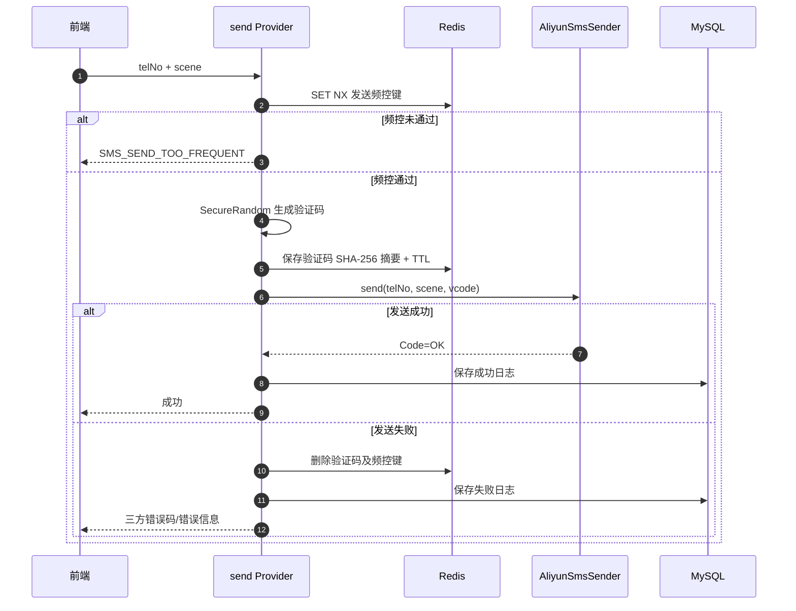

# 短信服务模块设计

> 模块：`com.th4.edge.components.sms`
> 定位：面向家装宝所有业务模块的通用短信验证码支撑，覆盖注册、找回密码、验证码登录及后续新增场景。
> 约束：遵循 `rules.md`，不引入 DTO/VO；Provider 的请求、响应均使用领域实体。

---

## 1. 目标与边界

### 1.1 目标

1. 提供厂商无关的短信验证码发送、校验能力。
2. 首期实现阿里云短信验证码通道。
3. 验证码只存 Redis，支持有效期、发送频控、错误次数限制、成功即作废。
4. 通过场景枚举隔离注册、找回密码、登录等业务流程，不同场景验证码不可串用。
5. 保留短信发送与校验审计日志，不落验证码明文。
6. 为后续短信通知、营销短信、其他短信厂商预留扩展点。

### 1.2 非目标

1. 本模块不直接创建用户、企业或修改密码。
2. 本模块不保存验证码明文。
3. 本模块不负责业务身份和租户隔离，只处理“手机号 + 场景”的验证码生命周期。

---

## 2. 架构结论

采用“业务编排 + 通道适配 + Redis 状态 + 审计日志”四层结构：

```text
Provider（send / verify）
    ├── VCodeGenerator        生成安全随机验证码
    ├── VCodeStore            保存、频控、原子校验、作废
    ├── Sender                厂商无关发送接口
    │   └── AliyunSmsSender   阿里云 SendSms OpenAPI 实现
    └── LogRepository         发送/校验审计
```

关键原则：

1. `Log` 同时作为 Provider 请求和响应实体，不定义短信 DTO。
2. `VCodeScene` 是场景白名单，也是 Redis 隔离维度和阿里云模板映射键。
3. 验证码生成、存储、校验均由服务端完成，前端只能提交手机号、场景和用户输入的验证码。
4. 验证码 Redis 值使用 SHA-256 摘要，数据库日志不保存验证码明文或摘要。
5. 校验和删除通过 Redis Lua 原子执行，防止并发重复使用。

---

## 3. 包结构

```text
components/sms
├── configure
│   ├── SmsEngine.java                 # 短信厂商枚举：Aliyun
│   ├── VCodeScene.java                # 验证码业务场景枚举
│   └── VCodeConfigure.java            # 验证码长度/有效期/频控/错误次数
├── model
│   └── Log.java                       # 短信请求、响应与审计实体
├── repository
│   └── LogRepository.java             # 短信日志仓储
├── sdk
│   └── aliyun
│       ├── AliyunSmsConfigure.java    # AccessKey、签名、模板映射
│       └── AliyunSmsSender.java       # 阿里云签名与 HTTP 调用
└── service/vcode
    ├── context
    │   ├── VCodeGenerator.java        # SecureRandom 验证码生成
    │   └── VCodeStore.java            # Redis 生命周期与 Lua 原子校验
    ├── sender
    │   ├── Sender.java                # 厂商无关发送接口
    │   ├── VCodeSendException.java    # 发送异常
    │   └── ...
    ├── validator
    │   ├── Validator.java             # 厂商无关校验接口
    │   ├── VCodeValidationException.java
    │   └── support/Validator.java     # Redis 校验实现
    ├── send
    │   ├── Send.java                  # Provider 契约
    │   └── support/Send.java          # 发送编排实现
    └── verify
        ├── Verify.java                # Provider 契约
        └── support/Verify.java        # 校验编排实现
```

---

## 4. 核心模型

### 4.1 `VCodeScene`

当前场景：

| 场景 | 枚举值 | 用途 | 阿里云模板配置键 |
| --- | --- | --- | --- |
| 注册 | `Register` | 注册企业/账号 | `register` |
| 找回密码 | `ResetPassword` | 重置密码 | `reset-password` |
| 登录 | `Login` | 手机验证码登录 | `login` |

场景同时参与 Redis Key 构造。`Register` 获得的验证码无法用于 `Login`，反之亦然。

### 4.2 `Log`

`Log` 是实体，也是 Provider 请求/响应类型：

| 字段 | 含义 |
| --- | --- |
| `telNo` | 手机号 |
| `scene` | 验证码场景 |
| `engine` | 短信厂商，当前为 `Aliyun` |
| `vcode` | 用户输入的验证码，`@Transient`，不落库、不返回前端 |
| `content` | 发送/校验操作说明 |
| `success` | 本次操作是否成功 |
| `errorCode/errorMsg` | 失败原因 |
| `createTime` | 框架 `DateTime` 创建时间 |

`vcode`、`extra`、`errorMsg` 通过 `@ServiceProperties` 从接口响应中过滤。

### 4.3 `Sender`

厂商无关发送接口：

```java
void send(String telNo, VCodeScene scene, String vcode) throws VCodeSendException;
```

当前实现为 `AliyunSmsSender`：

1. 从 `AliyunSmsConfigure` 获取 AccessKey、签名、场景模板。
2. 按阿里云 RPC API `SignatureVersion=1.0`、`HMAC-SHA1` 生成签名。
3. 调用 `SendSms` OpenAPI。
4. 仅当 HTTP 2xx 且业务 `Code=OK` 时视为成功。

### 4.4 `Validator`

业务 Provider 可在自身事务内直接调用：

```java
void validate(String telNo, VCodeScene scene, String vcode) throws VCodeValidationException;
```

校验成功、验证码过期、错误次数达到上限时都会作废验证码。

---

## 5. 业务流程

### 5.1 发送验证码



### 5.2 注册、找回密码

推荐由业务 Provider 在完成其他前置校验后直接调用 `Validator`：

```text
send 验证码
  → 用户提交注册/重置表单（含 smsCode）
  → 业务 Provider 校验手机号、企业、密码等
  → Validator.validate(telNo, scene, smsCode)
  → 创建企业/用户或更新密码
```

这样验证码只在业务动作执行时消费，避免“先调用 verify 成功，后续业务失败，但验证码已作废”的问题。

### 5.3 手机验证码登录

验证码校验本身就是登录动作，可直接调用 `verify Provider`。校验成功后由登录编排继续签发 token；若后续签发失败，应由上层决定是否引入一次性验证通过票据，不能简单恢复已删除的验证码。

---

## 6. 接口契约

### 6.1 发送验证码

```text
POST /components/sms/vcode/send
```

请求体使用 `Log` 实体中前端需要的字段：

```json
{
  "telNo": "13800138000",
  "scene": "Register"
}
```

响应仍为 `Log`：

```json
{
  "telNo": "13800138000",
  "scene": "Register",
  "engine": "Aliyun",
  "content": "验证码短信发送成功",
  "success": true,
  "createTime": {}
}
```

前端不能提交或覆盖验证码。

### 6.2 校验验证码

```text
POST /components/sms/vcode/verify
```

```json
{
  "telNo": "13800138000",
  "scene": "Login",
  "vcode": "123456"
}
```

成功返回 `success=true` 的 `Log`；失败由统一异常机制返回错误码。

> 注意：`scene` 使用 Java 枚举名，即 `Register`、`ResetPassword`、`Login`。

---

## 7. Redis 设计

Key 前缀：

```text
th4:components:sms:vcode:{scene}:{telNo}
```

完整 Key：

| Key | 类型 | 内容 | TTL |
| --- | --- | --- | --- |
| `...:code` | String | 验证码 SHA-256 摘要 | `expire-seconds` |
| `...:failures` | String | 连续错误次数 | 与验证码剩余 TTL 对齐 |
| `...:send-limit` | String | 发送频控占位 | `resend-interval-seconds` |

写入采用 Lua 原子执行 `SET <sha256(code)> EX expireSeconds` 并删除旧失败计数，保证重发新验证码时错误次数从零开始。

校验 Lua 逻辑：

1. 验证码不存在：返回过期。
2. 摘要匹配：同时删除验证码和错误次数键，返回成功。
3. 摘要不匹配：原子递增错误次数。
4. 错误次数达到 `max-attempts`：删除验证码和错误次数，返回次数超限。
5. 不使用“先 GET 再 DEL”，避免并发请求重复使用同一验证码。

---

## 8. 阿里云配置

配置类：`AliyunSmsConfigure`。生产环境 AccessKey 必须通过环境变量或配置中心注入。

```yaml
th4:
  edge:
    components:
      sms:
        vcode:
          code-length: 6
          expire-seconds: 300
          resend-interval-seconds: 60
          max-attempts: 5
        aliyun:
          enabled: true
          access-key-id: ${ALIYUN_SMS_ACCESS_KEY_ID:}
          access-key-secret: ${ALIYUN_SMS_ACCESS_KEY_SECRET:}
          sign-name: ${ALIYUN_SMS_SIGN_NAME:}
          endpoint: ${ALIYUN_SMS_ENDPOINT:https://dysmsapi.aliyuncs.com/}
          region-id: ${ALIYUN_SMS_REGION_ID:cn-hangzhou}
          connect-timeout-ms: 3000
          read-timeout-ms: 5000
          templates:
            register: ${ALIYUN_SMS_TEMPLATE_REGISTER:}
            reset-password: ${ALIYUN_SMS_TEMPLATE_RESET_PASSWORD:}
            login: ${ALIYUN_SMS_TEMPLATE_LOGIN:}
```

| 配置 | 说明 |
| --- | --- |
| `access-key-id` | RAM 用户 AccessKey ID |
| `access-key-secret` | RAM 用户 AccessKey Secret |
| `sign-name` | 阿里云审核通过的短信签名 |
| `templates.*` | 各场景审核通过的模板 CODE |
| `endpoint` | 短信 OpenAPI 地址 |
| `connect-timeout-ms` | 建立连接超时 |
| `read-timeout-ms` | 请求响应超时 |

生产 Secret 禁止提交到 Git。建议 RAM 用户只授予 `dysms:SendSms` 权限，并限制来源 IP。

---

## 9. 安全与风控

1. 验证码使用 `SecureRandom` 生成。
2. Redis 与数据库均不保存验证码明文。
3. 同一手机号 + 场景 60 秒内只允许发送一次。
4. 默认 5 分钟有效期。
5. 默认连续错误 5 次后验证码作废。
6. 校验成功立即作废，不能重复使用。
7. 提示信息不暴露验证码是否存在、摘要内容等敏感状态。
8. 接入生产前建议增加以下维度：
   - 手机号日发送上限；
   - IP/设备维度限流；
   - 图形验证码或风控挑战；
   - 发送量、失败率、阿里云错误码告警；
   - 验证码请求、校验日志脱敏保留期限。

---

## 10. 错误码

| 错误码 | 含义 |
| --- | --- |
| `SMS_CONFIG_MISSING` | 阿里云短信配置不完整 |
| `SMS_TEMPLATE_MISSING` | 场景未配置模板 |
| `SMS_NETWORK_ERROR` | 阿里云网络请求失败 |
| `SMS_SIGN_ERROR` | 请求签名失败 |
| `SMS_SEND_TOO_FREQUENT` | 验证码发送过于频繁 |
| `SMS_REDIS_ERROR` | Redis 读写失败 |
| `VCODE_EXPIRED` | 验证码不存在或已过期 |
| `VCODE_INCORRECT` | 验证码错误 |
| `VCODE_MAX_ATTEMPTS` | 错误次数过多 |
| `VCODE_REDIS_ERROR` | 验证码校验服务不可用 |

阿里云业务错误码会原样作为 `errorCode` 返回并记录日志，例如 `isv.BUSINESS_LIMIT_CONTROL`、`isv.SMS_SIGNATURE_ILLEGAL`。

---

## 11. 与用户注册流程的落点

1. 注册页先调用 `components/sms/vcode/send`，`scene=Register`。
2. 用户提交注册表单，注册 Provider 通过 `@AutoInject` 获取 `telNo`、`smsCode`。
3. Provider 完成手机号未注册、企业信息完整等检查。
4. Provider 注入 `Validator`，调用 `validate(telNo, VCodeScene.Register, smsCode)`。
5. 校验成功后在同一业务流程创建企业、默认门店、BOSS 员工及登录账号。
6. 找回密码复用同一机制，仅将场景切换为 `ResetPassword`。
7. 验证码登录使用 `Login` 场景和 `verify` Provider。

---

## 12. 扩展新厂商

新增厂商时只实现 `Sender`，并增加对应配置类和 `SmsEngine` 枚举：

```text
sdk/tencent/TencentSmsConfigure.java
sdk/tencent/TencentSmsSender.java
```

Provider、Redis 生命周期、校验逻辑和审计模型无需修改。若需要按场景/租户动态选择厂商，再将 `Sender` 注入改为路由选择器；首期保持单一阿里云实现，避免过度设计。
